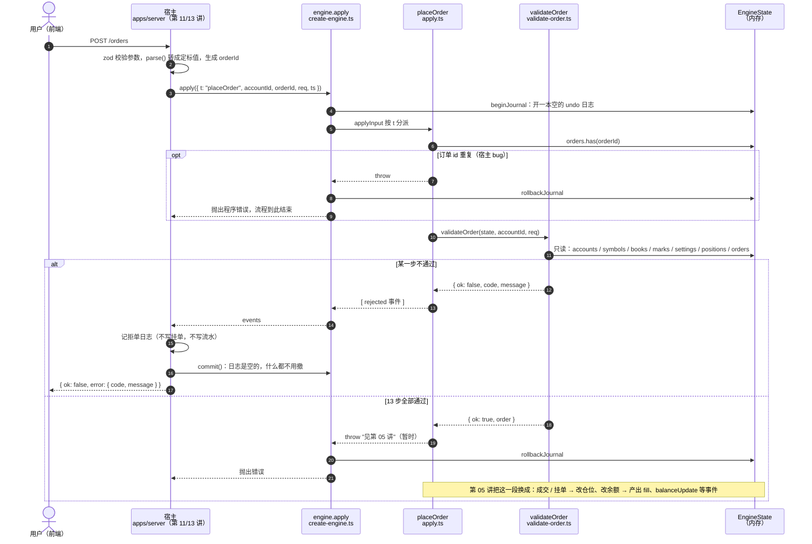
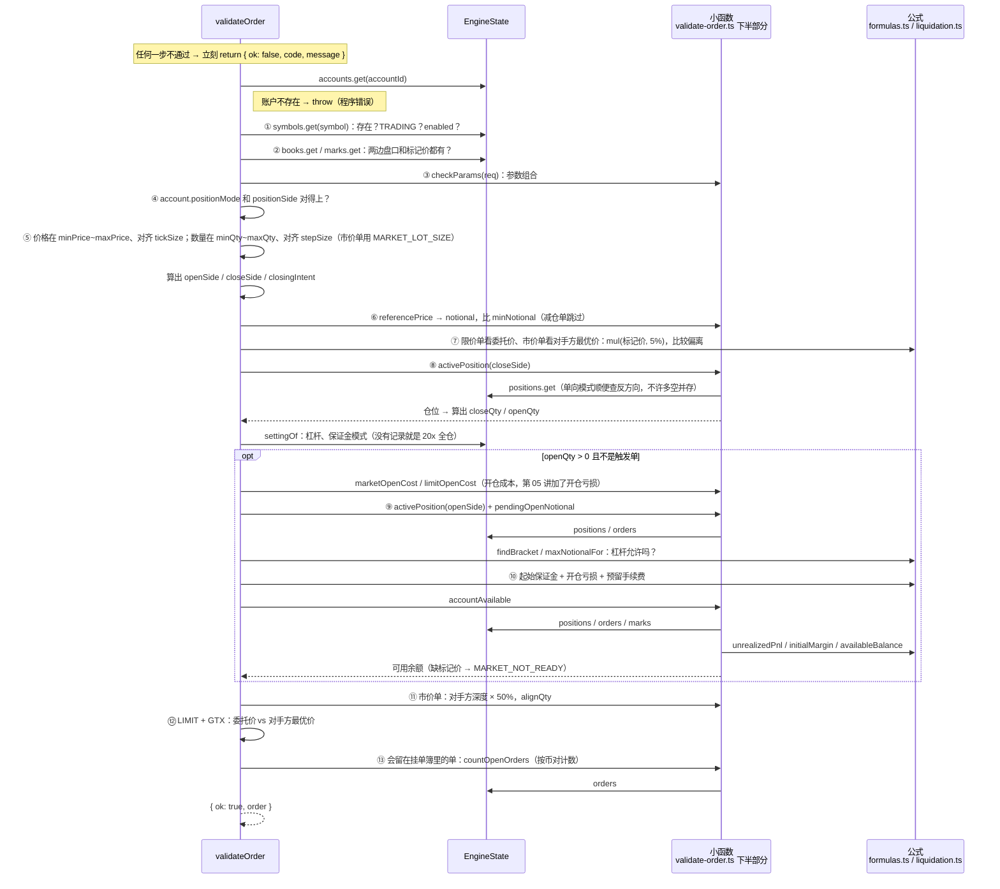
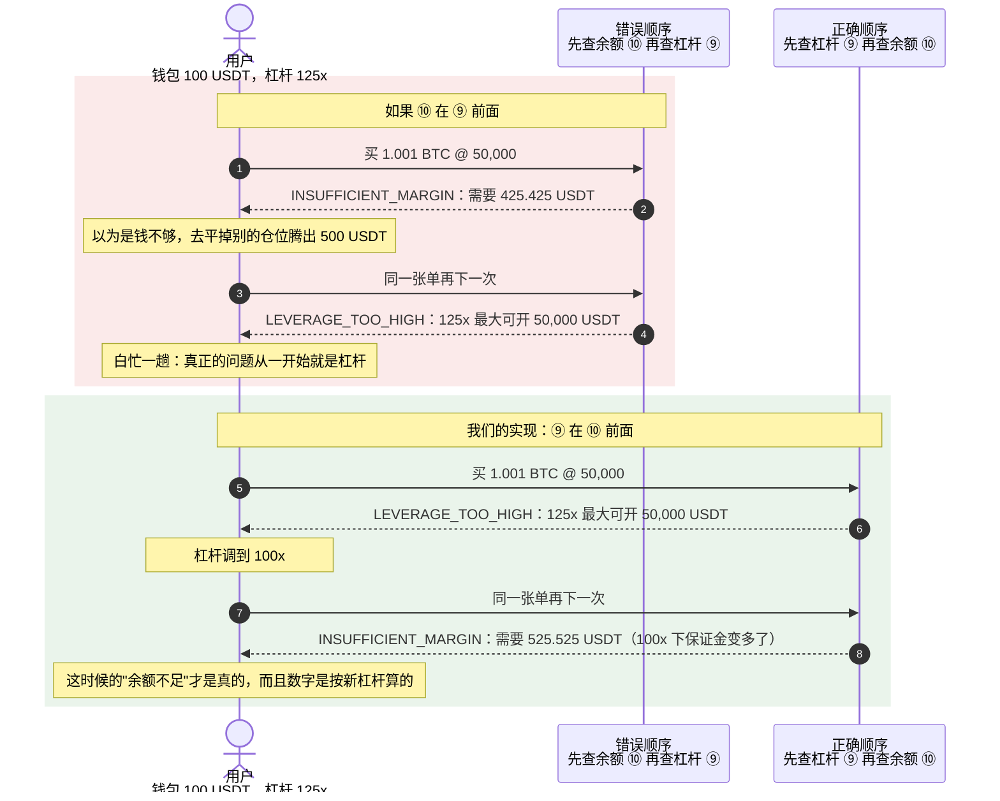

# 04 · 搭建教程：下单校验链（13 步）

> 这一讲只回答一个问题：**这张单能不能下**。
> 不成交、不挂单、不冻结保证金、不改任何状态。能下就把校验途中算出来的东西打包交给第 05 讲，不能下就给一个错误码加一句**带具体数字**的中文提示。

**这一讲结束时你会有什么**：

- `packages/engine/src/validate-order.ts`：`validateOrder()` 从上到下 13 步，外加几个查询/估算的小函数
- `apply.ts` 接上了 `placeOrder`：**被拒**时产出一条 `rejected` 事件；**通过**时暂时明确抛错"见第 05 讲"（和其它没实现的输入一样，故意炸，不悄悄吞掉）
- `state.ts` 多了 `settingOf()`：账户没调过杠杆时返回默认值 20x 全仓
- `testing/fixtures.ts` 多了盘口、标记价、下单请求、仓位几个测试数据
- 85 条新测试（`validate-order.test.ts` 82 条 + `apply.test.ts` 3 条），引擎共 169 条全绿
- 2026-09-17 按币安标准核对过一遍，交易规则改成从币安 `exchangeInfo` 按币对读取（第 7 节）
- 设计缺口清单新增 #12～#16，其中 #12、#13 这一讲定了，#14～#16 记下来留给后面几讲（#14 开仓亏损已在第 05 讲实现）

**先读**：`docs/design/04-backend-design.md` 第 6 节（13 步的表）、第 3 节（状态机）、5.3/5.4 节（市价逐档吃、限价角色判定），`01-domain-knowledge.md` 第五节（杠杆分层）。

> **代码已经在仓库里了**：AI 写代码和讲义，你对照着读。讲义里的代码块是用脚本从源文件截出来的，和仓库逐字一致（只去掉了公共缩进）。
>
> 如果觉得代码块太长，先读第 1、2 节和第 5 节的表格，把"每一步查什么、为什么这么定"弄明白，再回头对着 `validate-order.ts` 从上往下读——它就是一个长函数，每一步前面都有 ①～⑬ 的编号注释。

---

## 第 1 节：一张图看懂这一讲在哪

> 本讲的时序图用 Mermaid 写。GitHub 上直接能渲染；在 VS Code 里看，需要 Markdown 预览装上 Mermaid 支持（比如 "Markdown Preview Mermaid Support" 插件）。

下面是一次下单请求从前端到引擎、再回到前端的完整往返。**宿主**那几格（zod 校验、生成 `orderId`、记日志、`commit`）是第 11/13 讲才写的服务端代码，这里先画出来，好让你知道引擎这一段接在哪里。



几个值得盯住的点：

- **第 4 步 `beginJournal` 在分派之前就开了**。就算这次只是拒单、什么都没改，宿主也得按协议调一次 `commit()`——每次 `apply` 之后必须恰好调一次 `commit` 或 `rollback`（第 02 讲定的协议）。
- **拒单走的是 `commit` 分支，不是 `rollback`**。拒单是正常业务结果，不是出错；日志里什么都没记，`commit` 只是把空日志扔掉。
- **"通过"那条路现在是 `throw`**，`create-engine.ts` 会自动回滚。第 05 讲会把 `alt` 的下半段换成真正的成交。

`validateOrder` **只读不写**：它拿到的是 `EngineState`，但全程只调 `.get()`、只遍历，不调任何 `put*`。所以它不需要进 undo 日志，被拒的单也不会在内存里留下痕迹。`apply.test.ts` 里有一条测试专门验证"被拒前后快照完全相等"。

`apply.ts` 里接线的部分：

```ts
function placeOrder(state: EngineState, input: InputOf<"placeOrder">): EngineEvent[] {
  // 订单 id 由宿主生成（设计缺口 #2），重复说明宿主的 id 生成器有 bug
  if (state.orders.has(input.orderId)) {
    throw new Error(`订单 id ${input.orderId} 已经存在，宿主生成了重复的 id`);
  }

  const result = validateOrder(state, input.accountId, input.req);
  if (!result.ok) {
    // 被拒的单不进内存、不进挂单簿，只产出一条 rejected 事件（04-backend-design.md 第 3 节状态机）
    return [
      {
        t: "rejected",
        accountId: input.accountId,
        input: "placeOrder",
        clientOrderId: input.req.clientOrderId,
        orderId: input.orderId,
        code: result.code,
        message: result.message,
        ts: input.ts,
      },
    ];
  }

  // 第 05 讲：市价单逐档成交、限价单穿透部分成交；第 06 讲：不穿透的挂单排队；第 09 讲：触发单入簿
  return executeOrder(state, input, result.order);
}
```

**两种错误，处理方式相反**（第 02 讲定的规矩，这一讲第一次真正用上）：

| 情况 | 属于 | 引擎怎么做 |
| --- | --- | --- |
| 余额不够、价格没对齐、币对填错…… | 业务拒绝 | 返回 `rejected` 事件，宿主原样推给用户 |
| 账户不在引擎里、订单 id 重复、单向模式下同时有多空两个仓位 | 程序错误 | `throw`，说明宿主接线或状态已经坏了 |

注意"币对填错"的归类：**行情层**传来一个未知币对是程序错误（`requireSymbol` 抛错），**用户下单**填了未知币对是业务拒绝（`SYMBOL_NOT_TRADING`）。同一个事实，来源不同，性质不同。

---

## 第 2 节：这一讲定下来的两个设计缺口

写校验链时撞上了两处设计文档没说清、或者前后矛盾的地方。两处都**按设计文档里已有的说法**定了，没有新发明规则，但影响后面几讲，单独拎出来说。

### 缺口 #12：单向持仓模式下，仓位在引擎里怎么存

**矛盾**：

- `04-backend-design.md` 第 3 节："单向模式对外暴露 `BOTH`，**内部仍用 `LONG` / `SHORT` 表示方向**"
- `packages/db/src/schema/positions.ts` 的注释："单向模式下 positionSide **恒为 BOTH**，一个币对只会有一行"
- 而 `qty` 恒为非负——如果存成 `BOTH`，**根本分不清手上拿的是多还是空**

第 8 步（只减仓）必须知道这一点：单向模式下一张 `SELL` 只减仓单，只有持**多**时才能下。

**这一讲的决定**：按设计文档第 3 节来——**订单**上的 `positionSide` 是 `BOTH`（第 4 步强制），**仓位**在引擎内部按实际方向存成 `LONG` 或 `SHORT`，同一币对最多只有其中一个。万一两个同时存在，说明状态坏了，直接抛错。

```ts
/** 某个方向上 qty > 0 的仓位。单向模式下 LONG 和 SHORT 最多只能有一个。 */
function activePosition(
  state: EngineState,
  account: Account,
  symbol: string,
  direction: Direction,
): Readonly<Position> | undefined {
  const position = state.positions.get(positionKey(account.id, symbol, direction));
  if (account.positionMode === "ONE_WAY" && position && position.qty > 0n) {
    const other = state.positions.get(positionKey(account.id, symbol, opposite(direction)));
    if (other && other.qty > 0n) {
      throw new Error(`单向持仓模式的账户 ${account.id} 在 ${symbol} 上同时持有多空两个仓位，状态已损坏`);
    }
  }
  return position && position.qty > 0n ? position : undefined;
}
```

**数据库那边**（2026-09-17 你定的：按币安标准）：和币安 `GET /fapi/v3/positionRisk` 返回的一样——单向模式 `positionSide = BOTH` 一行，数量**带符号**，多头为正、空头为负（双向模式的 `SHORT` 行也是负数）。引擎内部不跟着改，仍是 `LONG` / `SHORT` + 非负 `qty`；两种表示法的互转放在第 11 讲的仓储层：

| 数据库（币安表示法） | 引擎内部 |
| --- | --- |
| 单向模式 `BOTH`，`position_amt = +1` | `LONG`，`qty = 1` |
| 单向模式 `BOTH`，`position_amt = -1` | `SHORT`，`qty = 1` |
| 双向模式 `LONG`，`position_amt = +1` | `LONG`，`qty = 1` |
| 双向模式 `SHORT`，`position_amt = -1` | `SHORT`，`qty = 1` |

为什么引擎不直接也用带符号数量：设计文档第 3 节的理由——负数在 `bigint` 运算里到处要判符号，保证金、盈亏、强平价的每条公式都得多一个分支，漏一处就算错钱。存储和对外格式跟币安一致，计算内核保持简单，两头各得其所。

第 11 讲迁移时要做的（已写进 `03-database-design.md`）：`qty` 改名 `position_amt`；部分索引条件从 `qty > 0` 改成 `position_amt <> 0`——**不改的话空头仓位会从资金费结算和强平扫描里消失**。

### 缺口 #13：GTX 会吃单，到底是"拒单"还是"过期"

**矛盾**：

- `04-backend-design.md` 第 6 节校验链第 12 步：`GTX` 会立刻成交 → `POST_ONLY_REJECTED`（拒单）
- 同一份文档第 3 节状态机、5.4 节伪代码、`06-testing-design.md` 场景表："GTX 会成交 → `EXPIRED`"

**这一讲的决定**：两个都对，只是**时机不同**——

| 时机 | 结果 | 在哪一讲 |
| --- | --- | --- |
| 下单那一刻就会吃单（普通 `LIMIT` + `GTX`） | 第 12 步拒单，`rejected` 事件 + `POST_ONLY_REJECTED`，订单从没存在过 | 04 ✅ |
| 止损限价 / 止盈限价单设了 `GTX`，**触发那一刻**挂出去会吃单 | 订单已经存在过（`NEW`），转 `EXPIRED` | 09 |

这样两处文档都说得通，也和状态机"下单校验失败 → REJECTED，已存在的单失效 → EXPIRED"的划分一致。

---

## 第 3 节：校验通过时交出去的东西

第 05 讲拿到一张通过校验的单，要知道：平掉多少现有仓位、开多少新仓、用几倍杠杆、冻结多少保证金……这些**校验途中都已经算过了**，所以直接打包带出来，不让下一讲再算一遍（再算一遍就有两份逻辑，迟早不一致）。

```ts
/** 仓位的实际方向。单向模式的 BOTH 在引擎内部也会落到这两个之一。 */
export type Direction = "LONG" | "SHORT";

/** 校验通过后，第 05/06 讲接着要用的东西——都是校验过程中顺手算出来的，不让下一讲再算一遍。 */
export interface ValidatedOrder {
  spec: SymbolSpec;
  /** 补齐默认值后的 TIF。市价类订单没有 TIF 的概念，填 GTC（和 orders 表的列默认值一致）。 */
  timeInForce: TimeInForce;
  /** 补齐默认值后的触发价格类型。默认 CONTRACT_PRICE（最新成交价），和币安条件单接口的默认值一致。 */
  workingType: WorkingType;
  /** closePosition 单为 0n：数量在触发那一刻按仓位现算。 */
  qty: Fixed;
  reduceOnly: boolean;
  closePosition: boolean;
  /** 开仓 / 加仓会落到哪个方向的仓位。 */
  openSide: Direction;
  /** 减仓会作用于哪个方向的仓位。双向模式下和 openSide 相同，单向模式下和 openSide 相反。 */
  closeSide: Direction;
  /** 这张单里用来平掉现有仓位的数量。 */
  closeQty: Fixed;
  /** 这张单里用来开新仓 / 加仓的数量。closeQty + openQty = qty（closePosition 单除外）。 */
  openQty: Fixed;
  leverageNum: number;
  marginMode: MarginMode;
  /**
   * 开仓部分需要的保证金（起始保证金 + 按 Taker 费率预留的手续费）。
   * 限价单：就是这张挂单的 frozenMargin。市价单：只用于第 10 步判断，成交时按真实成交价重算。
   * 纯减仓单、未触发的触发单：0n。
   */
  requiredMargin: Fixed;
}

export type OrderValidation =
  | { ok: true; order: ValidatedOrder }
  | { ok: false; code: ErrorCode; message: string };
```

`closeQty` / `openQty` 这两个数最关键。它们来自第 8 步，四种情况：

| 场景 | closeQty | openQty |
| --- | --- | --- |
| 只减仓 / 双向模式平仓（SELL + LONG） | 下单数量 | 0 |
| `closePosition` 触发单 | 当前**全部**仓位 | 0 |
| 单向模式、有反方向仓位（反手） | min(下单数量, 仓位) | 下单数量 − closeQty |
| 其它（纯开仓 / 加仓） | 0 | 下单数量 |

第 9、10 步**只看 `openQty`**——平仓只会释放保证金、降低名义价值，不需要检查杠杆和余额。

---

## 第 4 节：13 步逐步走读

先看全貌：`validateOrder` 按顺序做了哪些事、每一步从哪里读数据。**图里任何一步不通过，函数立刻 `return { ok: false, ... }`，后面的步骤都不会执行**——为了不让图太乱，每一步的"拒单返回"没有逐个画出来。



这张图里能看出两件事：

1. **前 7 步几乎不查账户状态**（只看请求、规格、行情）。它们查的是"这张单本身合不合法"，所以放前面——便宜、和用户的仓位无关
2. **从第 8 步开始才碰仓位和挂单**，第 9、10 步最贵（要遍历账户的全部仓位和挂单），所以只在"真的要开仓"时才做

函数开头先确认账户存在（不存在就抛错，理由见第 1 节）：

```ts
export function validateOrder(
  state: EngineState,
  accountId: string,
  req: PlaceOrderRequest,
): OrderValidation {
  // 账户不存在不是"业务拒绝"：鉴权通过的请求一定有账户，走到这里说明宿主接线错了
  const account = state.accounts.get(accountId);
  if (!account) {
    throw new Error(`账户 ${accountId} 不在引擎里，宿主必须先 registerAccount 再下单`);
  }
```

### ① 币对可交易 ② 行情就绪

```ts
// ① 币对存在、币安状态是 TRADING、我们对用户开放
//    注意和行情输入的区别：行情层传来未知币对是程序错误（抛错），用户下单填错币对是业务拒绝
const spec = state.symbols.get(req.symbol);
if (!spec || spec.status !== "TRADING" || !spec.enabled) {
  return reject("SYMBOL_NOT_TRADING", spec ? `${req.symbol} 暂停交易` : `不支持的交易对 ${req.symbol}`);
}

// ② 行情就绪：两边盘口都有、有标记价。缺任何一样都没法判断成交和保证金，宁可不接单
const book = state.books.get(req.symbol);
const mark = state.marks.get(req.symbol);
if (!book || book.bids.length === 0 || book.asks.length === 0 || !mark) {
  return reject("MARKET_NOT_READY", `${req.symbol} 行情尚未就绪，暂不接受下单`);
}
const markPrice = mark.markPrice;
```

"行情就绪"只查**有没有**，不查**新不新**。行情断线后暂停交易是宿主的事（它知道 WebSocket 断了，引擎不知道），见缺口 #16。

### ③ 参数组合

```ts
// ③ 参数组合
const paramsError = checkParams(req, account.positionMode);
if (paramsError) return reject("INVALID_PARAMS", paramsError);
const isTrigger = TRIGGER_TYPES.includes(req.type);
const closePosition = req.closePosition === true;
const reduceOnly = req.reduceOnly === true;
const qty = req.qty ?? 0n; // 第 3 步保证了：只有 closePosition 单才会没有 qty
```

规则单独放在 `checkParams` 里，按"价格 → 触发价 → TIF → workingType → closePosition → 数量"的顺序查，返回第一条不合法的原因：

```ts
/**
 * 返回第一条不合法的原因；合法返回 null。只看请求本身和持仓模式，不看仓位和行情。
 * 规则对照币安 New Order / New Algo Order 接口的参数说明；多传了不需要的参数，
 * 币安报 -1106 PARAM_NOT_REQUIRED，我们同样拒。
 */
function checkParams(req: PlaceOrderRequest, positionMode: PositionMode): string | null {
  const isTrigger = TRIGGER_TYPES.includes(req.type);
  const isPriced = PRICED_TYPES.includes(req.type);

  if (isPriced && req.price === undefined) return `${req.type} 单必须填委托价 price`;
  if (!isPriced && req.price !== undefined) return `${req.type} 单不接受委托价 price`;
  if (req.price !== undefined && req.price <= 0n) return "委托价必须大于 0";

  if (isTrigger && req.stopPrice === undefined) return `${req.type} 单必须填触发价 stopPrice`;
  if (!isTrigger && req.stopPrice !== undefined) return `${req.type} 单不接受触发价 stopPrice`;
  if (req.stopPrice !== undefined && req.stopPrice <= 0n) return "触发价必须大于 0";

  // TIF 描述的是"挂到盘口上之后怎么处理"，市价类订单不挂盘口，传了说明调用方理解错了
  if (!isPriced && req.timeInForce !== undefined) return `${req.type} 单不接受 timeInForce`;
  if (!isTrigger && req.workingType !== undefined) return "只有触发单才能指定 workingType";

  if (positionMode === "HEDGE") {
    // 币安："reduceOnly — Cannot be sent in Hedge Mode"。双向模式下 SELL + LONG、BUY + SHORT 本身就是减仓，
    // 不需要这个开关；传 false 也算传了（-1106），宿主不要默认塞 reduceOnly: false
    if (req.reduceOnly !== undefined) {
      return "双向持仓模式下不能传 reduceOnly：SELL + LONG（平多）、BUY + SHORT（平空）本身就是减仓";
    }
    // 币安："In Hedge Mode, cannot be used with BUY orders in LONG position side, and SELL orders in SHORT position side"
    const opening =
      (req.side === "BUY" && req.positionSide === "LONG") || (req.side === "SELL" && req.positionSide === "SHORT");
    if (req.closePosition && opening) {
      return `双向持仓模式下 ${req.side} + ${req.positionSide} 是开仓方向，不能用 closePosition`;
    }
  }

  if (req.closePosition) {
    if (!CLOSE_POSITION_TYPES.includes(req.type)) {
      return "closePosition 只能用于 STOP_MARKET / TAKE_PROFIT_MARKET";
    }
    if (req.reduceOnly) return "closePosition 已经隐含只减仓，不要同时设置 reduceOnly";
    if (req.qty !== undefined) return "closePosition 单在触发时按全部仓位平仓，不要填数量 qty";
    return null;
  }

  if (req.qty === undefined) return "必须填数量 qty";
  if (req.qty <= 0n) return "数量必须大于 0";
  return null;
}
```

几条可能让你意外的"严格"：

- **市价单传了 `timeInForce` 就拒**，而不是忽略。和币安一致：多传了不需要的参数，币安报 `-1106 PARAM_NOT_REQUIRED`。
- **双向持仓模式下不能传 `reduceOnly`**，传 `false` 也不行。币安下单接口的参数说明原文："Cannot be sent in Hedge Mode"。双向模式下 `SELL + LONG`（平多）、`BUY + SHORT`（平空）本身就是减仓，这个开关是多余的。所以宿主（第 13 讲）不要给请求默认塞 `reduceOnly: false`。
- **双向模式下 `closePosition` 不能用在开仓方向**（`BUY + LONG`、`SELL + SHORT`），同样来自币安条件单接口的说明。
- **`closePosition` 只能配 `STOP_MARKET` / `TAKE_PROFIT_MARKET`**，而且不能再填 `qty`、不能再勾 `reduceOnly`——它自己就代表"触发时全平"，再传别的只会让人疑惑以哪个为准。

### ④ 持仓模式匹配

```ts
// ④ 持仓模式匹配
if (account.positionMode === "HEDGE" && req.positionSide === "BOTH") {
  return reject("POSITION_SIDE_MISMATCH", "当前是双向持仓模式，positionSide 必须是 LONG 或 SHORT");
}
if (account.positionMode === "ONE_WAY" && req.positionSide !== "BOTH") {
  return reject("POSITION_SIDE_MISMATCH", `当前是单向持仓模式，positionSide 必须是 BOTH，收到 ${req.positionSide}`);
}
```

### ⑤ 价格、数量的交易规则

```ts
// ⑤ 价格、数量的交易规则（币安 PRICE_FILTER / LOT_SIZE / MARKET_LOT_SIZE）
//    价格：在 [minPrice, maxPrice] 内，且 (价格 − minPrice) 是 tickSize 的整数倍；触发价也是价格，同样要查
//    数量：在 [minQty, maxQty] 内，且 (数量 − minQty) 是 stepSize 的整数倍；市价单用 MARKET_LOT_SIZE 那一组
for (const [label, value] of [
  ["委托价", req.price],
  ["触发价", req.stopPrice],
] as const) {
  if (value === undefined) continue;
  if (value < spec.minPrice || value > spec.maxPrice) {
    return reject(
      "PRICE_FILTER",
      `${label} ${show(value)} 超出允许范围 ${show(spec.minPrice)} ~ ${show(spec.maxPrice)}`,
    );
  }
  if ((value - spec.minPrice) % spec.tickSize !== 0n) {
    return reject("PRICE_FILTER", `${label} ${show(value)} 不是最小价格变动 ${show(spec.tickSize)} 的整数倍`);
  }
}
const lot =
  req.type === "MARKET"
    ? { label: "市价单数量", minQty: spec.marketMinQty, maxQty: spec.marketMaxQty, stepSize: spec.marketStepSize }
    : { label: "数量", minQty: spec.minQty, maxQty: spec.maxQty, stepSize: spec.stepSize };
const base = baseAsset(req.symbol);
if (!closePosition) {
  if (qty < lot.minQty) {
    return reject("LOT_SIZE", `${lot.label} ${show(qty)} ${base} 低于最小下单量 ${show(lot.minQty)} ${base}`);
  }
  if (qty > lot.maxQty) {
    return reject("LOT_SIZE", `${lot.label} ${show(qty)} ${base} 超过最大下单量 ${show(lot.maxQty)} ${base}`);
  }
  if ((qty - lot.minQty) % lot.stepSize !== 0n) {
    return reject("LOT_SIZE", `${lot.label} ${show(qty)} 不是最小数量变动 ${show(lot.stepSize)} 的整数倍`);
  }
}
```

四条币安规则，全部按币对从 `exchangeInfo` 读（字段见第 7 节）：

| 规则 | 查什么 | 币安错误码 |
| --- | --- | --- |
| `PRICE_FILTER` | 委托价、触发价在 `[minPrice, maxPrice]` 内，`(价格 − minPrice)` 是 `tickSize` 的整数倍 | `-4013` / `-4002` / `-4007` |
| `LOT_SIZE` | 限价类订单数量在 `[minQty, maxQty]` 内，`(数量 − minQty)` 是 `stepSize` 的整数倍 | `-4004` / `-4005` / `-4023` |
| `MARKET_LOT_SIZE` | 市价单用这一组代替 `LOT_SIZE`。BTCUSDT 限价单最多 1000，**市价单最多 120** | 同上 |

整除判断直接用 `%`——都是定标 `bigint`，余数为 0 就是整数倍，不涉及任何舍入。"最小数量"以前放在第 6 步报 `MIN_NOTIONAL`，按币安改成了第 5 步的 `LOT_SIZE`（币安 `-4004 QTY_LESS_THAN_MIN_QTY` 属于数量规则，不属于名义价值规则）。

**注意这里只检查、不对齐**。`packages/shared` 里有 `alignPrice` / `alignQty`，但那是前端"失焦时自动吸附"用的。用户提交上来的价格没对齐，服务端**不替他改**——改了就是背着用户换了一个他没下过的价。

### 在第 6 步之前：算出方向

```ts
// 方向：这张单开仓会落到哪边、减仓会作用于哪边
const openSide: Direction =
  account.positionMode === "HEDGE" ? (req.positionSide as Direction) : req.side === "BUY" ? "LONG" : "SHORT";
const closeSide: Direction = account.positionMode === "HEDGE" ? openSide : opposite(openSide);
// 双向模式下 SELL + LONG（平多）、BUY + SHORT（平空）天生就是减仓，不管有没有勾 reduceOnly
const hedgeClosing =
  account.positionMode === "HEDGE" &&
  ((req.side === "SELL" && req.positionSide === "LONG") || (req.side === "BUY" && req.positionSide === "SHORT"));
// 双向模式不能传 reduceOnly、closePosition 方向也在第 3 步查过了，所以双向模式只看方向
const closingIntent = account.positionMode === "HEDGE" ? hedgeClosing : reduceOnly || closePosition;
```

`closingIntent`（"这张单想减仓"）在查仓位**之前**就能确定：只看请求上的开关和持仓模式。第 6 步要用它。

### ⑥ 最小名义价值

```ts
// ⑥ 最小名义价值（币安 MIN_NOTIONAL）
//    减仓类订单不查（币安 -4164："…no smaller than 5.0 (unless you choose reduce only)"）：
//    仓位被部分平掉、价格下跌之后，剩下的一点点仓位名义价值可能已经低于门槛，要是连它都不让平，用户就被困住了
if (!closePosition && !closingIntent) {
  const value = notional(qty, referencePrice(req, book));
  if (value < spec.minNotional) {
    return reject("MIN_NOTIONAL", `名义价值 ${show(value)} USDT 低于最小下单金额 ${show(spec.minNotional)} USDT`);
  }
}
```

**减仓类订单不查最小名义价值**。设想：你持有 0.004 BTC，部分平掉 0.003 后剩 0.001 BTC；BTC 从 50,000 跌到 4,000，这 0.001 BTC 名义价值只剩 4 USDT，低于 5 USDT 的门槛——要是连平仓单都卡这个门槛，这点仓位就永远平不掉了。币安错误码 `-4164` 的原文也写着 "unless you choose reduce only"。最小**数量**照查（第 5 步），因为数量不会随价格变。

参考价 `referencePrice`：限价类用委托价，市价触发单用触发价，市价单用对手方最优价。

### ⑦ 价格保护

```ts
// ⑦ 价格保护（币安 PERCENT_PRICE）：价格必须落在 [标记价 × multiplierDown, 标记价 × multiplierUp]，恰好在边界上放行
//    限价单查委托价（币安 -4016 / -4024）；市价单查对手方最优价（币安 -4131）——盘口离标记价太远时
//    市价单成交价会很离谱，币安直接拒。上下限按币对配置，BTCUSDT 是 1.05 / 0.95。
//    STOP / TAKE_PROFIT 的委托价要到触发那一刻才挂出去，和现在的标记价比没有意义（第 09 讲）
if (req.type === "LIMIT" || req.type === "MARKET") {
  const isLimit = req.type === "LIMIT";
  const price = isLimit ? req.price! : (req.side === "BUY" ? book.asks : book.bids)[0]!.price;
  const upper = mul(markPrice, spec.percentPriceUp);
  const lower = mul(markPrice, spec.percentPriceDown);
  if (price > upper || price < lower) {
    const range = `标记价 ${show(markPrice)} 下允许范围 ${show(lower)} ~ ${show(upper)}`;
    return reject(
      "PERCENT_PRICE",
      isLimit
        ? `委托价 ${show(price)} 超出价格保护范围：${range}`
        : `对手方最优价 ${show(price)} 超出价格保护范围，市价单暂不接受：${range}`,
    );
  }
}
```

用乘法算出上下限再比较，不做除法：`下限 = 标记价 × multiplierDown`，`上限 = 标记价 × multiplierUp`。除法要选舍入方向，乘法+比较没有这个问题。**恰好在边界上放行**（BTCUSDT 标记价 50,000 时：47,500 和 52,500 都能过，47,499.9 和 52,500.1 被拒）。

对照币安：
- **限价单**查委托价，对应币安错误码 `-4016`（高于标记价上限）/ `-4024`（低于标记价下限），币安也是**按标记价**算的
- **市价单**查**对手方最优价**（买看卖一、卖看买一），对应币安 `-4131`："The counterparty's best price does not meet the PERCENT_PRICE filter limit"。盘口离标记价太远，说明行情异常或流动性断层，这时候市价单的成交价会很离谱，直接拒
- 止损限价 / 止盈限价的委托价要等触发时才挂出去，拿今天的标记价去比没有意义，第 09 讲触发时再查

上下限**按币对配置**，来自 `exchangeInfo` 里 `PERCENT_PRICE` 过滤器的 `multiplierUp` / `multiplierDown`：BTCUSDT 是 1.05 / 0.95，有的币对是 1.15 / 0.85。

### ⑧ 只减仓

```ts
// ⑧ 只减仓：必须有对应仓位，数量不能超过仓位
const closeTarget = activePosition(state, account, req.symbol, closeSide);
let closeQty = 0n;
let openQty = 0n;
if (closingIntent) {
  const sideName = directionName(closeSide);
  if (!closeTarget) {
    return reject("REDUCE_ONLY_REJECTED", `没有可以减少的${sideName}仓位`);
  }
  if (!closePosition && qty > closeTarget.qty) {
    return reject(
      "REDUCE_ONLY_REJECTED",
      `减仓数量 ${show(qty)} ${base} 超过了${sideName}仓位剩余 ${show(closeTarget.qty)} ${base}`,
    );
  }
  closeQty = closePosition ? closeTarget.qty : qty;
} else if (account.positionMode === "ONE_WAY" && closeTarget) {
  // 单向模式反手：先平掉反方向的仓位，剩下的才是开仓
  closeQty = qty < closeTarget.qty ? qty : closeTarget.qty;
  openQty = qty - closeQty;
} else {
  openQty = qty;
}
```

两件事（"双向模式下方向矛盾"已经在第 3 步挡掉了）：

1. **没有可减的仓位** → 拒（`06-testing-design.md`："无仓位时下只减仓单 → 拒绝"）
2. **数量超过仓位** → 拒，对应币安 `-2022 REDUCE_ONLY_REJECT`。双向模式下 `SELL + LONG` 本身就是减仓，也走这条——这就是"双向模式禁止反手"

**不减掉其它只减仓挂单**：持多 1 BTC 时可以挂两张各 1 BTC 的只减仓卖单。其中一张成交把仓位平完后，另一张由第 09 讲"残余只减仓单自动撤销"处理。这符合设计文档"数量不超过仓位剩余"的字面意思。

币安文档在这一点上没写清（`-2022` 只说"新的只减仓单和已有挂单冲突"），**2026-09-17 你定了保持现在的做法**（缺口 #18）。理由：

- 就算下单时扣掉已挂的只减仓数量，也挡不住挂单之后仓位被别的方式减少（单向模式的普通反向单、强平、一键平仓），光靠下单校验保证不了"只平不反"
- 真正的保证放在**成交时**：只减仓单最多成交到当前剩余仓位，多余部分撤掉（第 05 讲实现）
- 扣掉已挂数量会挡住"同时挂满仓止盈 + 满仓止损"这个常见用法

### ⑨ 杠杆分层 ⑩ 可用余额

这两步是这一讲的核心，也是**顺序不能换**的那一对。

```ts
const setting = settingOf(state, accountId, req.symbol);
const leverageNum = setting.leverageNum;
const oppositeLevels = req.side === "BUY" ? book.asks : book.bids;
let requiredMargin = 0n;

// ⑨ ⑩ 只对"会开仓"的部分做。未触发的触发单不占保证金，触发那一刻再走一遍（第 09 讲）
if (openQty > 0n && !isTrigger) {
  // 开仓部分的成本（缺口 #14，按币安"开仓成本 = 起始保证金 + 开仓亏损"，外加我们预留的 Taker 手续费）：
  // 市价单按盘口逐档算真实成交价（先被平仓部分吃掉的档位跳过），限价单按委托价
  const costInput = {
    openSide,
    qty: openQty,
    markPrice,
    lastPrice: state.lastPrices.get(req.symbol),
    leverageNum,
    takerFeeRate: state.config.fees.takerFeeRate,
  };
  const cost =
    req.type === "MARKET"
      ? marketOpenCost({ ...costInput, levels: oppositeLevels, skipQty: closeQty })
      : limitOpenCost({ ...costInput, price: req.price! });

  // ⑨ 杠杆分层：成交后这个方向的总名义价值 = 现有仓位（按标记价）+ 同方向其它开仓挂单 + 本单
  const brackets = state.brackets.get(req.symbol)!;
  const held = activePosition(state, account, req.symbol, openSide);
  const afterNotional =
    (held ? notional(held.qty, markPrice) : 0n) +
    pendingOpenNotional(state, account, req.symbol, openSide) +
    cost.notional;

  const lastBracket = brackets[brackets.length - 1]!;
  if (afterNotional > lastBracket.notionalCap) {
    return reject(
      "LEVERAGE_TOO_HIGH",
      `成交后名义价值 ${show(afterNotional)} USDT 超出 ${req.symbol} 最大可持仓名义价值 ${show(lastBracket.notionalCap)} USDT`,
    );
  }
  const bracket = findBracket(brackets, afterNotional);
  if (leverageNum > bracket.maxLeverageNum) {
    return reject(
      "LEVERAGE_TOO_HIGH",
      `当前杠杆 ${leverageNum}x 下，${req.symbol} 最大可开名义价值 ${show(maxNotionalFor(brackets, leverageNum))} USDT；` +
        `本单成交后将达到 ${show(afterNotional)} USDT，该档位最高 ${bracket.maxLeverageNum}x，请调低杠杆或减少数量`,
    );
  }

  // ⑩ 可用余额 ≥ 起始保证金 + 开仓亏损 + 预留 Taker 手续费
  requiredMargin = cost.total;
  const available = accountAvailable(state, account);
  if (typeof available === "string") {
    return reject("MARKET_NOT_READY", `缺少 ${available} 的标记价，暂时无法计算可用余额`);
  }
  if (available < requiredMargin) {
    return reject(
      "INSUFFICIENT_MARGIN",
      `可用余额 ${show(available)} USDT 不足，本单需要 ${show(requiredMargin)} USDT` +
        `（${leverageNum}x 起始保证金 ${show(cost.initialMargin)} + 开仓亏损 ${show(cost.openLoss)} + 预留手续费 ${show(cost.feeReserve)}）`,
    );
  }
}
```

**先说第 9 步为什么必须在第 10 步前面**（`04-backend-design.md` 原话）："杠杆决定需要多少保证金。先查余额再查杠杆，会出现'余额够但杠杆不允许'时给出误导性的错误提示。"

具体例子（测试"顺序"第一条）：钱包 100 USDT，杠杆 125x，买 1.001 BTC。

- 如果先查余额：提示"余额不足，需要 425.425 USDT"——用户去平掉别的仓位腾出钱来，回来还是下不了单，因为 125x 根本开不了 50,050 的名义价值
- 先查杠杆：提示"当前杠杆 125x 下最大可开 50,000 USDT，请调低杠杆或减少数量"——这才是真正的原因

把两种顺序下用户的实际经历并排画出来：



注意最后那个数字：调到 100x 之后需要 **525.525**，比 125x 时的 425.425 还多。如果先查余额，用户照着 425.425 准备的钱，调完杠杆之后就不够了——**余额要求取决于杠杆，杠杆没定下来之前给出的余额数字本身就是错的**。这才是"顺序不能换"的根本原因。

**第 9 步："成交后名义价值"由三部分组成**：

```
afterNotional = 同方向现有仓位 × 标记价
              + 同方向其它会开仓的挂单（未成交部分 × 各自委托价）
              + 本单开仓部分
```

中间那一项是设计文档没写、这一讲加上的。不加的话，用户拆成 10 张 0.5 BTC 的小单，每张单独看都在第 1 层，全成交后早就跨层了——"跨层就拒单"就形同虚设。

```ts
/**
 * 同一方向上其它"会开仓"的挂单还没成交的名义价值（按各自委托价）。
 * 不算进来的话，用户拆成 10 张小单就能绕过杠杆分层——每张都不跨层，全成交后早就跨了。
 * 不算：只减仓 / 全部平仓单（不会加仓）、还没触发的触发单（触发时再校验）。
 */
function pendingOpenNotional(state: EngineState, account: Account, symbol: string, direction: Direction): Fixed {
  let sum = 0n;
  for (const order of state.orders.values()) {
    if (order.accountId !== account.id || order.symbol !== symbol) continue;
    if (order.reduceOnly || order.closePosition || order.price === null) continue;
    if (TRIGGER_TYPES.includes(order.type) && !order.triggered) continue;
    const orderDirection: Direction =
      account.positionMode === "HEDGE" ? (order.positionSide as Direction) : order.side === "BUY" ? "LONG" : "SHORT";
    if (orderDirection !== direction) continue;
    sum += notional(order.qty - order.executedQty, order.price);
  }
  return sum;
}
```

`maxNotionalFor` 给出提示里那个"最大可开 X USDT"：所有允许当前杠杆的档位里，上限最高的那一档。

```ts
/**
 * 给定杠杆下最多能开多大的名义价值：所有允许这个杠杆的档位里，上限最高的那一档。
 * 分层表按上限升序、最大杠杆逐层递减，所以从前往后找到最后一个允许的档位即可。
 */
export function maxNotionalFor(brackets: readonly { notionalCap: Fixed; maxLeverageNum: number }[], leverageNum: number): Fixed {
  let cap = 0n;
  for (const bracket of brackets) {
    if (bracket.maxLeverageNum >= leverageNum) cap = bracket.notionalCap;
  }
  return cap;
}
```

超出分层表最后一层上限（示例表是 8 亿 USDT）也归到 `LEVERAGE_TOO_HIGH`：`findBracket` 对超出上限的值会兜底返回最后一层，不单独挡一下就会漏过去。

**第 10 步：本单需要多少保证金**：

> **第 05 讲更新**：这一步按币安加上了**开仓亏损**（缺口 #14），函数从 `walkBook` 改成 `marketOpenCost` / `limitOpenCost`，公式和理由见 `05-market-order-fills.md` 第 3 节。下面的代码和算例已经是更新后的版本。

- **限价单**：`limitOpenCost`——起始保证金 + 开仓亏损 + 按 Taker 费率预留手续费。这个数也是挂单时要冻结的保证金
- **市价单**：`marketOpenCost`，**按盘口逐档用真实成交价算**，不用标记价

为什么市价单不能用标记价估：标记价 50,000，卖一 50,000、卖二 50,000.5、卖三 50,001。买 3 BTC 实际会吃到 50,000.5，按标记价估会**少算**保证金——第 05 讲真成交时余额可能就不够了，不变式 ③（可用余额非负）当场红。

```ts
/**
 * 市价单的开仓成本。币安下单时不知道会成交在哪，用"最新价 × 1.0015"当假设价格；
 * 我们的撮合就在同一次 apply 里、用同一份盘口完成，**真实成交价已经知道**，所以逐档用真实价格算：
 * 先跳过 skipQty（被平仓部分吃掉的档位），再吃 qty。
 * 手续费逐档向上取整再求和，和第 05 讲逐笔收费一致，只多不少。
 * 深度不够的部分按最深一档的价格估——这种单一定会在第 11 步被拒，这里只要别算崩。
 */
export function marketOpenCost(input: OpenCostInput & { levels: readonly Level[]; skipQty: Fixed }): OpenCost {
  let skip = input.skipQty;
  let remaining = input.qty;
  let notionalSum = 0n;
  let feeSum = 0n;
  let openLossSum = 0n;

  const take = (price: Fixed, qty: Fixed) => {
    const value = notional(qty, price);
    notionalSum += value;
    feeSum += mulCeil(value, input.takerFeeRate);
    openLossSum += openLossOf(input.openSide, price, qty, input.markPrice);
    remaining -= qty;
  };

  for (const level of input.levels) {
    if (remaining === 0n) break;
    let available = level.qty;
    if (skip > 0n) {
      const skipped = skip < available ? skip : available;
      skip -= skipped;
      available -= skipped;
    }
    if (available > 0n) take(level.price, remaining < available ? remaining : available);
  }
  if (remaining > 0n) take(input.levels[input.levels.length - 1]!.price, remaining);

  const initialMarginValue = divRound(notionalSum, BigInt(input.leverageNum) * SCALE);
  return {
    notional: notionalSum,
    initialMargin: initialMarginValue,
    openLoss: openLossSum,
    feeReserve: feeSum,
    total: initialMarginValue + openLossSum + feeSum,
  };
}
```

算例（测试里一模一样）：买 3 BTC，吃 2 @ 50,000 + 1 @ 50,000.5

```
名义价值   = 100,000 + 50,000.5              = 150,000.5
起始保证金 = 150,000.5 ÷ 20（四舍五入到 8 位）  = 7,500.025
开仓亏损   = (50,000.5 − 标记价 50,000) × 1     = 0.5
手续费     = ceil(100,000 × 0.05%) + ceil(50,000.5 × 0.05%)
           = 50 + 25.00025                     = 75.00025
合计                                           = 7,575.52525
```

钱包 7,575.52525 放行，7,575.52524 拒绝。手续费**逐档**向上取整再求和——因为第 05 讲是逐档产生成交、逐笔收手续费的，逐档取整的和 ≥ 合起来取整，估算只会多不会少。

**反手时的 `skipQty`**：单向模式持多 1 BTC，市价卖 2 BTC。第 05 讲成交时会先用买一的 1 BTC 平多，再用剩下的档位开空。所以估算开仓成本时，要**先跳过**被平仓吃掉的那 1 BTC，否则开仓部分会被估在更优的价格上。

**可用余额**用第 03 讲的 `availableBalance`，对整个账户现算：

```ts
/**
 * 04-backend-design.md 4.2 节的可用余额，对整个账户现算。
 * 全仓仓位要用标记价算浮盈浮亏；某个币对缺标记价时返回那个币对的名字——
 * 算不出来就说算不出来，不拿 0 顶替。
 *
 * 性能备注：这里遍历全部仓位和订单，和账户总数成正比。账户多了之后第 11 讲宿主
 * 应该给引擎加"按账户索引"，现在先保证算对。
 */
function accountAvailable(state: EngineState, account: Account): Fixed | string {
  let crossUnrealizedPnlSum = 0n;
  let crossInitialMarginSum = 0n;
  let isolatedMarginSum = 0n;

  for (const position of state.positions.values()) {
    if (position.accountId !== account.id || position.qty === 0n) continue;
    if (position.marginMode === "ISOLATED") {
      isolatedMarginSum += position.isolatedMargin;
      continue;
    }
    const mark = state.marks.get(position.symbol);
    if (!mark) return position.symbol;
    crossUnrealizedPnlSum += unrealizedPnl(position, mark.markPrice);
    crossInitialMarginSum += initialMargin(position.qty, position.entryPrice, position.leverageNum);
  }

  let frozenMarginSum = 0n;
  for (const order of state.orders.values()) {
    if (order.accountId === account.id) frozenMarginSum += order.frozenMargin;
  }

  return availableBalance({
    walletBalance: account.walletBalance,
    crossUnrealizedPnlSum,
    crossInitialMarginSum,
    isolatedMarginSum,
    frozenMarginSum,
  });
}
```

其它币对有全仓仓位、但那个币对还没收到标记价（比如服务刚重启）——算不出浮盈浮亏，就返回 `MARKET_NOT_READY`，**不拿 0 顶替**。拿 0 顶替的话，一个浮亏 5,000 的仓位会被当成不亏，放过一张本该被拒的单。

**跳过第 9、10 步的情况**：`openQty` 为 0（纯减仓），或者是**还没触发的触发单**——设计文档："触发单未触发时不冻结保证金……触发瞬间才做保证金校验"。第 09 讲触发时会再走一遍。

### ⑪ 市价单深度

```ts
// ⑪ 市价单数量 ≤ 对手方可见深度 × 50%（对齐 stepSize 向下取，提示里的数字就是真能下的量）
if (req.type === "MARKET") {
  const depth = oppositeLevels.reduce((sum, level) => sum + level.qty, 0n);
  const maxQty = alignQty(mul(depth, state.config.limits.marketDepthRatio), spec.marketStepSize);
  if (qty > maxQty) {
    return reject(
      "MARKET_ORDER_TOO_LARGE",
      `当前深度下最大可市价成交 ${show(maxQty)} ${base}，请减小数量或用限价单`,
    );
  }
}
```

提示里的"最大可市价成交 3.5 BTC"对齐了 `stepSize`（向下）——用户照着这个数重新下单，必须真的能过。**只减仓的市价单也受限**：深度不够就是不够，平仓单也不能编价格。

### ⑫ 只做 Maker

```ts
// ⑫ GTX（只做 Maker）：下单瞬间就会和对手盘成交的，拒掉
//    触发单的 GTX 要到触发时才知道会不会吃单，那时候转 EXPIRED（第 09 讲）
if (req.type === "LIMIT" && req.timeInForce === "GTX") {
  const price = req.price!;
  const best = oppositeLevels[0]!.price;
  const crosses = req.side === "BUY" ? price >= best : price <= best;
  if (crosses) {
    return reject(
      "POST_ONLY_REJECTED",
      `只做 Maker 的订单会立刻成交：委托价 ${show(price)}，对手方最优价 ${show(best)}`,
    );
  }
}
```

买单委托价 ≥ 卖一、卖单委托价 ≤ 买一，就是"会立刻成交"。GTC 单同样条件下不受影响——它会作为 Taker 成交，那是第 05 讲的事。

### ⑬ 挂单数上限

```ts
// ⑬ 挂单数上限（币安 MAX_NUM_ORDERS）：**每个币对**分别计数，普通挂单和触发单一起算，BTCUSDT 上限 200。
//    只有"会留在挂单簿里"的订单才受限——市价、IOC、FOK 下完就结束，不占挂单位；
//    要是它们也被拦，挂满的用户连市价平仓都做不了（币安文档没写这一点，是我们的判断）
const timeInForce = req.timeInForce ?? "GTC";
const rests = isTrigger || (req.type === "LIMIT" && (timeInForce === "GTC" || timeInForce === "GTX"));
if (rests) {
  const maxOrders = spec.maxNumOrdersNum;
  const openOrders = countOpenOrders(state, accountId, req.symbol);
  if (openOrders >= maxOrders) {
    return reject(
      "TOO_MANY_ORDERS",
      `${req.symbol} 上已有 ${openOrders} 张挂单，达到该币对上限 ${maxOrders} 张，请先撤掉一些`,
    );
  }
}
```

按币安 `MAX_NUM_ORDERS`：**每个币对分别计数**，普通挂单和触发单一起算，BTCUSDT 上限 200（设计文档原来写的是"每个账户 200"，2026-09-17 你定了按币安改）。所以一个账户最多能挂"开放币对数 × 200"张，20 个币对就是 4,000 张。

另外补了一个细节：**只有会留在挂单簿里的订单才受限**（GTC / GTX 限价单、触发单）。市价单、IOC、FOK 下完立刻结束，不占挂单位。不这样做的话，挂满的用户在行情剧烈时**连市价平仓都做不了**。这一点币安文档没写，是我们的判断。

---

## 第 5 节：这一讲的决定一览

读代码时如果某处让你觉得"为什么这么写"，先查这张表。"理由"一栏带了**币安依据**（错误码或接口文档原文）的，是 2026-09-17 按"以币安为标准"核对过的（规则见 `HANDOFF.md` 第六节）。

| # | 决定 | 在第几步 | 理由 |
| --- | --- | --- | --- |
| 1 | 单向模式仓位内部存 `LONG`/`SHORT` | ⑧ | 设计文档第 3 节；`qty` 非负，存 `BOTH` 分不清多空（缺口 #12） |
| 2 | 普通 GTX 下单时拒（`POST_ONLY_REJECTED`），触发型 GTX 触发时过期（`EXPIRED`） | ⑫ | 调和第 6 节和第 3 节的矛盾（缺口 #13）；币安 `-5022` 也是拒单 |
| 3 | 行情层传未知币对抛错，用户下单填未知币对拒单 | ① | 来源不同，性质不同 |
| 4 | 市价单不接受 `timeInForce`，非触发单不接受 `workingType`；双向模式不接受 `reduceOnly`，`closePosition` 不能用在开仓方向 | ③ | 币安 `-1106`；币安接口说明 "reduceOnly: Cannot be sent in Hedge Mode" |
| 5 | 价格/数量没对齐只拒不改；价格上下限、数量上限、市价单单独的数量上限都按币对查；最小数量报 `LOT_SIZE` | ⑤ | 不替用户换价；币安 `PRICE_FILTER` / `LOT_SIZE` / `MARKET_LOT_SIZE` |
| 6 | 减仓类订单不查最小名义价值（最小数量照查） | ⑥ | 币安 `-4164`："…no smaller than 5.0 (unless you choose reduce only)" |
| 7 | 价格保护按标记价算、上下限按币对配置：限价单查委托价，市价单查对手方最优价，恰好在边界上放行 | ⑦ | 币安 `PERCENT_PRICE`、`-4016` / `-4024` / `-4131`；触发单委托价触发时才查 |
| 8 | 双向模式 `SELL+LONG` / `BUY+SHORT` 天生是减仓，不许超过仓位 | ⑧ | "双向模式禁止反手"；币安 `-2022` |
| 9 | 只减仓数量只和当前仓位比，不扣除其它只减仓挂单 | ⑧ | 你定的（缺口 #18）；"只平不反"由第 05 讲成交时的截断保证 |
| 10 | 分层名义价值算进同方向开仓挂单 | ⑨ | 防止拆单绕过分层 |
| 11 | 超出最后一层上限也报 `LEVERAGE_TOO_HIGH` | ⑨ | `findBracket` 会兜底，不挡就漏；币安 `-2027` |
| 12 | 市价单保证金按盘口逐档估，手续费逐档向上取整 | ⑩ | 和第 05 讲成交路径一致，只多不少 |
| 13 | 缺标记价时报 `MARKET_NOT_READY`，不拿 0 顶替 | ⑩ | 宁可说做不到 |
| 14 | 未触发的触发单跳过 ⑨⑩ | ⑨⑩ | 设计文档：触发瞬间才校验保证金 |
| 15 | 只减仓的市价单也查深度 | ⑪ | 深度不够不编价格 |
| 16 | 挂单数上限按币对计数（普通 + 触发单）；市价 / IOC / FOK 不计入 | ⑬ | 币安 `MAX_NUM_ORDERS`；不计入是我们的判断（挂满了也要能平仓） |
| 17 | 触发单 `workingType` 默认 `CONTRACT_PRICE`（最新成交价） | — | 币安条件单接口默认值（缺口 #17，你定的） |

**留给后面几讲的问题**（已记进 `README.md` 缺口清单）：

- **#14 开仓亏损没算进所需保证金**（第 05 讲）。市价买单的成交价通常高于标记价，成交瞬间就有一笔按标记价算的浮亏。币安会把这笔"开仓亏损"加进所需保证金，设计文档只写了"起始保证金 + 预留手续费"。已在第 05 讲按币安公式实现
- **#15 触发价在下单时就已经被穿过**（第 09 讲）。比如标记价 50,000 时挂一张 `STOP` 买单、触发价 49,000——下一次标记价更新就会立刻触发。币安会拒这种单（`-2021` "Order would immediately trigger"、`-4142`），第 09 讲按币安做
- **#16 行情"就绪"只查有没有，不查新不新**（第 10/11 讲）。行情断线后暂停交易由宿主负责，引擎没有时钟，不知道盘口是多久以前的
- **#17 按币安标准核对后的三处调整**（已定）：挂单数按币对计数、触发单默认按最新成交价、交易规则按币对从 `exchangeInfo` 读——数据库要加的列见第 7 节
- **#18 只减仓数量要不要扣掉其它挂单**（已定）：不扣，下单时只和当前仓位比；第 05 讲成交时截断到剩余仓位

---

## 第 6 节：测试怎么组织

### 测试数据

`testing/fixtures.ts` 新加的盘口（`bookInput`）：卖方前三档就是 `04-backend-design.md` 5.3 节"市价买 5 BTC"算例用的三档，买卖两边各 7 BTC 可见深度。

```
买盘                     卖盘
49,999.9   2             50,000.0   2
49,999.5   2             50,000.5   2
49,999.0   3             50,001.0   3
```

标记价 50,000，钱包 10,000，默认 20x 全仓。在这个环境下几个好记的边界：

| 边界 | 值 |
| --- | --- |
| 价格保护 | 47,500 ~ 52,500 |
| 市价单最大数量 | 3.5 BTC（深度 50%；`MARKET_LOT_SIZE` 上限 120 BTC） |
| 限价买 @ 50,000 最多 | 3.96 BTC（4 BTC 需要 10,100） |
| 125x 最大名义价值 | 50,000 |

测试直接调 `validateOrder`，用第 02 讲的 `putPosition` / `putOrder` / `putSetting` 往状态里塞仓位、挂单、杠杆设置——不开 undo 日志时这几个函数不记录，正好当"准备数据"用。

### 两条"顺序"测试

**第一条**：第 9 步在第 10 步之前（第 4 节讲过的例子），带一个对照组——把杠杆调到 100x，同一张单才轮到余额检查。

**第二条**：一张**同时违反第 4～13 步（第 8 步除外）**的单，每修好一处，才暴露出下一步的错误：

```
positionSide: LONG（单向模式）   → POSITION_SIDE_MISMATCH
改成 BOTH                        → PRICE_FILTER（44000.05 没对齐）
价格改成 44000                   → LOT_SIZE（0.0005 低于最小下单量 0.001）
数量改成 0.001                   → MIN_NOTIONAL（44 USDT，门槛改成了 100）
数量改成 1.001                   → PERCENT_PRICE（44000 低于下限 47500）
价格改成 50000                   → LEVERAGE_TOO_HIGH（125x）
杠杆调到 100x                    → INSUFFICIENT_MARGIN（钱包 100）
钱包改成 100000                  → POST_ONLY_REJECTED（GTX 挂在卖一）
价格改成 49999.9                 → TOO_MANY_ORDERS（已有 200 张挂单）
改成市价单 3.501 BTC             → MARKET_ORDER_TOO_LARGE
数量改成 3.5                     → 通过
```

第 8 步没法放进这条链：只减仓单不查第 6 步的最小名义价值，也不走第 9、10 步，和链上其它错误不能同时出现。另有一条测试单独证明它在第 9 步之前（125x 下超量的只减仓单报 `REDUCE_ONLY_REJECTED`）。

有人把任意两步换了位置，这条测试都会在某一行红掉。比"13 个错误码各测一条"强得多——那样只证明每一步**能**拒，证明不了**先**拒谁。

### 通过 `apply` 的测试

`apply.test.ts` 里的三条走的是测试脚手架 `createTestEngine`：每次 `apply` 之后自动跑回滚自检和全部不变式。被拒的单产出的 `rejected` 事件逐字段断言，并且确认账户类快照完全没变、流水之和还是 10,000。

---

## 第 7 节：按币安标准核对（2026-09-17）

写完这一讲之后，按 `HANDOFF.md` 第六节"以币安为标准"的规则，把第 04 讲自己补的规则逐条拿到币安官方文档上核对了一遍。依据：币安 U 本位合约 New Order / New Algo Order 接口的参数说明、U 本位合约错误码表、`GET /fapi/v1/exchangeInfo` 的实时数据。

### 核对后改掉的

| 改了什么 | 以前 | 现在（币安） |
| --- | --- | --- |
| 双向模式的 `reduceOnly` | 允许传 | 不能传，传 `false` 也不行（接口说明 "Cannot be sent in Hedge Mode"） |
| 双向模式 `closePosition` 用在开仓方向 | 第 8 步报 `REDUCE_ONLY_REJECTED` | 第 3 步报 `INVALID_PARAMS` |
| 市价单的价格保护 | 不查 | 查对手方最优价（`-4131`） |
| 价格保护上下限 | 全局 ±5% | 按币对 `multiplierUp` / `multiplierDown` |
| 价格上下限、数量上限、市价单数量上限 | 不查 | 按币对查（`PRICE_FILTER` / `LOT_SIZE` / `MARKET_LOT_SIZE`） |
| 最小数量 | 第 6 步 `MIN_NOTIONAL` | 第 5 步 `LOT_SIZE`（`-4004`） |
| 挂单数上限 | 每个账户 200 | 每个币对 200（`MAX_NUM_ORDERS`，普通 + 触发单一起算）——你定的 |
| 触发单 `workingType` 默认值 | `MARK_PRICE` | `CONTRACT_PRICE`——你定的 |

### 核对后确认一致的

减仓单免最小名义价值（`-4164`）、GTX 会吃单就拒（`-5022`）、多传参数就拒（`-1106`）、跨层杠杆超限拒单（`-2027`）。

最后一条顺带纠正了设计文档的一个错误：文档说"币安会自动降杠杆，我们改成拒单"，实际上**币安下单时本来就是拒单**，错误码 `-2027 MAX_LEVERAGE_RATIO`。设计文档各处已加更正。

### 需要你在数据库里补的（第 11 讲接宿主之前）

引擎的 `SymbolSpec` 已经按币安 `exchangeInfo` 加好了字段，测试用的是 2026-09-17 BTCUSDT 的真实值。`symbols` 表和 `seed:symbols` 同步脚本要跟上：

| `symbols` 表新列 | 类型 | 来自 `exchangeInfo` 的哪里 | BTCUSDT 当前值 |
| --- | --- | --- | --- |
| `min_price` | bigint 定标 | `PRICE_FILTER.minPrice` | 556.8 |
| `max_price` | bigint 定标 | `PRICE_FILTER.maxPrice` | 4529764 |
| `max_qty` | bigint 定标 | `LOT_SIZE.maxQty` | 1000 |
| `market_min_qty` | bigint 定标 | `MARKET_LOT_SIZE.minQty` | 0.001 |
| `market_max_qty` | bigint 定标 | `MARKET_LOT_SIZE.maxQty` | 120 |
| `market_step_size` | bigint 定标 | `MARKET_LOT_SIZE.stepSize` | 0.001 |
| `percent_price_up` | bigint 定标 | `PERCENT_PRICE.multiplierUp` | 1.05 |
| `percent_price_down` | bigint 定标 | `PERCENT_PRICE.multiplierDown` | 0.95 |
| `max_num_orders` | integer | `MAX_NUM_ORDERS.limit` | 200 |

已有的 `tick_size` / `step_size` / `min_qty` / `min_notional` 不变（`min_notional` 对应 `MIN_NOTIONAL.notional`，BTCUSDT 现在是 50）。

另外两处数据库默认值要跟着改：

- `orders.working_type` 的列默认值 `MARK_PRICE` → `CONTRACT_PRICE`
- `positions`：缺口 #12 的改动（`qty` 改名 `position_amt` 存带符号数量、部分索引条件改 `position_amt <> 0`），见 `03-database-design.md`

---

## 验收清单

- [ ] `pnpm --filter @binance-contract-trading-full-stack/engine test` 全绿（169 条）
- [ ] `pnpm --filter @binance-contract-trading-full-stack/engine run check-types` 通过
- [ ] 14 个错误码（第 5 步有 `PRICE_FILTER`、`LOT_SIZE` 两个）每个至少一条测试，提示里带具体数字
- [ ] "顺序"两条测试：9 在 10 之前（带对照组）；逐个修复暴露下一步
- [ ] 市价买 3 BTC 所需保证金正好 7,575.52525（逐档估算、含开仓亏损 0.5、逐档向上取整手续费——第 05 讲更新后的数）
- [ ] 125x 下 50,000 名义价值放行、50,050 拒单，提示"最大可开名义价值 50000 USDT"
- [ ] 同一币对挂满 200 张单后，限价单被拒，市价单 / IOC / FOK 仍能下；别的币对不受影响
- [ ] 被拒的 `placeOrder` 只产出一条 `rejected` 事件，账户类状态不变
- [ ] `purity.test.ts` 依然全绿（`validate-order.ts` 没有引入时钟、随机数、IO）
- [ ] 读过第 5 节的决定表和第 7 节；**第 7 节列的数据库改动由你来写**（第 11 讲接宿主之前完成）

全部打勾，进第 05 讲：市价单与成交落账。

---

## 读完可以自测

1. 钱包 100 USDT、杠杆 125x、买 1.001 BTC，会收到哪个错误码？如果把第 9、10 步的顺序对调，用户看到的提示会是什么，为什么那是误导？
2. 单向模式持空 1 BTC，下一张不勾 `reduceOnly` 的买单 3 BTC，`closeQty` 和 `openQty` 各是多少？第 9、10 步用的是哪个数？
3. 为什么市价单的保证金不按标记价估算？按标记价估，第 05 讲会在哪里出问题？
4. 挂满 200 张单后，为什么还允许下市价单？
5. 同样是"币对不存在"，行情层传进来和用户下单填错，引擎的处理为什么不一样？
6. 双向模式持多 1 BTC，下一张 `SELL + LONG` 2 BTC、没勾 `reduceOnly` 的单，会怎样？
7. 双向持仓模式下，为什么不能传 `reduceOnly`？那怎么表达"平多"？
8. 为什么市价单数量除了第 11 步的深度限制，第 5 步还有一个 120 BTC 的上限？这个数从哪来？
