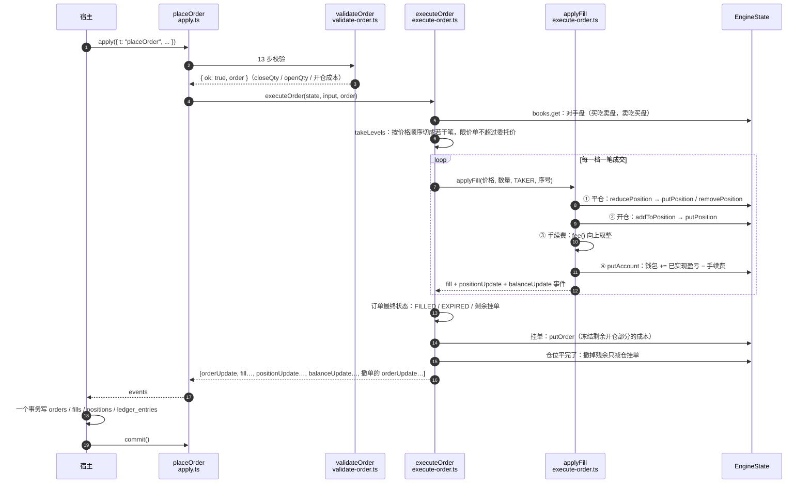
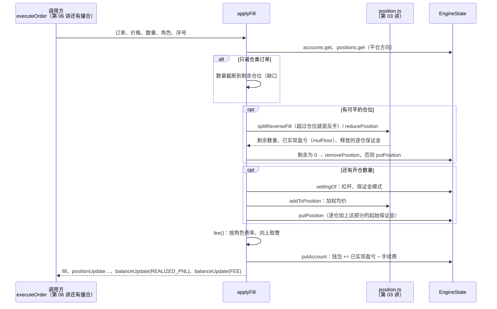

# 05 · 搭建教程：市价单与成交落账

> 第 04 讲回答"这张单能不能下"，这一讲回答"下了之后发生什么"：
> 吃掉对手盘 → 改仓位 → 算已实现盈亏 → 扣手续费 → 发 `balanceUpdate`。
> 从这一讲开始，引擎第一次真的**动钱**。

**这一讲结束时你会有什么**：

- `packages/engine/src/execute-order.ts`：
  - `executeOrder()`：市价单逐档吃单；限价单先判定会不会立刻成交，穿透的部分当 Taker 成交；IOC / FOK / GTC 剩余部分各自处理
  - `applyFill()`：一笔成交落账（平仓 → 开仓 → 手续费 → 余额），第 06 讲的 Maker 成交也走它
  - 仓位平完后，残余的只减仓挂单自动撤销
- `apply.ts` 里 `placeOrder` 校验通过后接上 `executeOrder`
- 第 04 讲的第 10 步按币安加上了**开仓亏损**（缺口 #14），挂单冻结保证金用同一个公式
- `packages/shared` 加了 `mulFloor`，已实现盈亏从"朝零截断"改成真正的"向下取整"
- 20 条新测试，引擎共 189 条、shared 共 34 条全绿

**先读**：`docs/design/04-backend-design.md` 4.4 节（仓位变更）、5.3 / 5.4 节（市价逐档吃、限价角色判定）、第 10 节（宿主落库分流）；`01-domain-knowledge.md` 第十二节（资金流水）；币安规则汇总见 `docs/design/07-binance-reference.md`。

> **代码已经在仓库里了**：AI 写代码和讲义，你对照着读。代码块用脚本从源文件截取，和仓库逐字一致（只去掉公共缩进）。时序图用 Mermaid 写，GitHub 直接能看，VS Code 要装 Mermaid 预览插件。

---

## 第 1 节：一张图看懂成交落账

一张市价买单从进入引擎到产出事件的全过程：



几个要点：

- **所有状态修改都走 `put*` / `remove*`**（第 02 讲的 undo 日志）。宿主落库失败调 `rollback()`，仓位、余额、订单一起撤回。测试脚手架每次 `apply` 都真的回滚一次比对，这一讲的 20 条测试都顺带验证了这一点
- **盘口快照不被修改**。这笔单吃掉的 2 BTC，下一个用户照样能吃到——多个模拟用户共享同一份真实流动性，这是 `02-architecture.md` 已知失真点 #2，刻意接受的
- **事件顺序：`orderUpdate` 放最前面**。数据库里 `fills.order_id` 外键引用 `orders`，宿主按事件顺序写，先写订单才不会外键报错

---

## 第 2 节：这一讲定下来的事

| # | 决定 | 依据 |
| --- | --- | --- |
| 1 | **所需保证金加上开仓亏损**（缺口 #14） | 币安 FAQ：开仓成本 = 起始保证金 + 开仓亏损。第 3 节细说 |
| 2 | 市价单开仓成本用**真实逐档成交价**，不用币安的"最新价 × 1.0015" | 币安下单时不知道成交价只能估；我们在同一次 `apply` 里用同一份盘口撮合，已经知道。有真实值就不编估算值 |
| 3 | 仍然额外预留 Taker 手续费 | 设计文档 4.3 节的刻意保守，币安成本公式里没有这一项 |
| 4 | **只减仓类订单成交时最多成交到剩余仓位**（缺口 #18） | 你定的：下单时只和当前仓位比，"只平不反"在成交时保证 |
| 5 | 仓位平完后撤销同方向残余的只减仓类挂单，状态 `CANCELED` | `01-domain-knowledge.md`："仓位平完后残余的只减仓单自动撤销"；设计文档状态机：只减仓单失效 → CANCELED |
| 6 | 已实现盈亏**向下取整**（`mulFloor`，朝负无穷） | `02-architecture.md` 舍入表"向下"；原来的 `mul` 朝零截断，亏损时反而少算，阅读指南第 8 节指出过 |
| 7 | 手续费**逐笔**向上取整，一档一笔成交 | 设计文档 5.3 节伪代码一档一笔；和第 10 步逐档估算一致，只多不少 |
| 8 | 已实现盈亏、手续费各发一条 `balanceUpdate`，盈亏在前 | `ledger_entries` 按 `REALIZED_PNL` / `FEE` 分类记账（第十二节流水表逐项列出） |
| 9 | 仓位清零后发一条 `qty = 0` 的 `positionUpdate`，然后移出内存 | 数据库行保留（`03-database-design.md`：平仓后行不删），内存只留活着的，和终态订单同一个原则 |
| 10 | 加仓时仓位的杠杆 / 保证金模式和当前设置不一致 → 抛错 | 调杠杆、切模式是第 08 讲，那时必须同步已有仓位；现在走到这里说明有 bug |
| 11 | 不穿透盘口的 GTC / GTX 限价单暂时抛错 | 要估算排队位置，第 06 讲 |
| 12 | 触发单暂时抛错 | 第 09 讲 |

---

## 第 3 节：开仓成本——币安公式（缺口 #14）

第 04 讲的第 10 步原来是"起始保证金 + 预留手续费"。问题出在**成交价和标记价不一样**的时候。

**例子**：标记价 50,000，卖一 50,000、卖二 50,000.5。市价买 3 BTC，成交 2 @ 50,000 + 1 @ 50,000.5。成交那一刻仓位按标记价算浮亏 0.5 USDT——这 0.5 从成交第一秒起就压在可用余额上。原来的第 10 步没算它，余额刚好够的用户成交后可用余额会变成负数（不变式 ③ 当场红）。极端情况下，挂一张远高于标记价的限价买单，一成交就接近强平。

币安的做法（FAQ "How to Calculate the Cost Required to Open a Position in Perpetual Futures Contracts"）：

```
开仓成本 = 起始保证金（按假设价格） + 开仓亏损

假设价格：限价多单 = 委托价
         限价空单 = max(委托价, 标记价, 最新价 × 1.0015)
开仓亏损 = 数量 × |min(0, 方向 × (标记价 − 委托价))|     方向：多 = 1，空 = −1
```

翻译成大白话：**多单成交价高于标记价、空单成交价低于标记价的那部分，就是开仓亏损**。

实现在 `validate-order.ts`，限价和市价各一个函数：

```ts
/**
 * 限价单（以及限价挂单剩余部分）的开仓成本，按币安 FAQ "How to Calculate the Cost Required to Open a Position"：
 *
 *   成本 = 起始保证金（按假设价格） + 开仓亏损
 *   假设价格：多单 = 委托价；空单 = max(委托价, 标记价, 最新价 × 1.0015)
 *   开仓亏损 = 数量 × |min(0, 方向 × (标记价 − 委托价))|，方向多单 = 1、空单 = −1
 *
 * 我们在币安之外再加一项：按 Taker 费率、按假设价格预留手续费（设计文档 4.3 节，成交时才不会余额不够）。
 * 还没收到过成交推送时最新价未知，假设价格里就不带这一项——不知道就不编。
 */
export function limitOpenCost(input: OpenCostInput & { price: Fixed }): OpenCost {
  let assumingPrice = input.price;
  if (input.openSide === "SHORT") {
    if (input.markPrice > assumingPrice) assumingPrice = input.markPrice;
    if (input.lastPrice !== undefined) {
      const lastMarked = mul(input.lastPrice, SHORT_ASSUMING_PRICE_MARKUP);
      if (lastMarked > assumingPrice) assumingPrice = lastMarked;
    }
  }
  const value = notional(input.qty, assumingPrice);
  const initialMarginValue = initialMargin(input.qty, assumingPrice, input.leverageNum);
  const openLoss = openLossOf(input.openSide, input.price, input.qty, input.markPrice);
  const feeReserve = mulCeil(value, input.takerFeeRate);
  return {
    notional: notional(input.qty, input.price),
    initialMargin: initialMarginValue,
    openLoss,
    feeReserve,
    total: initialMarginValue + openLoss + feeReserve,
  };
}
```

```ts
/**
 * 市价单的开仓成本。币安下单时不知道会成交在哪，用"最新价 × 1.0015"当假设价格；
 * 我们的撮合就在同一次 apply 里、用同一份盘口完成，**真实成交价已经知道**，所以逐档用真实价格算：
 * 先跳过 skipQty（被平仓部分吃掉的档位），再吃 qty。
 * 手续费逐档向上取整再求和，和第 05 讲逐笔收费一致，只多不少。
 * 深度不够的部分按最深一档的价格估——这种单一定会在第 11 步被拒，这里只要别算崩。
 */
export function marketOpenCost(input: OpenCostInput & { levels: readonly Level[]; skipQty: Fixed }): OpenCost {
  let skip = input.skipQty;
  let remaining = input.qty;
  let notionalSum = 0n;
  let feeSum = 0n;
  let openLossSum = 0n;

  const take = (price: Fixed, qty: Fixed) => {
    const value = notional(qty, price);
    notionalSum += value;
    feeSum += mulCeil(value, input.takerFeeRate);
    openLossSum += openLossOf(input.openSide, price, qty, input.markPrice);
    remaining -= qty;
  };

  for (const level of input.levels) {
    if (remaining === 0n) break;
    let available = level.qty;
    if (skip > 0n) {
      const skipped = skip < available ? skip : available;
      skip -= skipped;
      available -= skipped;
    }
    if (available > 0n) take(level.price, remaining < available ? remaining : available);
  }
  if (remaining > 0n) take(input.levels[input.levels.length - 1]!.price, remaining);

  const initialMarginValue = divRound(notionalSum, BigInt(input.leverageNum) * SCALE);
  return {
    notional: notionalSum,
    initialMargin: initialMarginValue,
    openLoss: openLossSum,
    feeReserve: feeSum,
    total: initialMarginValue + openLossSum + feeSum,
  };
}
```

```ts
/** 开仓亏损：多单成交价高于标记价、空单成交价低于标记价的那部分，向上取整（成本不低估）。 */
function openLossOf(openSide: Direction, price: Fixed, qty: Fixed, markPrice: Fixed): Fixed {
  const diff = openSide === "LONG" ? price - markPrice : markPrice - price;
  return diff > 0n ? mulCeil(diff, qty) : 0n;
}
```

第 10 步的提示也跟着拆开了，用户能看到钱花在哪：

```
可用余额 10000 USDT 不足，本单需要 10100 USDT（20x 起始保证金 10000 + 开仓亏损 0 + 预留手续费 100）
```

**`limitOpenCost` 同时是挂单冻结保证金的公式**：限价单穿透后剩余部分挂进挂单簿时，冻结的就是剩余部分的开仓成本（第 5 节）。下单时检查的数和挂单时冻结的数出自同一个函数，不会对不上。

> 第 03 讲的 `formulas.ts` 里还有一个 `frozenMargin()`（起始保证金 + 预留手续费），现在引擎不再用它，保留是因为第 03 讲的算例测试在用。

---

## 第 4 节：`executeOrder`——下单那一刻成交多少

```ts
export function executeOrder(state: EngineState, input: PlaceOrderInput, validated: ValidatedOrder): EngineEvent[] {
  const { req } = input;
  if (req.type !== "MARKET" && req.type !== "LIMIT") {
    throw new Error(`触发单（${req.type}）入簿和触发还没有实现，见第 09 讲`);
  }

  const book = state.books.get(req.symbol)!; // 第 2 步保证了存在
  const levels = req.side === "BUY" ? book.asks : book.bids;
  const limitPrice = req.type === "LIMIT" ? req.price! : null;

  let order: Order = {
    id: input.orderId,
    clientOrderId: req.clientOrderId,
    accountId: input.accountId,
    symbol: req.symbol,
    side: req.side,
    positionSide: req.positionSide,
    type: req.type,
    timeInForce: validated.timeInForce,
    price: limitPrice,
    stopPrice: null,
    workingType: validated.workingType,
    qty: validated.qty,
    executedQty: 0n,
    avgPrice: 0n,
    reduceOnly: validated.reduceOnly,
    closePosition: validated.closePosition,
    status: "NEW",
    triggered: false,
    queueAhead: 0n,
    queueEstimated: false,
    frozenMargin: 0n,
    rejectReason: null,
    createdAt: input.ts,
    updatedAt: input.ts,
  };

  // ── 限价单：先判定会不会立刻成交（5.4 节） ──
  if (limitPrice !== null) {
    const best = levels[0]!.price;
    const crosses = req.side === "BUY" ? limitPrice >= best : limitPrice <= best;
    if (!crosses) {
      if (order.timeInForce === "IOC" || order.timeInForce === "FOK") {
        order = { ...order, status: "EXPIRED", rejectReason: `${order.timeInForce} 单没有可以立即成交的对手盘` };
        return [{ t: "orderUpdate", order }];
      }
      throw new Error("不穿透盘口的 GTC / GTX 限价单要估算排队位置后挂单，见第 06 讲");
    }
  }

  const takes = takeLevels(levels, order.qty, limitPrice, req.side);
  const takeable = takes.reduce((sum, take) => sum + take.qty, 0n);

  if (order.type === "MARKET" && takeable < order.qty) {
    throw new Error(`市价单 ${order.id} 深度不够，校验链第 11 步应该已经拒掉了`);
  }
  if (order.timeInForce === "FOK" && takeable < order.qty) {
    // FOK：不能全部成交就整单过期，一笔都不成交
    order = {
      ...order,
      status: "EXPIRED",
      rejectReason: `FOK 单无法全部成交：委托价内可成交 ${takeable}，委托 ${order.qty}`,
    };
    return [{ t: "orderUpdate", order }];
  }

  // ── 逐笔成交 ──
  const fillEvents: EngineEvent[] = [];
  const closedSides = new Set<Direction>();
  let notionalSum = 0n;
  let fillCount = 0;
  for (const take of takes) {
    const result = applyFill(state, order, take.price, take.qty, "TAKER", fillCount + 1, input.ts);
    if (!result) break; // 只减仓单没有仓位可减了（缺口 #18 的成交时截断）
    fillCount++;
    fillEvents.push(...result.events);
    for (const side of result.closedSides) closedSides.add(side);
    order = { ...order, executedQty: order.executedQty + result.fill.qty };
    notionalSum += notional(result.fill.qty, result.fill.price);
  }
  if (order.executedQty > 0n) {
    order = { ...order, avgPrice: divRound(notionalSum, order.executedQty) };
  }

  // ── 订单的最终状态 ──
  const remaining = order.qty - order.executedQty;
  if (remaining === 0n) {
    order = { ...order, status: "FILLED" };
  } else if (order.type === "MARKET" || order.timeInForce === "IOC" || nothingLeftToClose(state, order)) {
    // 市价单 / IOC 剩余部分过期；只减仓类订单已经没有仓位可减，剩余部分同样过期
    order = { ...order, status: "EXPIRED", rejectReason: `未成交的 ${remaining} 已过期` };
  } else {
    // GTC 穿透后的剩余部分挂单：它已经把这个价位的对手盘吃光，自己排在第一个，排队位置是 0（5.4 节）
    order = {
      ...order,
      status: order.executedQty > 0n ? "PARTIALLY_FILLED" : "NEW",
      queueAhead: 0n,
      queueEstimated: false,
      frozenMargin: restingFrozenMargin(state, order, remaining),
    };
    putOrder(state, order);
  }

  // 订单事件放在最前面：数据库里 fills.order_id 外键引用 orders，宿主要先写订单再写成交
  return [
    { t: "orderUpdate", order },
    ...fillEvents,
    ...cancelResidualClosingOrders(state, order, closedSides, input.ts),
  ];
}
```

按顺序看：

1. **构造订单对象**。字段来自请求和第 04 讲带出来的 `ValidatedOrder`（补齐了默认的 TIF、`workingType`）
2. **限价单先判定角色**（5.4 节）：买单委托价 ≥ 卖一、卖单委托价 ≤ 买一，就是会立刻成交。不会成交的：IOC / FOK 直接过期（"没有可以立即成交的对手盘"），GTC / GTX 要排队，第 06 讲
3. **`takeLevels` 切成若干笔**：按价格顺序吃，限价单遇到比委托价差的档位就停
4. **FOK 先算够不够**：委托价内能吃到的总量不够，整单过期，一笔都不成交——所以 FOK 的检查必须在任何 `applyFill` 之前
5. **逐笔 `applyFill`**，累加成交量和名义价值，最后算成交均价（`divRound`，展示类数值四舍五入）
6. **最终状态**：

| 情况 | 状态 | 进挂单簿？ |
| --- | --- | --- |
| 全部成交 | `FILLED` | 否 |
| 市价单 / IOC 有剩余 | `EXPIRED` | 否 |
| 只减仓类订单已经没有仓位可减 | `EXPIRED` | 否 |
| GTC 穿透后有剩余 | `PARTIALLY_FILLED`，排队位置 0 | 是，冻结剩余开仓部分的成本 |

**穿透后剩余部分的排队位置是 0**（5.4 节特意强调"这个细节容易漏"）：它已经把委托价以内的对手盘吃光了，自己成了这个价位上的第一张单。

```ts
/** 按价格顺序吃档位，限价单不超过委托价。不修改盘口。 */
function takeLevels(levels: readonly Level[], qty: Fixed, limitPrice: Fixed | null, side: "BUY" | "SELL"): Take[] {
  const takes: Take[] = [];
  let remaining = qty;
  for (const level of levels) {
    if (remaining === 0n) break;
    if (limitPrice !== null && (side === "BUY" ? level.price > limitPrice : level.price < limitPrice)) break;
    const take = remaining < level.qty ? remaining : level.qty;
    takes.push({ price: level.price, qty: take });
    remaining -= take;
  }
  return takes;
}
```

---

## 第 5 节：`applyFill`——一笔成交落账

先看全貌：



```ts
/**
 * 一笔成交落账。返回 null 表示这是只减仓类订单、但已经没有仓位可减（缺口 #18：成交时截断）。
 *
 * 顺序（04-backend-design.md 4.4 节）：
 * 1. 先平：单向模式的反向仓位、双向模式的平仓方向，最多平到仓位数量，算已实现盈亏、按比例释放逐仓保证金
 * 2. 再开：剩下的数量按成交价开仓 / 加仓（单向模式超过仓位的部分就是反手）
 * 3. 手续费按整笔成交量收，向上取整
 * 4. 已实现盈亏、手续费各发一条 balanceUpdate——全系统只有这一种事件能改钱包余额
 */
export function applyFill(
  state: EngineState,
  order: Readonly<Order>,
  price: Fixed,
  requestedQty: Fixed,
  role: FillRole,
  seqNum: number,
  ts: number,
): FillResult | null {
  const account = state.accounts.get(order.accountId);
  if (!account) throw new Error(`成交的订单 ${order.id} 属于不存在的账户 ${order.accountId}`);

  const sides = orderSides(account.positionMode, order);
  const closeKey = positionKey(order.accountId, order.symbol, sides.closeSide);
  const closeTarget = sides.canClose ? state.positions.get(closeKey) : undefined;
  const closable = closeTarget && closeTarget.qty > 0n ? closeTarget.qty : 0n;

  // 缺口 #18：只减仓类订单最多成交到当前剩余仓位，多出来的不成交
  let qty = requestedQty;
  if (sides.closingOnly) {
    if (closable === 0n) return null;
    if (qty > closable) qty = closable;
  }

  const events: EngineEvent[] = [];
  const closedSides: Direction[] = [];
  let realizedPnl = 0n;
  let openQty = qty;

  // ① 平仓部分。成交量超过仓位就是反手（只有单向模式会走到，双向模式的平仓方向单上面已经截断），
  //    用第 03 讲的 splitReverseFill 拆成"平掉全部仓位 + 剩余开反向仓"
  if (closeTarget && closable > 0n) {
    const closeQty = qty > closable ? splitReverseFill(closable, qty).closeQty : qty;
    const reduced = reducePosition(
      closeTarget.positionSide,
      closeTarget.qty,
      closeTarget.entryPrice,
      closeTarget.isolatedMargin,
      closeQty,
      price,
    );
    realizedPnl = reduced.realizedPnl;
    const updated: Position = {
      ...closeTarget,
      qty: reduced.qty,
      isolatedMargin: closeTarget.isolatedMargin - reduced.releasedMargin,
      updatedAt: ts,
    };
    events.push({ t: "positionUpdate", position: updated });
    if (reduced.qty === 0n) {
      // 仓位平完：发一条 qty = 0 的更新让宿主落库，然后移出内存（和终态订单一样，内存里只留活着的）
      removePosition(state, closeKey);
      closedSides.push(sides.closeSide);
    } else {
      putPosition(state, updated);
    }
    openQty = qty - closeQty;
  }

  // ② 开仓 / 加仓部分
  if (openQty > 0n) {
    const setting = settingOf(state, order.accountId, order.symbol);
    const openKey = positionKey(order.accountId, order.symbol, sides.openSide);
    const existing = state.positions.get(openKey);
    if (existing && (existing.leverageNum !== setting.leverageNum || existing.marginMode !== setting.marginMode)) {
      // 调杠杆 / 切保证金模式要到第 08 讲才实现，那时候必须保证已有仓位和设置同步；走到这里说明没同步
      throw new Error(
        `仓位 ${openKey} 的杠杆 / 保证金模式（${existing.leverageNum}x ${existing.marginMode}）` +
          `和当前设置（${setting.leverageNum}x ${setting.marginMode}）不一致`,
      );
    }
    const added = addToPosition(existing?.qty ?? 0n, existing?.entryPrice ?? 0n, openQty, price);
    const addedIsolatedMargin =
      setting.marginMode === "ISOLATED" ? initialMargin(openQty, price, setting.leverageNum) : 0n;
    const position: Position = {
      accountId: order.accountId,
      symbol: order.symbol,
      positionSide: sides.openSide,
      marginMode: setting.marginMode,
      leverageNum: setting.leverageNum,
      qty: added.qty,
      entryPrice: added.entryPrice,
      isolatedMargin: (existing?.isolatedMargin ?? 0n) + addedIsolatedMargin,
      openedAt: existing?.openedAt ?? ts,
      updatedAt: ts,
    };
    putPosition(state, position);
    events.push({ t: "positionUpdate", position });
  }

  // ③ 手续费 + ④ 余额
  const fill: Fill = {
    id: `${order.id}:${seqNum}`,
    orderId: order.id,
    accountId: order.accountId,
    symbol: order.symbol,
    side: order.side,
    positionSide: order.positionSide,
    price,
    qty,
    role,
    fee: feeOf(qty, price, role, state.config.fees),
    realizedPnl,
    isLiquidation: false,
    ts,
  };
  events.unshift({ t: "fill", fill });

  let walletBalance = account.walletBalance;
  const ref = { type: "fill" as const, id: fill.id };
  if (realizedPnl !== 0n) {
    walletBalance += realizedPnl;
    events.push({
      t: "balanceUpdate",
      accountId: account.id,
      walletBalance,
      delta: realizedPnl,
      reason: "REALIZED_PNL",
      symbol: order.symbol,
      ref,
      ts,
    });
  }
  if (fill.fee > 0n) {
    walletBalance -= fill.fee;
    events.push({
      t: "balanceUpdate",
      accountId: account.id,
      walletBalance,
      delta: -fill.fee,
      reason: "FEE",
      symbol: order.symbol,
      ref,
      ts,
    });
  }
  if (walletBalance !== account.walletBalance) {
    putAccount(state, { ...account, walletBalance });
  }

  return { fill, events, closedSides };
}
```

**方向怎么判断**——和第 04 讲第 8 步前面算方向是同一套规则，抽成了 `orderSides`，第 06 讲的 Maker 成交也要用：

```ts
/**
 * 和校验链第 8 步前面的方向计算是同一套规则：
 * 单向模式开仓方向看买卖（买 → 多），平的是反方向；双向模式开平都看 positionSide，
 * SELL + LONG / BUY + SHORT 是平仓方向，天生只减仓。
 */
export function orderSides(positionMode: PositionMode, order: Pick<Order, "side" | "positionSide" | "reduceOnly" | "closePosition">): OrderSides {
  if (positionMode === "HEDGE") {
    const side = order.positionSide as Direction;
    const closing =
      (order.side === "SELL" && order.positionSide === "LONG") || (order.side === "BUY" && order.positionSide === "SHORT");
    return { openSide: side, closeSide: side, canClose: closing, closingOnly: closing };
  }
  const openSide: Direction = order.side === "BUY" ? "LONG" : "SHORT";
  return {
    openSide,
    closeSide: openSide === "LONG" ? "SHORT" : "LONG",
    canClose: true,
    closingOnly: order.reduceOnly || order.closePosition,
  };
}
```

| 持仓模式 | 订单 | 开仓方向 | 平仓方向 | 会平仓？ | 只减仓？ |
| --- | --- | --- | --- | --- | --- |
| 单向 | BUY | LONG | SHORT | 有空头就平 | 看 `reduceOnly` / `closePosition` |
| 单向 | SELL | SHORT | LONG | 有多头就平 | 同上 |
| 双向 | BUY + LONG | LONG | — | 否 | 否 |
| 双向 | SELL + LONG | — | LONG | 是 | 是 |
| 双向 | SELL + SHORT | SHORT | — | 否 | 否 |
| 双向 | BUY + SHORT | — | SHORT | 是 | 是 |

几个细节：

- **反手**（只有单向模式）：成交量超过反向仓位，第 03 讲的 `splitReverseFill` 拆成"平掉全部 + 剩余开新仓"。一笔 `Fill` 记录，`realizedPnl` 只来自平仓部分，手续费按整笔收
- **逐仓保证金**：开仓时加上这部分的起始保证金（`initialMargin(数量, 成交价, 杠杆)`），平仓时按比例释放。钱包余额不因此变化（缺口 #6）
- **余额只在最后改一次**，但发两条 `balanceUpdate`，每条的 `walletBalance` 都是那一步之后的余额——宿主据此写 `ledger_entries.balance_after`，测试脚手架逐条核对"余额 == 流水累加"

---

## 第 6 节：只减仓的两道保险（缺口 #18）

第 04 讲的讨论里定了：**下单时**只要求单张数量 ≤ 当前仓位；**成交时**再截断。原因是挂单之后仓位可能被别的方式减少（单向模式的普通反向单、强平、一键平仓），下单时怎么查都挡不住。

**第一道：成交时截断**，在 `applyFill` 开头。只减仓类订单最多成交到剩余仓位，没有仓位就返回 `null`，调用方停止成交。

**第二道：仓位平完后撤销残余挂单**：

```ts
/**
 * 仓位平完之后，同一方向上残余的只减仓类挂单已经没有仓位可减，撤掉（01-domain-knowledge.md："仓位平完后
 * 残余的只减仓单自动撤销"；04-backend-design.md 第 3 节状态机：只减仓单失效 → CANCELED）。
 */
function cancelResidualClosingOrders(
  state: EngineState,
  current: Readonly<Order>,
  closedSides: ReadonlySet<Direction>,
  ts: number,
): EngineEvent[] {
  if (closedSides.size === 0) return [];
  const account = state.accounts.get(current.accountId)!;
  const events: EngineEvent[] = [];
  for (const order of [...state.orders.values()]) {
    if (order.accountId !== current.accountId || order.symbol !== current.symbol) continue;
    const sides = orderSides(account.positionMode, order);
    if (!sides.closingOnly || !closedSides.has(sides.closeSide)) continue;
    const canceled: Order = { ...order, status: "CANCELED", rejectReason: "仓位已平完，只减仓单自动撤销", updatedAt: ts };
    removeOrder(state, order.id);
    events.push({ t: "orderUpdate", order: canceled });
  }
  return events;
}
```

测试里的场景：持多 5，挂一张只减仓限价卖 3（成交 2、剩 1 挂着），再市价只减仓卖 3 → 仓位清零，挂着的那张被撤销。反手也会触发：持多时下一张普通卖单反手开空，多头清零，指向多头的只减仓挂单同样撤销。

挂单剩余部分冻结多少保证金：

```ts
/**
 * 挂进挂单簿的剩余部分要冻结的保证金：只算其中"会开仓"的部分，和下单时第 10 步同一个公式（limitOpenCost）。
 * 单向模式下，剩余数量里还能平掉的反向仓位部分不冻结；只减仓类订单不冻结（不变式 ⑥）。
 */
function restingFrozenMargin(state: EngineState, order: Readonly<Order>, remaining: Fixed): Fixed {
  const account = state.accounts.get(order.accountId)!;
  const sides = orderSides(account.positionMode, order);
  if (sides.closingOnly) return 0n;

  let openPart = remaining;
  if (sides.canClose) {
    const target = state.positions.get(positionKey(order.accountId, order.symbol, sides.closeSide));
    if (target) openPart = remaining > target.qty ? remaining - target.qty : 0n;
  }
  if (openPart === 0n) return 0n;

  const setting = settingOf(state, order.accountId, order.symbol);
  return limitOpenCost({
    openSide: sides.openSide,
    qty: openPart,
    price: order.price!,
    markPrice: state.marks.get(order.symbol)!.markPrice,
    lastPrice: state.lastPrices.get(order.symbol),
    leverageNum: setting.leverageNum,
    takerFeeRate: state.config.fees.takerFeeRate,
  }).total;
}
```

---

## 第 7 节：已实现盈亏为什么改成 `mulFloor`

`02-architecture.md` 舍入表写的是"已实现盈亏：**向下**（截断）"。第 03 讲用的 `mul` 是 `bigint` 除法——**朝零**截断：

| 真实值 | `mul`（朝零） | `mulFloor`（朝负无穷） |
| --- | --- | --- |
| +0.000000045 | +0.00000004 | +0.00000004 |
| −0.000000045 | **−0.00000004**（少算亏损） | −0.00000005 |

盈利时两者一样；亏损时 `mul` 反而少算了亏损，和"保守"的意图相反。差距最多 1 个最小单位，但第 05 讲开始这个数真的进钱包了，所以在这一讲改掉：

```ts
/**
 * 乘法，向下取整（朝负无穷），用于已实现盈亏——盈利少算一点、亏损多算一点，两个方向都保守。
 * 和 mul 的区别只在负数：mul 是 bigint 除法，朝零截断，亏损时反而少算了亏损。
 */
export function mulFloor(a: Fixed, b: Fixed): Fixed {
  const product = a * b;
  const q = product / SCALE;
  return product % SCALE < 0n ? q - 1n : q;
}
```

`position.ts` 的 `reducePosition` 改用它，补了一条亏损方向的测试。

---

## 第 8 节：算例

测试里的数字都可以手算核对：

**① 市价买 5 BTC**（04-backend-design.md 5.3 节）：更深的盘口（前三档 2 / 2 / 3，后面加 10 BTC 深度，否则 5 BTC 超过第 11 步的 50% 深度限制）

```
成交：2 @ 50,000 + 2 @ 50,000.5 + 1 @ 50,001
均价 = (100,000 + 100,001 + 50,001) ÷ 5 = 50,000.4
手续费 = 50 + 50.0005 + 25.0005 = 125.001（逐笔向上取整）
钱包 100,000 → 99,874.999
```

**② 01-domain-knowledge.md 第十二节第 1 步**：10x 逐仓市价开多 1 BTC @ 50,000

```
Taker 费 25 → 钱包 9,975
逐仓保证金 5,000（不从钱包扣，只从可用余额扣）→ 可用余额 4,975
事件：orderUpdate → fill → positionUpdate → balanceUpdate(FEE, −25, 余额 9,975)
```

第十二节后面三步：第 3 步资金费是第 08 讲，第 4 步 Maker 平仓是第 06 讲。第 08 讲会把整张表重放一遍，净收益 +1,959.5。

**③ 平仓盈利**：多 1 @ 50,000（钱包 9,975），买一涨到 52,000，市价卖 1

```
已实现 +2,000 → 余额 11,975
手续费 26    → 余额 11,949
```

**④ 反手**：多 1 @ 50,000，市价卖 3（买一 49,999.9 × 2、买二 49,999.5 × 2）

```
第 1 笔 2 @ 49,999.9：平多 1（已实现 −0.1），开空 1
第 2 笔 1 @ 49,999.5：加空 1 → 空 2 @ 49,999.7
钱包 100,000 − 25 − 0.1 − 49.9999 − 24.99975 = 99,899.90035
```

**⑤ 限价穿透**：GTC 买 5 @ 50,000.5

```
吃 2 @ 50,000 + 2 @ 50,000.5 = 4 BTC，均价 50,000.25
剩 1 BTC 挂单：排队位置 0，冻结 2,500.025 + 开仓亏损 0.5 + 手续费 25.00025 = 2,525.52525
同一张单改 IOC：剩余过期；改 FOK：整单过期、零成交；FOK 4 BTC：全部成交
```

**⑥ 开仓亏损**（第 04 讲测试里补的）

```
限价买 1 @ 52,000，标记价 50,000：2,600 + 2,000 + 26 = 4,626
限价卖 1 @ 49,000（双向开空），标记价 50,000：
  假设价格 max(49,000, 50,000) = 50,000 → 2,500 + 1,000 + 25 = 3,525
  收到过最新价 50,100 时：假设价格 50,100 × 1.0015 = 50,175.15
  → 2,508.7575 + 1,000 + 25.087575 = 3,533.845075
市价买 3 BTC：7,500.025 + 0.5 + 75.00025 = 7,575.52525
```

---

## 第 9 节：测试怎么组织

`execute-order.test.ts` 全部走测试脚手架 `createTestEngine`：**每次 `apply` 之后自动跑 8 条不变式 + 回滚自检**。所以每条测试除了断言写出来的数字，还顺带证明了：

- 钱包余额 == 所有 `balanceUpdate` 的累加（不变式 ①），而且每条事件的 `walletBalance` 都自洽
- 仓位数量非负、成交量不超过委托量、`FILLED` 的单全部成交、内存里没有终态订单
- 可用余额非负（不变式 ③）——开仓亏损补上之后才守得住
- 回滚后账户类状态和 `apply` 之前一模一样——漏了一处 `put*` 就会被抓

`setup()` 返回的 `setSetting()` 用快照改杠杆设置，因为 `setLeverage` 输入第 08 讲才实现。只减仓截断和亏损取整两条直接调 `applyFill`，因为下单校验会先挡住，走 `apply` 构造不出那种状态。

---

## 验收清单

- [ ] `pnpm --filter @binance-contract-trading-full-stack/engine test` 全绿（189 条）
- [ ] `pnpm --filter @binance-contract-trading-full-stack/shared test` 全绿（34 条）
- [ ] `engine` / `shared` / `db` / `server` 四个包 `check-types` 通过
- [ ] 市价买 5 BTC 均价 50,000.4，手续费逐笔 50 / 50.0005 / 25.0005
- [ ] 10x 逐仓开多 1 BTC：钱包 9,975、逐仓保证金 5,000、可用余额 4,975
- [ ] 反手：两段分开算，第一笔已实现 −0.1，空 2 @ 49,999.7
- [ ] GTC 穿透剩余挂单排队位置 0；IOC 剩余过期；FOK 不能全成零成交
- [ ] 仓位平完后残余只减仓挂单 `CANCELED`
- [ ] 已实现亏损向下取整（−0.000000045 记 −0.00000005）
- [ ] `purity.test.ts` 依然全绿

全部打勾，进第 06 讲：限价单与拟真排队。

---

## 读完可以自测

1. 为什么 FOK 的"够不够全部成交"必须在第一次 `applyFill` 之前判断？放到循环里边成交边判断会出什么问题？
2. 限价 GTC 买单穿透盘口后剩下的部分，排队位置为什么是 0，而不是这个价位盘口上的数量？
3. 市价买 3 BTC 的开仓成本里，0.5 USDT 的开仓亏损是怎么来的？不算它，成交后哪条不变式会红？
4. 币安算市价单开仓成本用"最新价 × 1.0015"，我们为什么不用？
5. 持多 1 BTC，挂着一张只减仓卖 1 BTC 的限价单，然后下一张普通市价卖 3 BTC。成交后仓位是什么？那张挂单会怎样？
6. 一笔成交既有已实现盈亏又有手续费，为什么发两条 `balanceUpdate` 而不是合成一条？
7. 亏损 0.000000045 USDT，`mul` 和 `mulFloor` 各记多少？为什么选后者？
