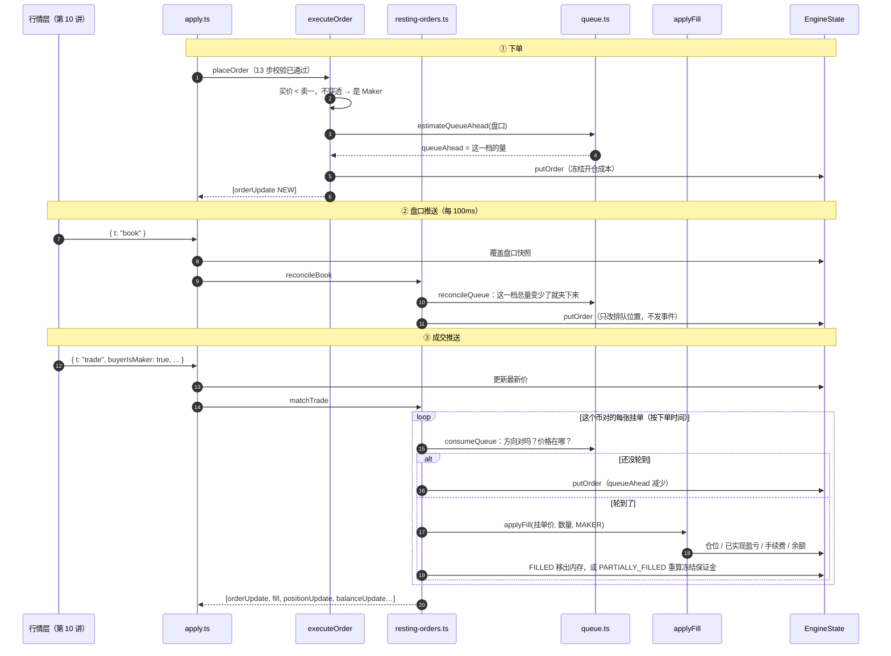

# 06 · 搭建教程：限价单与拟真排队

> 第 05 讲的限价单只处理了"下单那一刻就能成交"的部分。这一讲处理剩下的：**挂在盘口上等**。
> 我们的单不在币安的订单簿里，没有真实的队列可排，只能用币安真实发生的成交去"推算"：
> 如果这张单真的挂在币安上，现在轮到它了吗？
>
> 这个判定做得诚不诚实，决定了这个模拟盘是练习工具还是骗人的玩具（04-backend-design.md 5.1 节）。

**这一讲结束时你会有什么**：

- `packages/engine/src/queue.ts`：排队的三个纯函数，只算数不碰状态
  - `estimateQueueAhead()`：下单时估算前方还有多少量
  - `reconcileQueue()`：盘口更新时夹逼
  - `consumeQueue()`：一笔行情成交推进队列，算出能成交多少
- `packages/engine/src/resting-orders.ts`：挂单簿随行情变化
  - `reconcileBook()`：`book` 输入 → 夹逼这个币对所有挂单
  - `matchTrade()`：`trade` 输入 → 消耗队列，轮到的按**挂单价**成交（Maker），走第 05 讲的 `applyFill` 落账
  - `cancelOrder()`：用户撤单
- `execute-order.ts`：不穿透盘口的 GTC / GTX 限价单不再抛错，估算排队位置后挂进挂单簿
- `EngineInput` 的 `trade` 加了 `tradeId`，`qty` 明确取币安推送里的 `nq`（第 2 节）
- 34 条新测试，引擎共 223 条全绿，其中 `04-backend-design.md` 5.5 节 T0→T4 那张表逐行断言

**先读**：`docs/design/04-backend-design.md` 5.2 节（主循环顺序）、5.4 节（限价单角色判定）、**5.5 节（拟真排队，这一讲的核心）**；`02-architecture.md` 第九节失真点 #2、#3；`06-testing-design.md` 第 3 节场景清单。

> **代码已经在仓库里了**：AI 写代码和讲义，你对照着读。代码块用脚本从源文件截取，和仓库逐字一致（只去掉公共缩进）。时序图用 Mermaid 写。

---

## 第 1 节：一张图看懂挂单怎么成交

一张不穿透盘口的限价买单，从挂上去到成交：



几个要点：

- **排队位置的变化不发事件**，只有成交、撤单这类"订单真的变了"才发 `orderUpdate`（第 2 节 #5）
- **模拟挂单之间互不撮合**，也不消耗真实流动性。同一笔行情成交可以同时让十个用户的挂单都成交——这是失真点 #2，第 05 讲的吃单也是这样
- 成交落账完全复用第 05 讲的 `applyFill`，只是角色从 `TAKER` 换成 `MAKER`、价格用挂单价

---

## 第 2 节：这一讲定下来的事

| # | 决定 | 依据 |
| --- | --- | --- |
| 1 | **`trade.qty` 取币安推送的 `nq`，不取 `q`** | 币安 2025-11 引入 RPI 订单（只和 App / 网页端订单撮合的只挂单），RPI 挂单**不出现在 depth 流里**；2025-12-31 起 `@aggTrade` 加了 `nq` 字段，只统计普通订单的成交量（更新日志 2025-11-18、2025-12-29）。我们的队列是从 depth 流读出来的，消耗它的成交量必须同口径，用 `q` 会把 RPI 成交也算进来，让队列前进得比真实快。2026-09-17 抓真实推送核对过字段 |
| 2 | `trade` 输入加 `tradeId`（推送里的 `a`），Maker 成交的 id 是 `订单id:t归集成交id` | 一笔行情成交最多让一张挂单成交一次，所以不会重复；归集成交 id 在币对内单调递增，重启后也不会撞上。第 05 讲吃单的 id 是 `订单id:序号`，两种格式互不冲突 |
| 3 | 成交价永远是**挂单价**，不是行情成交价 | 设计文档 5.5 节；所有订单簿的规则：挂单方按自己的价格成交 |
| 4 | **初始排队位置、夹逼和设计文档伪代码有两处不同**（缺口 #20） | 伪代码漏了两种情况，都会让排队位置错误地偏向对用户有利。第 4 节细说 |
| 5 | 排队位置的变化**不发事件**（缺口 #21） | depth 每 100ms 一次，挂单一多宿主写库写不过来；内存值是准的，数据库里的值重启后反正要保守重置（`04-backend-design.md` 第 10 节"重启恢复"第 4 步） |
| 6 | 一笔行情成交里多张挂单按 `createdAt`、再按 `id` 排序处理 | Map 的遍历顺序在 `rollback` 之后会变，不排序就不是确定性的 |
| 7 | Maker 部分成交后，冻结保证金按**剩余数量**重算 | 和第 05 讲穿透后剩余挂单同一个函数 `restingFrozenMargin` |
| 8 | 只减仓挂单被成交时：成交时截断；仓位平完后剩余部分和同方向其它只减仓挂单一起 `CANCELED` | 第 05 讲缺口 #18 的规则，挂单成交同样适用 |
| 9 | 撤单：订单不存在、已结束、不是自己的，一律 `ORDER_NOT_FOUND` | 不区分三种情况，免得拿订单 id 探测别人的单。币安同样只回 `-2011` "Unknown order sent" |
| 10 | `nq = 0` 的行情成交（只有 RPI 订单参与）：只更新最新价，不碰队列 | 这笔成交和我们看得见的队列无关 |
| 11 | 订单成交均价用和仓位均价同一个函数（`addToPosition`）按数量加权 | 同一件事不写两套舍入 |

顺带发现、记给后面的讲：

- **币安合约行情流的连接地址拆开了**（缺口 #22，第 10 讲）：depth 类走 `wss://fstream.binance.com/public/...`，aggTrade / markPrice 走 `wss://fstream.binance.com/market/...`。`04-backend-design.md` 第 2 节还写着旧的 `/stream`。币安公告说旧地址 2026-04-23 之后只推 `/public` 那一类数据，2026-09-17 实测旧地址收得到 depth、收不到 aggTrade，和公告一致
- **别的挂单的冻结保证金不会随仓位变化重算**（缺口 #23，第 07 讲）：单向模式持多 1，挂一张卖 2 的普通限价单，只冻结"开空 1"的成本；之后用市价把多头平掉，这张挂单全成交会开空 2，冻结却还是 1 份。第 05 讲就存在，这一讲没有放大它

---

## 第 3 节：`m` 字段——弄反了就全错

币安每条 `@aggTrade` 推送带一个 `m`：**买方是不是 Maker**。

```
m = true   买方是 Maker（挂着的买单）  → 主动方在卖 → 吃掉的是买盘 → 推进"买单"的队列
m = false  卖方是 Maker（挂着的卖单）  → 主动方在买 → 吃掉的是卖盘 → 推进"卖单"的队列
```

我们的买单挂在买盘里，只有"有人主动卖、吃掉买盘"的成交才会让它往前走。反过来的成交哪怕价格穿过了我们的挂单价，也和买盘队列无关——那是卖盘被吃。

**弄反会怎样**：买单会在有人主动买的时候成交。价格在涨、根本没人往下砸，你的低价买单却成交了。测试里专门把这一行改反跑过一次：16 条测试变红。

2026-09-17 抓的两条真实推送（BTCUSDT）：

```json
{"e":"aggTrade","a":3453526449,"p":"76132.60","q":"0.015","nq":"0.015","m":false,"T":1789611046557}
{"e":"aggTrade","a":3453526450,"p":"76132.50","q":"0.060","nq":"0.060","m":true, "T":1789611046819}
```

第一条是主动买（成交在卖一 76,132.6），第二条是主动卖（成交在买一 76,132.5），价格正好差一个 tick，和 `m` 对得上。

---

## 第 4 节：`queue.ts`——三个纯函数

先看挂单价在自己这一侧盘口（买单看 bids，卖单看 asks）里落在哪：

```ts
type Spot = { kind: "at"; qty: Fixed } | { kind: "inside" } | { kind: "beyond" };

function locate(levels: readonly Level[], side: OrderSide, price: Fixed): Spot {
  const deepest = levels[levels.length - 1];
  if (!deepest) return { kind: "beyond" }; // 这一侧一档都没有：什么都看不到
  const level = levels.find((l) => l.price === price);
  if (level) return { kind: "at", qty: level.qty };
  // 买单价格越低越深，卖单价格越高越深
  const deeper = side === "BUY" ? price < deepest.price : price > deepest.price;
  return deeper ? { kind: "beyond" } : { kind: "inside" };
}
```

三种位置决定了一切：

| 位置 | 例子（买盘 50,000 / 49,950 / 49,900） | 前方有多少 |
| --- | --- | --- |
| `at` 正好有这一档 | 挂 49,950 | 这一档的量 |
| `inside` 在可见范围内但没有这一档 | 挂 50,000.2（比买一还优）、挂 49,920（两档之间） | 0 |
| `beyond` 比最深一档还深 | 挂 49,000 | **看不到** |

### 4.1 初始排队位置

```ts
export function estimateQueueAhead(
  side: OrderSide,
  price: Fixed,
  book: { bids: readonly Level[]; asks: readonly Level[] },
): QueuePosition {
  const levels = ownSide(book, side);
  const spot = locate(levels, side, price);
  switch (spot.kind) {
    case "at":
      return { queueAhead: spot.qty, queueEstimated: false };
    case "inside":
      return { queueAhead: 0n, queueEstimated: false };
    case "beyond":
      // 看不到真实值，用最深一档的量兜底，等价位进入可见范围再校准。
      // 一侧盘口为空时校验链第 2 步已经拒单，走到这里说明调用方没校验
      if (levels.length === 0) throw new Error(`盘口 ${side === "BUY" ? "bids" : "asks"} 为空，无法估算排队位置`);
      return { queueAhead: levels[levels.length - 1]!.qty, queueEstimated: true };
  }
}
```

**和设计文档伪代码的第一处不同**：伪代码只判断了"正好有这一档"和"比最优价还优"，其余一律"用最深档兜底"。但挂在两档**之间**的价位（49,920）也会走到兜底。depth20 给的是**前 20 个非空价位**，在这个范围里缺的价位就是没有挂单，前方确实是 0，而且是看得见的事实，不是估算。

`beyond` 才是真的看不到。设计文档选了"最深一档的量"兜底，这个数字本身没什么道理，所以打上 `queueEstimated = true`，等价位进入可见范围立刻换成真实值（4.2 节）。

### 4.2 盘口更新时夹逼

```ts
export function reconcileQueue(
  order: { side: OrderSide; price: Fixed } & QueuePosition,
  book: { bids: readonly Level[]; asks: readonly Level[] },
): QueuePosition {
  const spot = locate(ownSide(book, order.side), order.side, order.price);
  switch (spot.kind) {
    case "at":
      if (order.queueEstimated) return { queueAhead: spot.qty, queueEstimated: false };
      return { queueAhead: order.queueAhead < spot.qty ? order.queueAhead : spot.qty, queueEstimated: false };
    case "inside":
      return { queueAhead: 0n, queueEstimated: false };
    case "beyond":
      return { queueAhead: order.queueAhead, queueEstimated: order.queueEstimated };
  }
}
```

真实队列是先进先出的，前面的人撤单我就往前走，后面的人撤单和我无关。我们只看得到**总量**，看不到撤的是谁。设计文档的办法：

- 默认撤单都发生在**我后面**（`queueAhead` 只被成交减少）——保守，不高估成交
- 但前方的量**不可能超过这一档的总量**——总量掉下来了，就把我夹下来

**和设计文档伪代码的第二处不同**：伪代码是"找不到这一档就归零"。价格往反方向跑远、我的挂单掉出 20 档视野时，也找不到这一档——那时候归零，等于凭空把用户排到队首，价格回来的第一笔成交就先给他。这正是 CLAUDE.md 说的"让某一条失真点变得更不诚实"。所以 `beyond` 保持不动。

测试里把这一行改成归零跑过一次：两条测试变红，一条是纯函数的，一条是"价格涨上去再回来"的场景。

估算过的单（`queueEstimated`）一旦进入视野，直接换成真实值，**哪怕比估算值大**——估算值本来就没有根据，不能因为它小就留着。

### 4.3 行情成交推进队列

```ts
export function consumeQueue(
  order: { side: OrderSide; price: Fixed; queueAhead: Fixed; remainingQty: Fixed },
  trade: { price: Fixed; qty: Fixed; buyerIsMaker: boolean },
): ConsumeResult {
  const unchanged = { queueAhead: order.queueAhead, fillQty: 0n };
  const hitsMySide = order.side === "BUY" ? trade.buyerIsMaker : !trade.buyerIsMaker;
  if (!hitsMySide || trade.qty === 0n || order.remainingQty === 0n) return unchanged;

  // ① 成交价比我的挂单价更优（买单：别人在更高的价位成交）：那是排在我前面价位的队列，与我无关
  const better = order.side === "BUY" ? trade.price > order.price : trade.price < order.price;
  if (better) return unchanged;

  // ② 成交价穿过了我的价位：我这一档已经被吃光，剩余全部成交
  const through = order.side === "BUY" ? trade.price < order.price : trade.price > order.price;
  if (through) return { queueAhead: 0n, fillQty: order.remainingQty };

  // ③ 正好在我的价位：先消耗前方的量，多出来的才轮到我
  if (trade.qty <= order.queueAhead) {
    return { queueAhead: order.queueAhead - trade.qty, fillQty: 0n };
  }
  const leftover = trade.qty - order.queueAhead;
  return { queueAhead: 0n, fillQty: leftover < order.remainingQty ? leftover : order.remainingQty };
}
```

四个分支，按顺序：

1. **方向不对**、成交量为 0、已经没有剩余：什么都不动
2. **成交价比我更优**（买单：别人在比我高的价位成交）：那是排在我前面价位的队列，吃不到我这一档
3. **成交价穿过我**（买单：成交在比我低的价位）：说明我这一档已经被吃光了，**剩余全部成交**
4. **正好在我的价位**：先吃掉前方的量，多出来的才轮到我，最多成交到剩余数量

第 3 条是"穿透"。注意它不看成交量：哪怕穿透那笔只有 0.001 BTC，我这 0.5 BTC 也全部成交。道理是价格能走到 49,880，49,900 那一档一定已经空了，而我排在那一档里。

---

## 第 5 节：挂单入簿

`executeOrder` 里原来抛错的那个分支：

```ts
// ── 限价单：先判定会不会立刻成交（5.4 节） ──
if (limitPrice !== null) {
  const best = levels[0]!.price;
  const crosses = req.side === "BUY" ? limitPrice >= best : limitPrice <= best;
  if (!crosses) {
    if (order.timeInForce === "IOC" || order.timeInForce === "FOK") {
      order = { ...order, status: "EXPIRED", rejectReason: `${order.timeInForce} 单没有可以立即成交的对手盘` };
      return [{ t: "orderUpdate", order }];
    }
    // GTC / GTX 不穿透：是 Maker，估算排队位置后挂进挂单簿，冻结整张单的开仓成本（5.4 节 else 分支）
    order = {
      ...order,
      ...estimateQueueAhead(order.side, limitPrice, book),
      frozenMargin: restingFrozenMargin(state, order, order.qty),
    };
    putOrder(state, order);
    return [{ t: "orderUpdate", order }];
  }
}

const takes = takeLevels(levels, order.qty, limitPrice, req.side);
```

冻结保证金用的是第 05 讲穿透剩余挂单同一个函数 `restingFrozenMargin`：只冻结"会开仓"的部分，单向模式下能平掉反向仓位的部分不冻结，只减仓单不冻结。

GTX 走到这里说明第 12 步已经确认它不会吃单，所以和 GTC 完全一样处理。

---

## 第 6 节：`resting-orders.ts`——挂单随行情成交

### 6.1 哪些单参与、按什么顺序

```ts
function restingOrders(state: EngineState, symbol: string): Readonly<Order>[] {
  const list: Readonly<Order>[] = [];
  for (const order of state.orders.values()) {
    if (order.symbol !== symbol || order.price === null) continue;
    // 还没触发的触发单不在盘口上（第 09 讲）
    if (order.type !== "LIMIT" && !order.triggered) continue;
    list.push(order);
  }
  return list.sort((a, b) => a.createdAt - b.createdAt || (a.id < b.id ? -1 : a.id > b.id ? 1 : 0));
}
```

为什么要排序：`EngineState.orders` 是 `Map`，按插入顺序遍历。`rollback()` 会把被删掉的订单重新 `set` 回去，这时候它跑到了末尾。同样的状态、同样的输入，遍历顺序却不一样，事件顺序就不一样——引擎承诺的"确定性"就破了。

### 6.2 `matchTrade`

```ts
export function matchTrade(state: EngineState, input: InputOf<"trade">): EngineEvent[] {
  const events: EngineEvent[] = [];
  for (const { id } of restingOrders(state, input.symbol)) {
    // 每张单重新从状态里取：前面某张单的成交可能已经把它当作残余只减仓单撤掉了
    const order = state.orders.get(id);
    if (!order) continue;

    const price = order.price!;
    const result = consumeQueue(
      { side: order.side, price, queueAhead: order.queueAhead, remainingQty: order.qty - order.executedQty },
      input,
    );
    if (result.fillQty === 0n) {
      if (result.queueAhead !== order.queueAhead) putOrder(state, { ...order, queueAhead: result.queueAhead });
      continue;
    }
    events.push(...fillResting(state, { ...order, queueAhead: result.queueAhead }, result.fillQty, input));
  }
  return events;
}
```

循环里**每张单重新从状态里取**：前一张单成交、平掉仓位时，会把同方向残余的只减仓挂单撤掉（第 05 讲的 `cancelResidualClosingOrders`）。循环开头拿到的列表里还有它，但它已经不在内存里了，不能再让它成交。测试"只减仓挂单成交平掉仓位后……"就是测这个。

### 6.3 `fillResting`：一张挂单被吃到

```ts
function fillResting(
  state: EngineState,
  order: Readonly<Order>,
  qty: bigint,
  input: InputOf<"trade">,
): EngineEvent[] {
  const price = order.price!;
  // ★ 成交价是挂单价，不是行情成交价：挂单方永远按自己的价格成交
  const result = applyFill(state, order, price, qty, "MAKER", `${order.id}:t${input.tradeId}`, input.ts);

  let updated: Order = { ...order, updatedAt: input.ts };
  if (result) {
    updated = {
      ...updated,
      executedQty: order.executedQty + result.fill.qty,
      // 订单成交均价和仓位均价同一套算法：按数量加权、四舍五入到 8 位
      avgPrice: addToPosition(order.executedQty, order.avgPrice, result.fill.qty, price).entryPrice,
    };
  }

  const remaining = updated.qty - updated.executedQty;
  if (remaining === 0n) {
    updated = { ...updated, status: "FILLED", frozenMargin: 0n };
    removeOrder(state, order.id);
  } else if (nothingLeftToClose(state, updated)) {
    // 只减仓类挂单，仓位已经被这笔（或者别的单）平完了，剩下的撤掉（缺口 #18）
    updated = { ...updated, status: "CANCELED", frozenMargin: 0n, rejectReason: "仓位已平完，只减仓单自动撤销" };
    removeOrder(state, order.id);
  } else {
    // 部分成交：冻结保证金按剩余部分重算（仓位变了，剩余里"会开仓"的部分也可能变了）
    updated = {
      ...updated,
      status: updated.executedQty > 0n ? "PARTIALLY_FILLED" : updated.status,
      frozenMargin: restingFrozenMargin(state, updated, remaining),
    };
    putOrder(state, updated);
  }

  // 和第 05 讲一样，订单事件在最前面（fills.order_id 外键）
  return [
    { t: "orderUpdate", order: updated },
    ...(result ? result.events : []),
    ...(result ? cancelResidualClosingOrders(state, updated, new Set(result.closedSides), input.ts) : []),
  ];
}
```

`applyFill` 返回之后分三种结局：

| 结局 | 条件 | 状态 |
| --- | --- | --- |
| 全部成交 | 剩余 0 | `FILLED`，移出内存 |
| 只减仓单没得减了 | 只减仓类订单，对应方向已经没有仓位 | `CANCELED`，移出内存 |
| 部分成交 | 其它 | `PARTIALLY_FILLED`，冻结保证金按剩余数量重算 |

事件顺序和第 05 讲一致：`orderUpdate` 在最前（数据库 `fills.order_id` 外键引用 `orders`），然后是 `applyFill` 产出的成交、仓位、流水，最后是被连带撤掉的其它只减仓挂单。

### 6.4 接进 `apply.ts`

```ts
function applyBook(state: EngineState, input: InputOf<"book">): EngineEvent[] {
  requireSymbol(state, input.symbol);
  state.books.set(input.symbol, {
    bids: input.bids.map((l) => ({ ...l })),
    asks: input.asks.map((l) => ({ ...l })),
    ts: input.ts,
  });
  // 5.2 节：① 覆盖盘口快照 ② 夹逼这个币对所有挂单的排队位置（估算过的顺带校准）
  return reconcileBook(state, input);
}
```

```ts
function applyTrade(state: EngineState, input: InputOf<"trade">): EngineEvent[] {
  requireSymbol(state, input.symbol);
  // 5.2 节：① 更新最新价 ② 消耗挂单队列、轮到的按挂单价成交并落账；④ 风控扫描是第 07 讲
  state.lastPrices.set(input.symbol, input.price);
  return matchTrade(state, input);
}
```

顺序照 5.2 节主循环表：先更新最新价、再消耗队列。最新价要先更新，因为部分成交后重算冻结保证金时，空单的"假设价格"会用到最新价（第 05 讲 `limitOpenCost`）。第 ④ 步"风控扫描"是第 07 讲。

---

## 第 7 节：盘口更新——为什么不发事件

```ts
export function reconcileBook(state: EngineState, input: InputOf<"book">): EngineEvent[] {
  const book = state.books.get(input.symbol)!; // 调用方刚写进去
  for (const order of restingOrders(state, input.symbol)) {
    const next = reconcileQueue({ ...order, price: order.price! }, book);
    if (next.queueAhead !== order.queueAhead || next.queueEstimated !== order.queueEstimated) {
      putOrder(state, { ...order, ...next });
    }
  }
  return [];
}
```

`queueAhead` 是 `orders` 表里的一列（`queue_ahead`），按理说变了就该落库。但：

- depth20 每 100ms 推一次，20 个币对就是每秒 200 次 `book` 输入
- 每次都可能让很多挂单的排队位置变一点点
- 每一个变化都发 `orderUpdate`，宿主的异步批量写（`04-backend-design.md` 第 10 节"攒 200ms 或 50 条"）会一直满载

而这个值落不落库**没有正确性影响**：进程重启后第 4 步要按当时的盘口保守重置，库里的旧值本来就不能用。所以定下来（缺口 #21）：排队位置只在内存里是准的，数据库里的值跟着订单的其它变化（成交、撤单）顺带写进去。

**注意它仍然走 `putOrder`**：内存状态的每一处修改都要进 undo 日志，宿主落库失败回滚时，排队位置也要回到 `apply` 之前。测试脚手架每次 `apply` 都真的回滚一次比对，漏了会被抓。

---

## 第 8 节：撤单

```ts
export function cancelOrder(state: EngineState, input: InputOf<"cancelOrder">): EngineEvent[] {
  const order = state.orders.get(input.orderId);
  if (!order || order.accountId !== input.accountId) {
    return [
      {
        t: "rejected",
        accountId: input.accountId,
        input: "cancelOrder",
        clientOrderId: null,
        orderId: input.orderId,
        code: "ORDER_NOT_FOUND",
        message: `订单 ${input.orderId} 不存在或已经结束`,
        ts: input.ts,
      },
    ];
  }
  removeOrder(state, order.id);
  return [{ t: "orderUpdate", order: { ...order, status: "CANCELED", frozenMargin: 0n, updatedAt: input.ts } }];
}
```

撤单不需要"释放冻结保证金"这一步：可用余额是每次现算的（`accountAvailable` 遍历内存里的订单），订单一移出内存，它的 `frozenMargin` 就不算了。事件里把 `frozenMargin` 置 0，数据库里那一行也就不再显示占用。

---

## 第 9 节：算例

**① 04-backend-design.md 5.5 节**：49,900 挂买 0.5 BTC，下单时这一档 3.0 BTC

| 时刻 | 输入 | 处理 | queueAhead | 事件 |
| --- | --- | --- | --- | --- |
| T0 | 下单 | `at`，这一档 3.0 | 3.0 | `orderUpdate NEW` |
| T1 | trade @49,900 qty 1.2 m=true | 正好在我的价位，1.2 ≤ 3.0 | 1.8 | 无 |
| T2 | depth：这一档只剩 1.5 | 夹逼 min(1.8, 1.5) | 1.5 | 无 |
| T3 | trade @49,900 qty 0.8 m=true | 0.8 ≤ 1.5 | 0.7 | 无 |
| T4 | trade @49,900 qty 2.0 m=true | 2.0 − 0.7 = 1.3，最多成交剩余 0.5 | 0 | `orderUpdate FILLED` → `fill` → `positionUpdate` → `balanceUpdate FEE` |

```
Maker 费 = 49,900 × 0.5 × 0.02% = 4.99
钱包 100,000 → 99,995.01
仓位：多 0.5 @ 49,900
```

穿透版本：T1 之后收到 trade @49,880 m=true qty 0.001 → 剩余 0.5 全部成交在 49,900。

**② 部分成交重算冻结**：49,900 挂买 2 BTC，20x，标记价 50,000

```
下单冻结：起始保证金 99,800 ÷ 20 = 4,990 + 预留 Taker 费 49.9 = 5,039.9（买价低于标记价，没有开仓亏损）
trade @49,900 qty 4 m=true：前方 3，轮到我 1 → PARTIALLY_FILLED
剩余 1 BTC 冻结：2,495 + 24.95 = 2,519.95
```

**③ 01-domain-knowledge.md 第十二节第 4 步**：10x 逐仓多 1 @ 50,000（钱包 9,975），标记价 51,000，限价卖 1 @ 52,000 挂单

```
平仓方向，冻结 0；卖盘 52,000 这一档 2 BTC → queueAhead 2
trade @52,000 qty 3 m=false：轮到我 1 → FILLED
已实现 +2,000 → 11,975
Maker 费 52,000 × 0.02% = 10.4 → 11,964.6
```

文档里是 11,959.5，差的 5.1 是第 3 步的资金费——第 08 讲实现资金费后把整张表重放一遍。

**④ 穿透后剩余的挂单继续成交**（接第 05 讲算例 ⑤）：GTC 买 5 @ 50,000.5，吃掉 4（均价 50,000.25），剩 1 挂单、排队位置 0

```
trade @50,000.5 qty 0.3 m=true → 直接成交 0.3，fill id o-1:t1
订单均价 = (4 × 50,000.25 + 0.3 × 50,000.5) ÷ 4.3 = 50,000.267441860… → 50,000.26744186
```

---

## 第 10 节：测试怎么组织

| 文件 | 条数 | 测什么 |
| --- | --- | --- |
| `queue.test.ts` | 17 | 三个纯函数，买卖两个方向都测；不需要引擎，直接喂数字 |
| `resting-orders.test.ts` | 17 | 全部走测试脚手架：5.5 节算例逐行、`06-testing-design.md` 排队 6 条、缺口 #20 的三种位置、Maker 成交落账、撤单 |

`06-testing-design.md` 第 3 节的对照：

| 场景 | 测试 |
| --- | --- |
| 正常排队消耗 | 5.5 节算例 T0→T4 |
| 价格穿透 | 5.5 节穿透场景 |
| 方向错误的成交流不推进队列 | 买单收到 m=false，价格在挂单价和穿过挂单价各一次 |
| 撤单夹逼 | 5.5 节算例 T2 |
| 价位从盘口消失 | "价位从盘口消失（仍在可见范围内）" |
| 挂单价优于最优价 | "挂单价优于最优价：初始 queueAhead = 0……" |
| 限价角色 4 条 | 第 05 讲 `execute-order.test.ts`（穿透 / IOC / FOK）、第 04 讲 `validate-order.test.ts`（GTX 拒单） |

**怎么确认测试真的有用**：写完之后故意把代码改错跑一遍。这一讲做了两次——`m` 方向改反（16 条红），`beyond` 改成归零（2 条红）——然后改回来。一条测试从来没红过，你就不知道它到底测没测到东西。

---

## 第 11 节：对前几讲代码的改动

| 文件 | 改了什么 | 为什么 |
| --- | --- | --- |
| `types.ts` | `trade` 输入加 `tradeId`，每个字段注明对应币安推送的哪个字段 | 第 2 节 #1 #2 |
| `execute-order.ts` | `applyFill` 的第 6 个参数从序号 `seqNum: number` 改成 `fillId: string`，由调用方拼 | 吃单和挂单成交的 id 规则不同 |
| `execute-order.ts` | `restingFrozenMargin` / `nothingLeftToClose` / `cancelResidualClosingOrders` 改成 `export` | `resting-orders.ts` 复用 |
| `apply.ts` | `book` / `trade` 接上，`cancelOrder` 从"未实现"里拿出来 | |
| `apply.test.ts` / `create-engine.test.ts` | "未实现的输入"改用 `setLeverage` 举例；"不穿透的 GTC 抛错"改成"挂进挂单簿" | |
| 各测试里的 `trade` 输入 | 补 `tradeId` | 类型要求 |

第 05 讲讲义第 4、5 节贴的代码是第 05 讲时的样子（抛错那一行、`seqNum` 参数），以仓库为准。

---

## 验收清单

- [ ] `pnpm --filter @binance-contract-trading-full-stack/engine test` 全绿（223 条）
- [ ] `engine` / `shared` / `db` / `server` 四个包 `check-types` 通过
- [ ] 5.5 节 T0→T4：3.0 → 1.8 → 1.5 → 0.7 → 成交 0.5 @ 49,900，Maker 费 4.99
- [ ] 穿透：trade @49,880 m=true，剩余 0.5 全部成交在 49,900
- [ ] 买单收到 m=false 的成交，不管价格在哪都不动
- [ ] 挂单掉出可见范围，排队位置保持不变；可见范围内的空价位，排队位置 0
- [ ] 部分成交后冻结保证金 5,039.9 → 2,519.95
- [ ] 第十二节第 4 步：已实现 +2,000、Maker 费 10.4，钱包 11,964.6
- [ ] 撤别人的单、撤不存在的单、撤两次，都是 `ORDER_NOT_FOUND`
- [ ] `purity.test.ts` 依然全绿

全部打勾，进第 07 讲：风控与强平。

---

## 读完可以自测

1. 挂买单 49,900，收到一笔 trade @49,850 m=**false**。这笔成交说明了什么？为什么不让挂单成交？
2. 为什么 `consumeQueue` 的"穿透"分支不看成交量，0.001 BTC 的穿透也能让 0.5 BTC 全部成交？
3. 设计文档伪代码"盘口里找不到这一档就归零"，在什么行情下会让用户占便宜？
4. `queueEstimated = true` 的单进入可见范围，真实值比估算值大。为什么还是换成真实值？
5. 同一笔行情成交让 A、B 两个用户的挂单都成交了，真实交易所里可能吗？我们为什么接受？
6. 为什么排队位置变化不发 `orderUpdate`，却还要走 `putOrder` 进 undo 日志？
7. 币安推送里 `q` 和 `nq` 不一样的时候，用 `q` 会让模拟挂单成交得更快还是更慢？
8. 持多 1 BTC，挂两张只减仓卖单各 1 BTC（先挂 50,001、后挂 50,000.5），一笔 trade @50,002 m=false 同时穿过两张。结果是什么？如果 `matchTrade` 循环里不重新从状态取订单，会发生什么？
