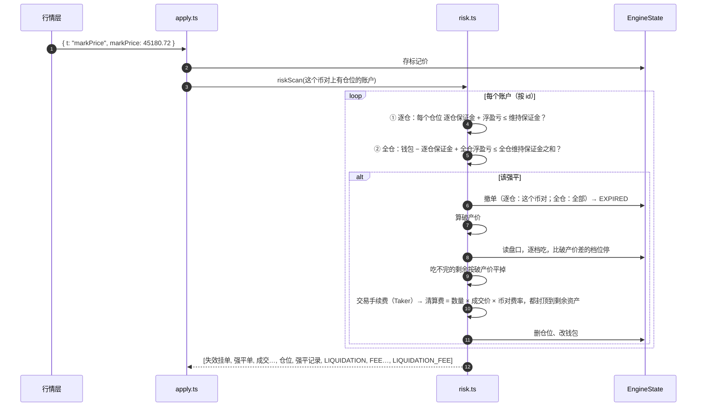

# 07 · 搭建教程：风控与强平

> 前几讲引擎只会"开仓、平仓、挂单"。这一讲处理最刺痛用户的那件事：**钱不够了，系统替你平仓**。
> 强平是用户最容易质疑"你们是不是算错了"的地方，所以每一步都按币安核对过，每一个数字都能手算复现。

**这一讲结束时你会有什么**：

- `packages/engine/src/risk.ts`：
  - `riskScan()`：对一批账户扫描，逐仓一个一个判、全仓整户判
  - `liquidatePosition()`：平掉一个仓位——撤单 → 强平单逐档吃盘口（比破产价差的不吃）→ 剩余按破产价平掉 → 收交易手续费和清算费
- `apply.ts`：标记价更新后、`trade` 和 `placeOrder` 产生成交后跑扫描
- `packages/shared` 的订单类型加了 `LIQUIDATION`；清算费率从全局 0.5% 改成按币对（`SymbolSpec.liquidationFeeRate`，BTC 1.25%）
- `execute-order.ts`：成交改变仓位后，重算同币对其它挂单的冻结保证金（缺口 #23）
- 测试脚手架：不变式 ③ 收窄（缺口 #19），新增不变式 ⑨"不能留下该强平没强平的仓位"
- 20 条新测试，引擎共 243 条全绿

**先读**：`docs/design/04-backend-design.md` 第 8 节（风控与强平，**注意末尾的"已定"注释，改了原设计四处**）、4.5 / 4.6 节（维持保证金、强平价）；`01-domain-knowledge.md` 第六、七节；`docs/design/07-binance-reference.md` 第 8 节（这一讲核对的币安规则）。

> **代码已经在仓库里了**：AI 写代码和讲义，你对照着读。代码块用脚本从源文件截取，和仓库逐字一致（只去掉公共缩进）。

---

## 第 1 节：一张图看懂强平



---

## 第 2 节：这一讲定下来的事

先说原设计和币安对不上的地方——这一讲大部分决定都来自核对币安 FAQ "Binance Futures Liquidation Protocols"、"What Is Auto-Deleveraging (ADL)"、"What Fees are Generated in Binance Futures Trading?"（2026-01 更新），以及 `GET /fapi/v1/exchangeInfo`。

| # | 决定 | 依据 |
| --- | --- | --- |
| 1 | **强平单吃盘口，吃不完按破产价平**，不按标记价平 | **你定的**。币安的强平单是限价 = 破产价的 IOC 单，打进真实市场；吃不完的是"破产仓位"，保险基金按破产价接管。我们没有保险基金，但对用户来说结果一样。原设计"全部按标记价平"的成交价不是任何真实可成交的价格 |
| 2 | **不做部分强平**，整个仓位一次平掉 | **你定的**。币安 Smart Liquidation 会"保证金够了就停"，但那张 IOC 单多大文档没说，我们不编 |
| 3 | **清算费按币对，BTC 1.25%**，不是 0.5% | 币安 exchangeInfo 每个币对有 `liquidationFee`（我们开放的 20 个币对是 1.25% 或 1.5%）。原设计说"币安把清算成本包在 MMR 里"是错的，币安本身就单收 |
| 4 | 清算费 = 成交数量 × **成交价** × 币对费率，**最多扣到剩余资产为 0**；有剩余按破产价接管就不收 | 币安费用 FAQ："Notional Value = Number of Contracts × Trade Price"；"从维持仓位的资产里扣……除非是破产仓位"；小仓位"进入强平就会变成破产仓位"。扣到 0 为止你确认过 |
| 5 | **全仓权益 = 钱包 − 逐仓保证金 + 全仓浮盈亏** | 缺口 #6 定了逐仓保证金留在钱包里；原设计的"钱包 + 所有仓位浮盈亏"会拿逐仓的钱给全仓兜底。币安是 `crossWalletBalance + crossUnPnl` |
| 6 | 撤单：全仓撤账户**所有**挂单，逐仓撤账户在**这个币对**上的挂单；状态 `EXPIRED` | 币安 FAQ 原文；币安订单到期原因 5 "Order has expired when the account was liquidated"。原设计是"该币对该方向"、`CANCELED` |
| 7 | 强平生成一张 `type = LIQUIDATION` 的订单，`clientOrderId = autoclose-<ts>` | 币安有同样的订单类型和前缀；`fills.order_id` 是非空外键，有了它才有得引用（缺口 #7） |
| 8 | 权益**恰好等于**维持保证金也强平 | 币安 FAQ 三种说法里"保证金率达到 100%""标记价触及强平价"都包含等于 |
| 9 | **强平成交收交易手续费**：吃盘口的每笔按 Taker 收，按破产价接管的部分不收。扣费顺序 已实现盈亏 → 手续费 → 清算费，每项最多扣到 0。流水：`LIQUIDATION` → `FEE`（每笔成交一条）→ `LIQUIDATION_FEE` | **你定的**；币安费用 FAQ：Commission Fee "Incurred every time an order is executed"。Taker 角色、先手续费后清算费是我们的判断 |
| 10 | 先逐仓、后全仓 | 逐仓强平最多亏掉那笔逐仓保证金，而这笔钱本来就不算在全仓权益里，所以逐仓强平不会把全仓推下线；反过来不成立 |
| 11 | 扫描时机：`markPrice` 之后扫这个币对上有仓位的账户；`trade`、`placeOrder` 有成交之后扫成交的账户 | 设计文档第 8 节"检测时机"；资金费结算后扫描是第 08 讲 |
| 12 | 缺口 #19：不变式 ③ 收窄，新增 ⑨ | 第 8 节 |
| 13 | 缺口 #23：仓位变化后重算其它挂单的冻结保证金 | 第 6 节 |

顺带发现（缺口 #24）：`01-domain-knowledge.md` 算例 B 的强平价 54,780.88 用的是第 1 层 0.4%，但 54,780 的名义价值已经在第 2 层了，真实强平价是 **54,776.12**。第 03 讲的公式测试把分层直接传进去，所以没发现；这一讲风控按名义价值查层，测试一跑就对不上。

数据库要跟进（缺口 #25，你来写）：`order_type` 枚举加 `LIQUIDATION`；`symbols` 表加 `liquidation_fee`。

---

## 第 3 节：什么时候该强平

```ts
function scanAccount(state: EngineState, accountId: string, ts: number): EngineEvent[] {
  if (!state.accounts.has(accountId)) return [];
  const events: EngineEvent[] = [];

  // ① 逐仓：一个一个判。先做逐仓：逐仓强平只会让全仓钱包余额变多或不变（亏损上限就是那笔逐仓保证金，
  //    平完之后这笔保证金从"锁定"里释放），不会把全仓推下线
  for (const { symbol, positionSide } of sortedPositions(
    state,
    (p) => p.accountId === accountId && p.marginMode === "ISOLATED",
  )) {
    const position = state.positions.get(positionKey(accountId, symbol, positionSide));
    const mark = state.marks.get(symbol)?.markPrice;
    // 没有标记价就不知道仓位值多少——不知道就不强平，而不是拿 0 顶替
    if (!position || mark === undefined) continue;
    const equity = position.isolatedMargin + unrealizedPnl(position, mark);
    const mm = positionMaintMargin(state, position, mark);
    if (equity > mm) continue;

    events.push(...expireOrders(state, (o) => o.accountId === accountId && o.symbol === symbol, ts));
    events.push(...liquidatePosition(state, position, mark, { marginBalanceBefore: equity, maintMarginAt: mm }, ts));
  }

  // ② 全仓：整户判
  const cross = sortedPositions(state, (p) => p.accountId === accountId && p.marginMode === "CROSS");
  if (cross.length === 0) return events;
  let crossMaintMargin = 0n;
  let crossUnrealizedPnl = 0n;
  for (const position of cross) {
    const mark = state.marks.get(position.symbol)?.markPrice;
    if (mark === undefined) return events; // 有一个全仓仓位缺标记价，整户都算不出来
    crossMaintMargin += positionMaintMargin(state, position, mark);
    crossUnrealizedPnl += unrealizedPnl(position, mark);
  }
  const crossEquity = crossWalletBalance(state, accountId) + crossUnrealizedPnl;
  if (crossEquity > crossMaintMargin) return events;

  events.push(...expireOrders(state, (o) => o.accountId === accountId, ts));
  const forensic = { marginBalanceBefore: crossEquity, maintMarginAt: crossMaintMargin };
  for (const { symbol, positionSide } of cross) {
    // 按币对、方向的顺序一个一个平：前一个平掉之后钱包变了，后一个的破产价要用新的钱包余额算
    const position = state.positions.get(positionKey(accountId, symbol, positionSide))!;
    events.push(...liquidatePosition(state, position, state.marks.get(symbol)!.markPrice, forensic, ts));
  }
  return events;
}
```

两种判法：

| | 权益 | 维持保证金 |
| --- | --- | --- |
| 逐仓（每个仓位） | 逐仓保证金 + 这个仓位的浮盈亏 | 这个仓位的 |
| 全仓（整户） | 全仓钱包余额 + 所有全仓仓位的浮盈亏 | 所有全仓仓位的之和 |

维持保证金按**标记价**算名义价值，再去分层表查这个名义价值在哪一层：

```ts
export function positionMaintMargin(state: EngineState, position: Readonly<Position>, markPrice: Fixed): Fixed {
  const value = notional(position.qty, markPrice);
  return maintMargin(value, findBracket(state.brackets.get(position.symbol)!, value));
}
```

```ts
export function crossWalletBalance(state: EngineState, accountId: string): Fixed {
  let isolated = 0n;
  for (const position of state.positions.values()) {
    if (position.accountId === accountId && position.marginMode === "ISOLATED") isolated += position.isolatedMargin;
  }
  return state.accounts.get(accountId)!.walletBalance - isolated;
}
```

**全仓钱包为什么要减逐仓保证金**：第 03 讲定过（缺口 #6），开逐仓不从钱包里扣钱，只是把一部分标成"锁定"。钱包 10,000 里有 5,000 锁在逐仓仓位上，全仓能用的只有另外 5,000。不减的话，全仓仓位亏到 −9,000 都不会强平——拿的是逐仓那 5,000 在兜底，逐仓仓位"亏光只亏逐仓保证金"的承诺就破了。测试里专门有一条："钱包 10,000 里 5,000 锁在逐仓空头上，全仓多头按剩下的 5,000 判"。

缺标记价时**不强平**：不知道仓位值多少，就不知道该不该平，不拿 0 顶替。

---

## 第 4 节：破产价——强平单的底线

**破产价**是保证金余额正好归零的价格（币安 ADL FAQ 原文："the price at which the margin balance of the liquidated user is equal to zero"）。币安的强平单就用它做限价。

```
多头：可用资产 + (破产价 − 开仓价) × 数量 = 0   →   破产价 = 开仓价 − 可用资产 ÷ 数量
空头：可用资产 + (开仓价 − 破产价) × 数量 = 0   →   破产价 = 开仓价 + 可用资产 ÷ 数量
```

"可用资产"不含这个仓位自己的浮盈亏：逐仓就是逐仓保证金；全仓是全仓钱包 + 其它全仓仓位的浮盈亏。

```ts
function liquidatePosition(
  state: EngineState,
  position: Readonly<Position>,
  markPrice: Fixed,
  forensic: Forensic,
  ts: number,
): EngineEvent[] {
  const account = state.accounts.get(position.accountId)!;
  const spec = requireSymbol(state, position.symbol);
  const isLong = position.positionSide === "LONG";
  const isolated = position.marginMode === "ISOLATED";

  // 这个仓位能动用的资产，不含它自己的未实现盈亏：
  // 逐仓 = 自己的逐仓保证金；全仓 = 全仓钱包余额 + 其它全仓仓位按标记价的未实现盈亏
  let assets = isolated ? position.isolatedMargin : crossWalletBalance(state, account.id);
  if (!isolated) {
    for (const other of state.positions.values()) {
      if (other === position || other.accountId !== account.id || other.marginMode !== "CROSS") continue;
      assets += unrealizedPnl(other, state.marks.get(other.symbol)!.markPrice);
    }
  }

  // 破产价：保证金余额正好归零的价格（币安 ADL FAQ："the price at which the margin balance of the liquidated user is equal to zero"）
  //   多：资产 + (破产价 − 开仓价) × 数量 = 0 → 破产价 = 开仓价 − 资产 ÷ 数量；空头方向相反
  const offset = divRound(assets, position.qty);
  const bankruptcyPrice = isLong ? position.entryPrice - offset : position.entryPrice + offset;
```

**和强平价的区别**：强平价是"该开始平了"的价格（权益 = 维持保证金），破产价是"再差就要倒贴"的价格（权益 = 0）。10x 逐仓多 1 @ 50,000：强平价 45,180.72，破产价 45,000。中间那 180 多 USDT 就是维持保证金，用来吸收强平过程中的滑点和清算费。

---

## 第 5 节：强平单怎么成交

```ts
// ② 强平单 = 限价破产价的 IOC：多头往买盘卖，空头从卖盘买，比破产价差的档位不吃
const book = state.books.get(position.symbol);
const levels = book ? (isLong ? book.bids : book.asks) : [];
const fills: LiquidationFill[] = [];
let remaining = position.qty;
const close = (price: Fixed, qty: Fixed, fee: Fixed) => {
  const { realizedPnl } = reducePosition(position.positionSide, remaining, position.entryPrice, 0n, qty, price);
  fills.push({ price, qty, realizedPnl, fee });
  remaining -= qty;
};
for (const level of levels) {
  if (remaining === 0n) break;
  if (isLong ? level.price < bankruptcyPrice : level.price > bankruptcyPrice) break;
  const qty = remaining < level.qty ? remaining : level.qty;
  close(level.price, qty, tradingFeeOf(qty, level.price, "TAKER", state.config.fees));
}

// ③ 吃不完的剩余：按破产价平掉（币安由保险基金按破产价接管）
let bankrupt = false;
if (remaining > 0n && bankruptcyPrice > 0n) {
  close(bankruptcyPrice, remaining, 0n); // 接管不是市场成交，不收交易手续费
  bankrupt = true;
}
// 破产价 ≤ 0 只可能出现在全仓、而且其它仓位的维持保证金远大于这个仓位的时候：这个仓位本身离破产还远，
// 按一个不存在的价格"接管"是编数字。吃不完的留在仓位里，下一次扫描接着平

let realizedPnl = fills.reduce((sum, f) => sum + f.realizedPnl, 0n);
// 舍入尾差：已实现盈亏逐笔向下取整，吃到正好等于破产价的档位时，资产可能被多扣几个 1e-8。
// 这个仓位的亏损上限就是它能动用的资产（穿仓部分币安由保险基金承担，我们不追偿，失真点 #6），补回到正好归零
if (fills.length > 0 && assets + realizedPnl < 0n) {
  const shortfall = -(assets + realizedPnl);
  fills[fills.length - 1]!.realizedPnl += shortfall;
  realizedPnl += shortfall;
  bankrupt = true;
}

const closedQty = position.qty - remaining;
if (closedQty === 0n) return []; // 盘口一档都吃不到、破产价又 ≤ 0：这次什么都做不了

// ④ 扣费：已实现盈亏之后剩下的资产，先交交易手续费、再交清算费，每一项最多扣到 0
//    "剩下的资产"不算其它全仓仓位的浮盈——浮盈还没落袋，不能拿来交费
let assetsLeft = (isolated ? position.isolatedMargin : crossWalletBalance(state, account.id)) + realizedPnl;
if (assetsLeft < 0n) assetsLeft = 0n;
// 交易手续费：逐笔应收；总额超过剩余资产时，从最后一笔往前少收，保证每笔成交记录上的手续费加起来等于实收
let feeShortfall = fills.reduce((sum, f) => sum + f.fee, 0n) - assetsLeft;
for (let i = fills.length - 1; i >= 0 && feeShortfall > 0n; i--) {
  const cut = fills[i]!.fee < feeShortfall ? fills[i]!.fee : feeShortfall;
  fills[i]!.fee -= cut;
  feeShortfall -= cut;
}
const tradingFee = fills.reduce((sum, f) => sum + f.fee, 0n);
assetsLeft -= tradingFee;
// 清算费：按成交的名义价值（数量 × 成交价）收；破产仓位不收。
// 币安 FAQ："小仓位的维持保证金率可能低于清算费率，进入强平时就会变成破产仓位"——剩余资产不够交清算费时扣到 0 为止
const feeDue = mulCeil(
  fills.reduce((sum, f) => sum + notional(f.qty, f.price), 0n),
  spec.liquidationFeeRate,
);
const liquidationFee = bankrupt ? 0n : feeDue < assetsLeft ? feeDue : assetsLeft;
```

按顺序：

1. **逐档吃**：多头往买盘卖（从买一往下），空头从卖盘买（从卖一往上）。比破产价差的档位停下——再往下吃，用户就要倒贴钱了
2. **吃不完的剩余按破产价平**：币安这部分由保险基金按破产价接管，用户这部分保证金亏光。标记为 `bankrupt`
3. **舍入尾差**：已实现盈亏逐笔向下取整（第 05 讲），吃到正好等于破产价的档位时，可能多扣几个 1e-8，让资产变成 −0.00000002。补回到正好归零，算破产——亏损上限就是能动用的资产（失真点 #6 穿仓不追偿）
4. **交易手续费**：吃盘口的每笔按 Taker 应收；总额超过剩余资产时从最后一笔往前少收，保证成交记录上的手续费加起来等于实收
5. **清算费**：应收 = 成交数量 × 成交价 × 币对费率；破产仓位不收；否则最多收到交完手续费后的剩余资产为 0

**关于破产价 ≤ 0**：只可能出现在全仓、而且这个仓位很小、其它仓位的维持保证金很大的时候——这个仓位本身离破产还很远。这时候按"破产价"接管剩余是按一个不存在的价格成交，所以吃不完的留在仓位里，强平单状态 `EXPIRED`，下一次扫描接着平。

**清算费经常被封顶**：币安 FAQ 专门提醒过，小仓位的维持保证金率（BTC 第 1 层 0.4%）低于清算费率（1.25%），强平时剩下的资产根本不够交清算费——所以 10x 逐仓强平的结果通常就是"逐仓保证金全部亏光"。这就是"爆仓比自己平仓亏得多"。

---

## 第 6 节：事件和状态

```ts
  // ── 改状态 ──
  const id = `liq:${position.accountId}:${position.symbol}:${position.positionSide}:${ts}`;
  const released = isolated && remaining === 0n ? position.isolatedMargin : 0n;
  const updatedPosition: Position = {
    ...position,
    qty: remaining,
    isolatedMargin: position.isolatedMargin - released,
    updatedAt: ts,
  };
  if (remaining === 0n) {
    removePosition(state, positionKey(position.accountId, position.symbol, position.positionSide));
  } else {
    putPosition(state, updatedPosition);
  }
  const walletBalance = account.walletBalance + realizedPnl - tradingFee - liquidationFee;
  putAccount(state, { ...account, walletBalance });

  // ── 事件：订单 → 成交 → 仓位 → 强平记录 → 流水（LIQUIDATION → FEE… → LIQUIDATION_FEE） ──
  const hedge = account.positionMode === "HEDGE";
  const notionalSum = fills.reduce((sum, f) => sum + notional(f.qty, f.price), 0n);
  const order: Order = {
    id,
    clientOrderId: `autoclose-${ts}`, // 币安强平单的 clientOrderId 以 "autoclose-" 开头
    accountId: position.accountId,
    symbol: position.symbol,
    side: isLong ? "SELL" : "BUY",
    positionSide: hedge ? position.positionSide : "BOTH",
    type: "LIQUIDATION",
    timeInForce: "IOC",
    price: bankruptcyPrice,
    stopPrice: null,
    workingType: "MARK_PRICE",
    qty: position.qty,
    executedQty: closedQty,
    avgPrice: divRound(notionalSum, closedQty),
    reduceOnly: !hedge, // 双向模式不能带 reduceOnly（第 04 讲），平仓方向本身就是减仓
    closePosition: false,
    status: remaining === 0n ? "FILLED" : "EXPIRED",
    triggered: false,
    queueAhead: 0n,
    queueEstimated: false,
    frozenMargin: 0n,
    rejectReason: remaining === 0n ? null : `盘口可成交量不足，剩余 ${remaining} 留待下次强平`,
    createdAt: ts,
    updatedAt: ts,
  };
  const record: LiquidationRecord = {
    id,
    accountId: position.accountId,
    symbol: position.symbol,
    positionSide: position.positionSide,
    marginMode: position.marginMode,
    qty: closedQty,
    entryPrice: position.entryPrice,
    markPrice,
    realizedPnl,
    liquidationFee,
    marginBalanceBefore: forensic.marginBalanceBefore,
    maintMarginAt: forensic.maintMarginAt,
    ts,
  };
  const events: EngineEvent[] = [{ t: "orderUpdate", order }];
  fills.forEach((f, i) => {
    const fill: Fill = {
      id: `${id}:${i + 1}`,
      orderId: id,
      accountId: position.accountId,
      symbol: position.symbol,
      side: order.side,
      positionSide: order.positionSide,
      price: f.price,
      qty: f.qty,
      role: "TAKER",
      fee: f.fee, // Taker 手续费（剩余资产不够时少收）；按破产价接管的那笔为 0
      realizedPnl: f.realizedPnl,
      isLiquidation: true,
      ts,
    };
    events.push({ t: "fill", fill });
  });
  events.push({ t: "positionUpdate", position: updatedPosition });
  events.push({ t: "liquidation", record });

  const ref = { type: "liquidation" as const, id };
  let balance = account.walletBalance;
  if (realizedPnl !== 0n) {
    balance += realizedPnl;
    events.push({
      t: "balanceUpdate",
      accountId: account.id,
      walletBalance: balance,
      delta: realizedPnl,
      reason: "LIQUIDATION",
      symbol: position.symbol,
      ref,
      ts,
    });
  }
  fills.forEach((f, i) => {
    if (f.fee === 0n) return;
    balance -= f.fee;
    events.push({
      t: "balanceUpdate",
      accountId: account.id,
      walletBalance: balance,
      delta: -f.fee,
      reason: "FEE",
      symbol: position.symbol,
      ref: { type: "fill", id: `${id}:${i + 1}` },
      ts,
    });
  });
  if (liquidationFee > 0n) {
    balance -= liquidationFee;
    events.push({
      t: "balanceUpdate",
      accountId: account.id,
      walletBalance: balance,
      delta: -liquidationFee,
      reason: "LIQUIDATION_FEE",
      symbol: position.symbol,
      ref,
      ts,
    });
  }
  return events;
}
```

事件顺序：

```
失效的挂单 orderUpdate(EXPIRED)…     ← 撤单在最前（scanAccount 里）
强平单 orderUpdate(FILLED)            ← fills.order_id 外键要先有订单
fill…                                 ← isLiquidation = true, fee = Taker 手续费（接管的那笔为 0）
positionUpdate(qty = 0)
liquidation                           ← 强平记录，流水的 ref 指向它
balanceUpdate(LIQUIDATION)            ← 已实现盈亏
balanceUpdate(FEE)…                   ← 每笔成交的手续费，ref 指向成交
balanceUpdate(LIQUIDATION_FEE)        ← 清算费
```

强平记录里的 `marginBalanceBefore` / `maintMarginAt` 是**取证字段**（`packages/db/src/schema/liquidations.ts` 的注释）：用户质疑"我不该被强平"时，把这两个数摆出来。全仓强平时它们是整户的值。

### 缺口 #23：仓位变了，其它挂单的冻结保证金跟着变

```ts
export function refreshFrozenMargins(state: EngineState, current: Readonly<Order>, ts: number): EngineEvent[] {
  const events: EngineEvent[] = [];
  const others = sortedOrders(
    state,
    (o) => o.accountId === current.accountId && o.symbol === current.symbol && o.id !== current.id && o.price !== null,
  );
  for (const order of others) {
    // 未触发的触发单不冻结保证金（第 09 讲），不参与
    if (order.type !== "LIMIT" && !order.triggered) continue;
    const next = restingFrozenMargin(state, order, order.qty - order.executedQty);
    if (next === order.frozenMargin) continue;
    const updated: Order = { ...order, frozenMargin: next, updatedAt: ts };
    putOrder(state, updated);
    events.push({ t: "orderUpdate", order: updated });
  }
  return events;
}
```

在 `executeOrder`（有成交时）和 `fillResting`（Maker 成交后）的末尾调用。算例：持多 1、挂卖 2 @ 51,000（20x）只冻结"开空 1"的 2,575.5；市价平掉多头之后，这张卖单全成交会开空 2，冻结变成 5,151，发一条 `orderUpdate`。

重算后可用余额可能变负——挂单不撤。强平只看维持保证金，可用余额为负只意味着开不了新仓。

---

## 第 7 节：接进 `apply.ts`

```ts
function applyMarkPrice(state: EngineState, input: InputOf<"markPrice">): EngineEvent[] {
  requireSymbol(state, input.symbol);
  state.marks.set(input.symbol, {
    markPrice: input.markPrice,
    fundingRate: input.fundingRate,
    nextFundingTs: input.nextFundingTs,
    ts: input.ts,
  });
  // 5.2 节：① 更新标记价 ② 未实现盈亏是现算的，不用存 ③ 触发单（第 09 讲）④ 风控扫描：这个币对上有仓位的账户
  return riskScan(state, accountsHolding(state, input.symbol), input.ts);
}
```

```ts
function applyTrade(state: EngineState, input: InputOf<"trade">): EngineEvent[] {
  requireSymbol(state, input.symbol);
  // 5.2 节：① 更新最新价 ② 消耗挂单队列、轮到的按挂单价成交并落账 ④ 有成交的账户跑风控扫描
  state.lastPrices.set(input.symbol, input.price);
  const events = matchTrade(state, input);
  return [...events, ...riskScan(state, filledAccounts(events), input.ts)];
}
```

`placeOrder` 末尾同理：`executeOrder` 产生成交就扫描成交的账户。

**风控扫描对 undo 日志透明**：`risk.ts` 里所有修改都走 `putAccount` / `removePosition` / `removeOrder`，宿主落库失败回滚时，强平一起撤回。测试脚手架每次 `apply` 都真的回滚一次比对。

---

## 第 8 节：不变式 ③ 收窄、新增 ⑨（缺口 #19）

第 03 讲写的 ③"可用余额 ≥ 0"在第 05 讲就发现有问题：标记价往不利方向走，全仓仓位的浮亏会让可用余额在强平之前就变负——这是正常状态，币安也一样（强平线是维持保证金，不是可用余额）。

它真正要守的是：**下单校验不能放过保证金不够的单**。所以改成：

```ts
function availableScopeOf(
  input: EngineInput,
  out: readonly EngineEvent[],
  before: EngineSnapshot,
  marks: ReadonlyMap<string, Fixed>,
): ReadonlySet<string> {
  if (input.t !== "placeOrder" || out.some((e) => e.t === "rejected")) return new Set();
  const account = before.accounts.find((a) => a.id === input.accountId);
  if (!account) return new Set();
  let crossUnrealizedPnlSum = 0n;
  let crossInitialMarginSum = 0n;
  let isolatedMarginSum = 0n;
  for (const p of before.positions) {
    if (p.accountId !== account.id) continue;
    if (p.marginMode === "ISOLATED") {
      isolatedMarginSum += p.isolatedMargin;
      continue;
    }
    const mark = marks.get(p.symbol);
    if (mark === undefined) return new Set();
    crossUnrealizedPnlSum += unrealizedPnl(p, mark);
    crossInitialMarginSum += initialMargin(p.qty, p.entryPrice, p.leverageNum);
  }
  const frozenMarginSum = before.orders.filter((o) => o.accountId === account.id).reduce((s, o) => s + o.frozenMargin, 0n);
  const available = availableBalance({
    walletBalance: account.walletBalance,
    crossUnrealizedPnlSum,
    crossInitialMarginSum,
    isolatedMarginSum,
    frozenMarginSum,
  });
  return available >= 0n ? new Set([account.id]) : new Set();
}
```

同时加一条更有用的 ⑨：**每次 `apply` 之后，不能留下"权益 ≤ 维持保证金"却没被强平的仓位**。它抓两类 bug：漏了某个输入之后的扫描；判定条件写错。第 9 节算例 ④ 的测试第一次写的时候就被 ⑨ 抓到过一次——测试先装进一个已经该强平的仓位，再喂盘口，⑨ 当场报错（盘口更新不扫描），这是测试写法的问题，调整了顺序。

---

## 第 9 节：算例

**① 逐仓多头（`01` 第六节算例 A）**：10x 逐仓市价开多 1 @ 50,000，钱包 9,975，逐仓保证金 5,000

```
标记价 45,180.73：权益 5,000 − 4,819.27 = 180.73 > 维持保证金 45,180.73 × 0.4% = 180.72292  → 不强平
标记价 45,180.72：权益 180.72 ≤ 180.72288                                                 → 强平
破产价 = 50,000 − 5,000 ÷ 1 = 45,000
```

| 盘口买盘 | 成交 | 已实现 | 清算费 | 钱包 |
| --- | --- | --- | --- | --- |
| 45,170 × 5 | 1 @ 45,170 | −4,830 | 手续费 22.585；清算费应收 564.625，剩 147.415 全收 | **4,975** |
| 45,170 × 0.4、45,100 × 0.3、44,900 × 5 | 0.4 @ 45,170、0.3 @ 45,100、0.3 @ 破产价 45,000（44,900 不吃） | −1,932 − 1,470 − 1,500 = −4,902 | 手续费 9.034 + 6.765（接管部分不收）；破产仓位，清算费不收 | 5,057.201 |
| 49,000 × 5，标记价跳空到 44,000 | 1 @ 49,000 | −1,000 | 手续费 24.5；清算费按**成交价** 49,000 × 1.25% = 612.5，剩余够 | 8,338 |
| 45,010 × 5 | 1 @ 45,010 | −4,990 | 剩 10：手续费应收 22.505 只收 10；清算费 0 | 4,975 |

第一行就是 06-testing-design"逐仓爆仓只亏 isolatedMargin，钱包不倒扣"：9,975 → 4,975，正好少 5,000。最后一行是"剩余资产连手续费都不够"：费用扣到 0 为止，不倒扣。

**② 逐仓空头（缺口 #24）**：市价开空 1 @ 50,000

```
第 2 层 mmr 0.5%、cum 50：5,000 + 50,000 − M = 0.005 M − 50 → M = 55,050 ÷ 1.005 = 54,776.119…
54,776.11 不强平，54,776.12 强平；破产价 55,000
卖盘 54,790 × 5 → 1 @ 54,790，已实现 −4,790，剩余 210：手续费 27.395，其余 182.605 交清算费 → 钱包 4,975
```

**③ 全仓多头**：10x 全仓市价开多 1 @ 50,000，钱包 9,975

```
权益 9,975 + (M − 50,000) ≤ 0.004 M → M ≤ 40,025 ÷ 0.996 = 40,185.7429…
40,185.75 不强平，40,185.74 强平；破产价 = 50,000 − 9,975 = 40,025

买盘 40,100 × 0.5：0.5 @ 40,100（−4,950）+ 0.5 @ 40,025（−4,987.5）= −9,937.5；手续费 10.025（接管部分不收），破产不收清算费，钱包 27.475
买盘只有 39,000，标记价跳空到 39,000：1 @ 破产价 40,025，−9,975，钱包 0 ★ 余额归零不为负
  强平记录 marginBalanceBefore = −1,025：强平前一刻已经穿仓
```

**④ 边界**：逐仓多 1 @ 54,800、保证金 5,000，标记价 50,000 → 权益 200、维持保证金 50,000 × 0.4% = 200，**相等也强平**。

**⑤ 全仓减逐仓保证金**：双向模式，钱包 10,000；全仓多 1 @ 50,000；逐仓空 1 @ 50,000、保证金 5,000。标记价 45,180.72：全仓权益 (10,000 − 5,000) − 4,819.28 = 180.72 ≤ 180.72288 → 全仓多头强平；逐仓空头在赚钱，不动。

---

## 第 10 节：测试怎么组织

| 文件 | 新增 | 测什么 |
| --- | --- | --- |
| `risk.test.ts` | 17 | 第 9 节全部算例、撤单范围、双向模式强平单、缺口 #23、`LIQUIDATION` 不能手动下 |
| `testing/invariants.test.ts` | 3 | ③ 的范围、⑨ 逐仓和全仓 |

06-testing-design 第 3 节"风控"四条：强平价前一档不强平（①③ 各一条）、触及强平价强平、逐仓只亏 isolatedMargin（① 第一行）、全仓余额归零不为负（③ 跳空那条）。

**故意改错跑一遍**，五处都要有测试变红：

| 改法 | 红几条 |
| --- | --- |
| 触发条件 `≤` 改成 `<` | 1（算例 ④） |
| 清算费不封顶 | 4 |
| 强平前不撤单 | 2 |
| 破产价限价不生效（吃所有档位） | 2 |
| 全仓钱包不减逐仓保证金 | 1（算例 ⑤） |

第一版测试写完时，第一处和最后一处改错之后**测试全绿**——说明没测到。补了算例 ④ ⑤ 才抓住。

---

## 验收清单

- [ ] `pnpm --filter @binance-contract-trading-full-stack/engine test` 全绿（243 条）
- [ ] `pnpm --filter @binance-contract-trading-full-stack/shared test` 全绿（34 条）
- [ ] `engine` / `shared` / `db` / `server` 四个包 `check-types` 通过
- [ ] 逐仓多：45,180.73 不强平、45,180.72 强平；手续费 22.585、清算费 147.415，钱包 9,975 → 4,975
- [ ] 盘口吃不完：44,900 那档不吃，剩余 0.3 @ 45,000，接管部分不收手续费，不收清算费
- [ ] 跳空：清算费按成交价 49,000 算（612.5），不是标记价
- [ ] 剩余资产不够交手续费：扣到 0 为止
- [ ] 全仓多：跳空到 39,000，钱包归零不为负
- [ ] 逐仓空：54,776.12 强平（不是文档里的 54,780.88）
- [ ] 权益正好等于维持保证金也强平
- [ ] 持多 1 挂卖 2，平掉多头后冻结从 2,575.5 变 5,151
- [ ] `purity.test.ts` 依然全绿

全部打勾，进第 08 讲：资金费与账户操作。

---

## 读完可以自测

1. 强平价和破产价差在哪？为什么强平单用破产价做限价，而不是强平价？
2. 10x 逐仓强平之后，为什么钱包通常正好少了整笔逐仓保证金，一分不多一分不少？
3. 钱包 10,000、5,000 锁在逐仓仓位上。如果全仓判定时不减这 5,000，会发生什么？
4. 盘口吃不完的剩余按破产价平掉，用户这部分亏多少？为什么这部分不收交易手续费、整单也不收清算费？
5. 为什么先扫逐仓、再扫全仓？反过来会有什么问题？
6. 可用余额变成负数了，但没有强平。这是 bug 吗？不变式 ③ 为什么要改？
7. 持多 1、挂卖 2 的限价单。多头被市价平掉之后，如果不重算这张挂单的冻结保证金，用户能多做什么？
8. 算例 B 的 54,780.88 为什么是错的？第 03 讲的测试为什么没发现？
