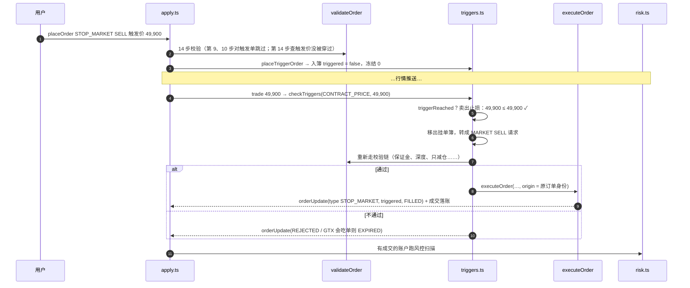

# 09 · 搭建教程：触发单与只减仓

> 引擎内核的最后一讲。止损 / 止盈单是用户给自己设的防线：价格走到某个点，系统替你下单。
> 它难在两个地方——**方向**（止损买是涨上去触发，止盈买是跌下来触发，搞反了只有真触发时才暴露），
> 和**时机**（触发那一刻账户状态可能和下单时完全不同，要重新校验）。

**这一讲结束时你会有什么**：

- `packages/engine/src/triggers.ts`：
  - `placeTriggerOrder()`：触发单下单入簿，不冻结保证金、不排队
  - `checkTriggers()`：标记价 / 最新价推送时检查
  - `fireTrigger()`：触发那一刻转成市价 / 限价单，重新走校验链再成交
- 校验链第 14 步：触发价下单时已经被穿过就拒单（缺口 #15）、条件单合计上限
- `executeOrder` 加了第 4 个参数 `origin`，触发后的订单保留原来的身份
- `packages/shared` 新错误码 `WOULD_IMMEDIATELY_TRIGGER`
- 18 条新测试，引擎共 284 条全绿。**引擎内核（第 02–09 讲）全部完成**

**先读**：`docs/design/04-backend-design.md` 第 7 节（触发单，**注意末尾的"已定"**）、第 3 节状态机；`01-domain-knowledge.md` 第十一节；`docs/design/07-binance-reference.md` 第 10 节。

> **代码已经在仓库里了**：AI 写代码和讲义，你对照着读。代码块用脚本从源文件截取，和仓库逐字一致（只去掉公共缩进）。

---

## 第 1 节：一张图看懂触发单



---

## 第 2 节：这一讲定下来的事

按币安 New Algo Order 接口说明核对（网页版，本地副本里只有参数表没有备注），出处写在 `07-binance-reference.md` 第 10 节。

| # | 决定 | 依据 |
| --- | --- | --- |
| 1 | 触发条件：STOP 买 ≥、卖 ≤；TAKE_PROFIT 买 ≤、卖 ≥；**恰好等于也触发** | 币安接口说明原文 |
| 2 | 价格按 `workingType` 取：MARK_PRICE 单在标记价推送时查，CONTRACT_PRICE（默认）单在行情成交推送时查 | 设计文档伪代码只写了标记价；默认值第 04 讲已按币安改成 CONTRACT_PRICE |
| 3 | 下单时触发价已经被穿过 → 拒单 `WOULD_IMMEDIATELY_TRIGGER`（缺口 #15） | 币安 -2021 / -4142 |
| 4 | 未触发的条件单**所有币对合计**最多 200 张 | 币安 2025-12-29 更新日志；-4045 |
| 5 | 未触发时不冻结保证金、不排队 | 币安；设计文档第 3 节 |
| 6 | 触发时转成 MARKET / LIMIT 请求，**重新走整条校验链** | 设计文档"触发瞬间才做保证金校验"；深度、只减仓等规则也要按当时状态算 |
| 7 | 触发时校验失败 → **`REJECTED`**；GTX 会吃单 → `EXPIRED`（缺口 #13） | 币安条件单状态 REJECTED："such as in scenarios of margin check failures"。设计文档原来写的 EXPIRED 不对 |
| 8 | closePosition 按触发那一刻的全部仓位平；单向模式转成只减仓 | 币安："If triggered, close all current long position (if SELL) or current short position (if BUY)" |
| 9 | 标记价推送：**先查触发单、再跑风控** | 设计文档 5.2 节；止损单要抢在强平之前 |
| 10 | 行情成交推送：先撮合挂单、再查触发单 | 触发出来的单是在这笔成交之后才进盘口的，不能吃到这笔成交 |
| 11 | 触发后沿用同一张订单（`triggered = true`，类型仍是 STOP…） | 我们的选择，币安是新开一张普通单（缺口 #29） |
| 12 | 没实现 `priceProtect`、止损限价单委托价上下限、`TRAILING_STOP_MARKET`、`GTD` | 缺口 #28，第 13 讲定 REST 参数时再决定 |

"只减仓"这一半在前几讲已经做完：下单时不能超过仓位（第 04 讲第 8 步）、成交时截断（第 05 讲缺口 #18）、仓位平完后残余只减仓单自动撤销（第 05 讲）。这一讲的 closePosition 触发单同样适用最后一条。

---

## 第 3 节：方向——一个函数管两处

```ts
export function triggerReached(type: OrderType, side: "BUY" | "SELL", stopPrice: Fixed, price: Fixed): boolean {
  const isStop = type === "STOP" || type === "STOP_MARKET";
  const risesTo = (side === "BUY") === isStop; // 止损买、止盈卖：价格涨到触发价
  return risesTo ? price >= stopPrice : price <= stopPrice;
}
```

用"涨到还是跌到"来记，别背四个组合：

| | 买 | 卖 |
| --- | --- | --- |
| **止损**（往不利方向走就认输） | 空头怕涨：**涨到**触发价买回 | 多头怕跌：**跌到**触发价卖出 |
| **止盈**（往有利方向走就落袋） | 空头盼跌：**跌到**触发价买回 | 多头盼涨：**涨到**触发价卖出 |

代码里 `risesTo = (side === "BUY") === isStop`：止损买、止盈卖是"涨到"。

**下单时（第 14 步）和触发时（`checkTriggers`）用的是同一个函数**。下单时"已经满足"就拒，触发时"满足了"就触发——两处判断不一致，就会出现"下单时说没穿过、下一笔行情立刻触发"或者"永远触发不了"。

测试里把这一行改反：22 条测试变红。

---

## 第 4 节：下单——校验链第 14 步

```ts
// ⑭ 触发单（第 09 讲）：
//    条件单总数上限——所有币对合计（币安 -4045 MAX_STOP_ORDER_EXCEEDED；上限 200 见 LimitConfig）
//    触发价下单时就已经被穿过 → 拒单（缺口 #15，币安 -2021 "Order would immediately trigger"）。
//    "现在的价格"按 workingType 取：MARK_PRICE 用标记价，CONTRACT_PRICE（默认）用最新成交价
if (isTrigger) {
  const maxConditional = state.config.limits.maxConditionalOrdersNum;
  const conditional = countConditionalOrders(state, accountId);
  if (conditional >= maxConditional) {
    return reject("TOO_MANY_ORDERS", `已有 ${conditional} 张未触发的条件单，达到所有币对合计上限 ${maxConditional} 张`);
  }
  const workingType = req.workingType ?? "CONTRACT_PRICE";
  const current = workingType === "MARK_PRICE" ? markPrice : state.lastPrices.get(req.symbol);
  if (current === undefined) {
    return reject("MARKET_NOT_READY", `${req.symbol} 还没有最新成交价，暂时无法判断触发价`);
  }
  if (triggerReached(req.type, req.side, req.stopPrice!, current)) {
    const priceName = workingType === "MARK_PRICE" ? "标记价" : "最新价";
    return reject(
      "WOULD_IMMEDIATELY_TRIGGER",
      `触发价 ${show(req.stopPrice!)} 已经被穿过（当前${priceName} ${show(current)}），下单会立刻触发`,
    );
  }
}

return {
```

第 9、10 步（杠杆分层、保证金）第 04 讲就对触发单跳过了：`if (openQty > 0n && !isTrigger)`。未触发的单不占保证金，校验放到触发那一刻。

"现在的价格"拿不到（还没收到过行情成交）时拒 `MARKET_NOT_READY`：不知道价格就判断不了会不会立刻触发，不拿 0 顶替。

入簿：

```ts
export function placeTriggerOrder(state: EngineState, input: PlaceOrderInput, validated: ValidatedOrder): EngineEvent[] {
  const { req } = input;
  const order: Order = {
    id: input.orderId,
    clientOrderId: req.clientOrderId,
    accountId: input.accountId,
    symbol: req.symbol,
    side: req.side,
    positionSide: req.positionSide,
    type: req.type,
    timeInForce: validated.timeInForce,
    price: req.price ?? null,
    stopPrice: req.stopPrice!,
    workingType: validated.workingType,
    qty: validated.qty, // closePosition 单为 0，触发时按仓位现算
    executedQty: 0n,
    avgPrice: 0n,
    reduceOnly: validated.reduceOnly,
    closePosition: validated.closePosition,
    status: "NEW",
    triggered: false,
    queueAhead: 0n,
    queueEstimated: false,
    frozenMargin: 0n, // 币安：条件单未触发时不占保证金
    rejectReason: null,
    createdAt: input.ts,
    updatedAt: input.ts,
  };
  putOrder(state, order);
  return [{ t: "orderUpdate", order }];
}
```

---

## 第 5 节：触发

```ts
export function checkTriggers(
  state: EngineState,
  symbol: string,
  workingType: WorkingType,
  price: Fixed,
  ts: number,
): EngineEvent[] {
  const events: EngineEvent[] = [];
  const candidates = sortedOrders(
    state,
    (o) => o.symbol === symbol && o.stopPrice !== null && !o.triggered && o.workingType === workingType,
  );
  for (const { id } of candidates) {
    // 重新取：前面触发的单成交后可能平掉了仓位，把这张只减仓类触发单连带撤掉了
    const order = state.orders.get(id);
    if (!order || !triggerReached(order.type, order.side, order.stopPrice!, price)) continue;
    events.push(...fireTrigger(state, order, ts));
  }
  return events;
}
```

```ts
function fireTrigger(state: EngineState, order: Readonly<Order>, ts: number): EngineEvent[] {
  const account = state.accounts.get(order.accountId)!;
  // 先移出挂单簿：重新校验时，第 13、14 步的挂单数、第 9 步的同方向挂单名义价值都不该把它自己算进去
  removeOrder(state, order.id);

  const isMarket = order.type === "STOP_MARKET" || order.type === "TAKE_PROFIT_MARKET";
  const hedge = account.positionMode === "HEDGE";
  let qty = order.qty;
  if (order.closePosition) {
    // 币安："If triggered, close all current long position (if SELL) or current short position (if BUY)"
    const { closeSide } = orderSides(account.positionMode, order);
    qty = state.positions.get(positionKey(order.accountId, order.symbol, closeSide))?.qty ?? 0n;
    if (qty === 0n) return [finish(order, "REJECTED", "触发时已经没有可以平的仓位", ts)];
  }

  const req: PlaceOrderRequest = {
    clientOrderId: order.clientOrderId,
    symbol: order.symbol,
    side: order.side,
    positionSide: order.positionSide,
    type: isMarket ? "MARKET" : "LIMIT",
    ...(isMarket ? {} : { price: order.price!, timeInForce: order.timeInForce }),
    qty,
    // 双向模式不能传 reduceOnly（第 04 讲）；单向模式 closePosition 转成只减仓
    ...(hedge ? {} : { reduceOnly: order.reduceOnly || order.closePosition }),
  };

  const validation = validateOrder(state, order.accountId, req);
  if (!validation.ok) {
    const status = validation.code === "POST_ONLY_REJECTED" ? "EXPIRED" : "REJECTED";
    return [finish(order, status, `触发时${validation.message}（${validation.code}）`, ts)];
  }

  return executeOrder(
    state,
    { t: "placeOrder", accountId: order.accountId, orderId: order.id, req, ts },
    validation.order,
    {
      type: order.type,
      stopPrice: order.stopPrice,
      workingType: order.workingType,
      createdAt: order.createdAt,
      closePosition: order.closePosition,
    },
  );
}
```

三个细节：

1. **先移出挂单簿再校验**。第 13 步（每币对挂单数）、第 14 步（条件单总数）、第 9 步（同方向开仓挂单的名义价值）都会遍历挂单簿，不移出就把自己也算进去了。移出之后校验失败也不用放回去——失败就是终态
2. **转换请求时双向模式不能带 `reduceOnly`**（第 04 讲第 3 步，币安 "Cannot be sent in Hedge Mode"）；单向模式 closePosition 转成只减仓
3. **失败的状态**：`POST_ONLY_REJECTED` → `EXPIRED`，其它 → `REJECTED`。原因写成 `触发时<校验链的中文提示>（<错误码>）`，用户能看到"为什么没成交"

### `executeOrder` 的 `origin`

```ts
export type OrderOrigin = Pick<Order, "type" | "stopPrice" | "workingType" | "createdAt" | "closePosition">;

export function executeOrder(
  state: EngineState,
  input: PlaceOrderInput,
  validated: ValidatedOrder,
  origin?: OrderOrigin,
): EngineEvent[] {
  const { req } = input;
  if (req.type !== "MARKET" && req.type !== "LIMIT") {
    throw new Error(`executeOrder 只处理 MARKET / LIMIT，触发单（${req.type}）要先经过 triggers.ts`);
  }

  const book = state.books.get(req.symbol)!; // 第 2 步保证了存在
  const levels = req.side === "BUY" ? book.asks : book.bids;
  const limitPrice = req.type === "LIMIT" ? req.price! : null;

  let order: Order = {
    id: input.orderId,
    clientOrderId: req.clientOrderId,
    accountId: input.accountId,
    symbol: req.symbol,
    side: req.side,
    positionSide: req.positionSide,
    type: origin?.type ?? req.type,
    timeInForce: validated.timeInForce,
    price: limitPrice,
    stopPrice: origin?.stopPrice ?? null,
    workingType: origin?.workingType ?? validated.workingType,
    qty: validated.qty,
    executedQty: 0n,
    avgPrice: 0n,
    reduceOnly: validated.reduceOnly,
    closePosition: origin?.closePosition ?? validated.closePosition,
    status: "NEW",
    triggered: origin !== undefined,
    queueAhead: 0n,
    queueEstimated: false,
    frozenMargin: 0n,
    rejectReason: null,
    createdAt: origin?.createdAt ?? input.ts,
    updatedAt: input.ts,
  };

  // ── 限价单：先判定会不会立刻成交（5.4 节） ──
  if (limitPrice !== null) {
    const best = levels[0]!.price;
    const crosses = req.side === "BUY" ? limitPrice >= best : limitPrice <= best;
    if (!crosses) {
      if (order.timeInForce === "IOC" || order.timeInForce === "FOK") {
        order = { ...order, status: "EXPIRED", rejectReason: `${order.timeInForce} 单没有可以立即成交的对手盘` };
        return [{ t: "orderUpdate", order }];
      }
      // GTC / GTX 不穿透：是 Maker，估算排队位置后挂进挂单簿，冻结整张单的开仓成本（5.4 节 else 分支）
      order = {
        ...order,
        ...estimateQueueAhead(order.side, limitPrice, book),
        frozenMargin: restingFrozenMargin(state, order, order.qty),
      };
      putOrder(state, order);
      return [{ t: "orderUpdate", order }];
    }
  }

  const takes = takeLevels(levels, order.qty, limitPrice, req.side);
  const takeable = takes.reduce((sum, take) => sum + take.qty, 0n);

  if (req.type === "MARKET" && takeable < order.qty) {
    throw new Error(`市价单 ${order.id} 深度不够，校验链第 11 步应该已经拒掉了`);
  }
  if (order.timeInForce === "FOK" && takeable < order.qty) {
    // FOK：不能全部成交就整单过期，一笔都不成交
    order = {
      ...order,
      status: "EXPIRED",
      rejectReason: `FOK 单无法全部成交：委托价内可成交 ${takeable}，委托 ${order.qty}`,
    };
    return [{ t: "orderUpdate", order }];
  }

  // ── 逐笔成交 ──
  const fillEvents: EngineEvent[] = [];
  const closedSides = new Set<Direction>();
  let notionalSum = 0n;
  let fillCount = 0;
  for (const take of takes) {
    const result = applyFill(state, order, take.price, take.qty, "TAKER", `${order.id}:${fillCount + 1}`, input.ts);
    if (!result) break; // 只减仓单没有仓位可减了（缺口 #18 的成交时截断）
    fillCount++;
    fillEvents.push(...result.events);
    for (const side of result.closedSides) closedSides.add(side);
    order = { ...order, executedQty: order.executedQty + result.fill.qty };
    notionalSum += notional(result.fill.qty, result.fill.price);
  }
  if (order.executedQty > 0n) {
    order = { ...order, avgPrice: divRound(notionalSum, order.executedQty) };
  }

  // ── 订单的最终状态 ──
  const remaining = order.qty - order.executedQty;
  if (remaining === 0n) {
    order = { ...order, status: "FILLED" };
  } else if (req.type === "MARKET" || order.timeInForce === "IOC" || nothingLeftToClose(state, order)) {
    // 市价单 / IOC 剩余部分过期；只减仓类订单已经没有仓位可减，剩余部分同样过期
    order = { ...order, status: "EXPIRED", rejectReason: `未成交的 ${remaining} 已过期` };
  } else {
    // GTC 穿透后的剩余部分挂单：它已经把这个价位的对手盘吃光，自己排在第一个，排队位置是 0（5.4 节）
    order = {
      ...order,
      status: order.executedQty > 0n ? "PARTIALLY_FILLED" : "NEW",
      queueAhead: 0n,
      queueEstimated: false,
      frozenMargin: restingFrozenMargin(state, order, remaining),
    };
    putOrder(state, order);
  }

  // 订单事件放在最前面：数据库里 fills.order_id 外键引用 orders，宿主要先写订单再写成交
  return [
    { t: "orderUpdate", order },
    ...fillEvents,
    ...cancelResidualClosingOrders(state, order, closedSides, input.ts),
    ...(fillCount > 0 ? refreshFrozenMargins(state, order, input.ts) : []),
  ];
}
```

触发之后订单在数据库里还是那一行：类型 `STOP_MARKET`、触发价 49,900、`triggered = true`、下单时间是最初下单的时间。`executeOrder` 的成交机制只看转换后的 `req.type`（`MARKET` / `LIMIT`），所以里面原来两处 `order.type === "MARKET"` 改成了 `req.type === "MARKET"`。

---

## 第 6 节：接进 `apply.ts`——顺序

```ts
function applyMarkPrice(state: EngineState, input: InputOf<"markPrice">): EngineEvent[] {
  requireSymbol(state, input.symbol);
  state.marks.set(input.symbol, {
    markPrice: input.markPrice,
    fundingRate: input.fundingRate,
    nextFundingTs: input.nextFundingTs,
    ts: input.ts,
  });
  // 5.2 节：① 更新标记价 ② 未实现盈亏是现算的，不用存 ③ 按标记价触发的触发单 ④ 风控扫描：这个币对上有仓位的账户
  //   触发必须在风控之前：止损单触发平掉仓位，本来就是为了不被强平
  const events = checkTriggers(state, input.symbol, "MARK_PRICE", input.markPrice, input.ts);
  return [...events, ...riskScan(state, [...accountsHolding(state, input.symbol), ...filledAccounts(events)], input.ts)];
}
```

```ts
function applyTrade(state: EngineState, input: InputOf<"trade">): EngineEvent[] {
  requireSymbol(state, input.symbol);
  // 5.2 节：① 更新最新价 ② 消耗挂单队列、轮到的按挂单价成交并落账 ④ 有成交的账户跑风控扫描
  state.lastPrices.set(input.symbol, input.price);
  // ③ 按最新成交价触发的触发单（放在挂单撮合之后：触发出来的单是在这笔行情成交之后才进盘口的）
  const events = [...matchTrade(state, input), ...checkTriggers(state, input.symbol, "CONTRACT_PRICE", input.price, input.ts)];
  return [...events, ...riskScan(state, filledAccounts(events), input.ts)];
}
```

**为什么标记价推送要先查触发单**：测试"触发在风控之前"——10x 逐仓多 1 @ 50,000，挂了止损 46,000（MARK_PRICE、closePosition），标记价跳空到 45,180（已经穿过强平价 45,180.72）：

```
先触发：止损单市价卖出 1 @ 45,170，已实现 −4,830，Taker 费 22.585，仓位平掉 → 风控扫描时没有仓位了
先风控：权益 180 ≤ 维持保证金 180.72 → 强平，另收清算费
```

用户设止损就是为了不被强平。把两行调换顺序跑一遍：1 条测试变红。

---

## 第 7 节：算例

盘口：买 49,999.9 / 49,999.5 / 49,999，卖 50,000 / 50,000.5 / 50,001；标记价、最新价 50,000。

| 场景 | 下单 | 行情 | 结果 |
| --- | --- | --- | --- |
| 止损买 | STOP_MARKET BUY 触发 50,100 | 最新价 50,099.9 → 50,100 | 第一笔不触发；第二笔触发，买 1 @ 50,000 |
| 止损卖 | STOP_MARKET SELL 触发 49,900 | 49,900.1 → 49,900 | 卖 1 @ 49,999.9 |
| 止盈买 | TAKE_PROFIT_MARKET BUY 触发 49,900 | 49,900.1 → 49,900 | 买 1 @ 50,000 |
| 止盈卖 | TAKE_PROFIT_MARKET SELL 触发 50,100 | 50,099.9 → 50,100 | 卖 1 @ 49,999.9 |
| 已经穿过 | 止损买 49,000 / 止损卖 51,000 / 止盈买 51,000 / 止盈卖 49,000 | 最新价 50,000 | 四个都拒 `WOULD_IMMEDIATELY_TRIGGER` |
| 触发时保证金不足 | 钱包 1,000，止损买 1 BTC | 50,100 | `REJECTED`，原因含 `INSUFFICIENT_MARGIN` |
| GTX 止盈限价 | TAKE_PROFIT SELL 委托 49,999.9 触发 50,100 GTX | 50,100 | 委托价 ≤ 买一会吃单 → `EXPIRED` |
| closePosition | 多 1，挂止损卖 49,000 全平，再加仓 0.5 | 49,000 | 按触发时的 1.5 平掉 |

---

## 第 8 节：测试怎么组织

`triggers.test.ts` 18 条：四种方向触发（参数化 4 条）、四种方向下单拒单（4 条）、价格类型 2、触发时校验 4、closePosition 3、条件单上限 1。另外 `validate-order.test.ts` 有 4 条老测试要补一个最新价（第 14 步需要）。

06-testing-design 第 3 节"触发单"三条：四种触发方向 ✓、触发时保证金不足（改成 REJECTED）✓、closePosition ✓。

**故意改错跑一遍**：

| 改法 | 红几条 |
| --- | --- |
| 触发方向整体反了 | 22 |
| 到触发价不触发（`>` 代替 `>=`） | 11 |
| 下单时不查触发价已穿过 | 4 |
| GTX 触发时不转 EXPIRED | 1 |
| closePosition 不按当时仓位 | 1 |
| 标记价推送先风控后触发 | 1 |
| 不区分价格类型 | 2 |

---

## 验收清单

- [ ] `pnpm --filter @binance-contract-trading-full-stack/engine test` 全绿（284 条）
- [ ] `pnpm --filter @binance-contract-trading-full-stack/shared test` 全绿（34 条，错误码 28 个）
- [ ] `engine` / `shared` / `db` / `server` 四个包 `check-types` 通过
- [ ] 止损买 / 止损卖 / 止盈买 / 止盈卖：差一个 tick 不触发，到价触发
- [ ] 四个方向下单时已穿过都拒 `WOULD_IMMEDIATELY_TRIGGER`
- [ ] MARK_PRICE 单只看标记价，CONTRACT_PRICE 单只看最新价
- [ ] 触发时保证金不足 `REJECTED`；GTX 会吃单 `EXPIRED`
- [ ] closePosition 按触发时的全部仓位平
- [ ] 标记价跳空穿过止损价和强平价：止损先平仓，没有强平
- [ ] `purity.test.ts` 依然全绿

全部打勾，引擎内核完成。第 10 讲开始是服务端（行情层），开工前先确认分工。

---

## 读完可以自测

1. 空头仓位想设止损，应该下"止损买"还是"止损卖"？它在价格涨到还是跌到触发价时触发？
2. 下单时判断"已经被穿过"和触发时判断"满足条件"为什么必须用同一个函数？
3. 触发单下单时为什么不查保证金？这样会带来什么后果，引擎怎么处理？
4. 触发时为什么要先把订单移出挂单簿再校验？
5. 触发时校验失败，币安为什么是 REJECTED 而不是 EXPIRED？GTX 那种情况为什么又是 EXPIRED？
6. 挂了 closePosition 止损单之后又加仓，触发时平多少？如果仓位先被市价单平掉了，这张单会怎样？
7. 标记价推送时为什么先查触发单、再跑风控？调换顺序在什么行情下会让用户多亏钱？
8. 行情成交推送时为什么先撮合挂单、再查触发单？
