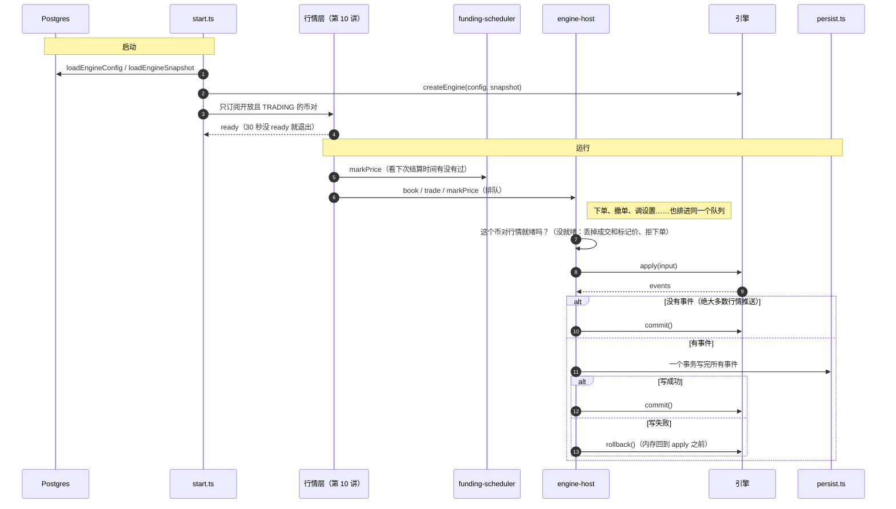

# 11 · 搭建教程：仓储层与引擎宿主

> 到上一讲为止，引擎是一个只活在测试里的纯函数，行情层是一个只会打印价格的脚本。这一讲把它们**接起来、存下来**：
> server 启动时从数据库恢复引擎状态，连上币安行情，行情和用户操作排成一队喂给引擎，
> 引擎产生的每一个事件都在一个事务里写进数据库——写失败就回滚内存，内存和数据库永远一致。
>
> 验收标准是：**进程随时被 `kill -9`，重启之后账依然对得上，引擎状态和被杀之前一模一样**。

**这一讲结束时你会有什么**：

| 位置 | 干什么 |
| --- | --- |
| `packages/db` 迁移 0003 / 0004 | `symbols` 加 10 列币安交易规则；`positions.qty` → 带符号 `position_amt`；`order_type` 加 `LIQUIDATION`；`orders.working_type` 默认值 |
| `packages/db` `seed:symbols` | 同步新列；开放名单里有不在 TRADING 的币对就中止 |
| `packages/db` `open-symbols.ts` | 去掉 TONUSDT，19 个 |
| `packages/engine` | 新输入 `setBrackets`（分层表热加载）；强平单 `clientOrderId` 带上币对和方向 |
| `apps/server/src/persistence/` | `ids.ts` id 换算、`positions.ts` 仓位表示法互转、`load.ts` 启动加载、`persist.ts` 一个事务落库 |
| `apps/server/src/engine-host/` | `engine-host.ts` 串行队列、`funding-scheduler.ts` 资金费排期、`start.ts` 启动流程 |
| `apps/server/src/index.ts` | 启动交易内核；分层表同步有变化就热加载 |

- 迁移已应用到本地库，`seed:symbols` 已重跑（你授权的）
- 测试：引擎 285、db 51、server 66 条全绿，其中一条是连本地数据库的完整集成测试

**先读**：`docs/design/02-architecture.md` 第七节（状态归属与持久化，**注意末尾"已定"**）、第六节 ① 引擎 ↔ 宿主契约；`04-backend-design.md` 第 1 节启动顺序、第 9 节资金费、第 10 节宿主（**末尾"已定"**）；`03-database-design.md` 第五、六节。

> **代码已经在仓库里了**：AI 写代码和讲义，你对照着读。代码块用脚本从源文件截取，和仓库逐字一致（只去掉公共缩进）。

---

## 第 1 节：一张图



---

## 第 2 节：这一讲定下来的事

| # | 决定 | 依据 |
| --- | --- | --- |
| 1 | 数据库迁移由我写并直接应用到本地库 | 你定的 |
| 2 | 开放名单去掉 TONUSDT | 你定的（缺口 #30） |
| 3 | 引擎 id → 数据库 uuid：本来是 uuid 的原样用，其它按 **UUID v5** 换算 | 缺口 #8；确定性、不需要映射表、重复落库撞主键 |
| 4 | **所有事件同步、一个事务**落库，没做"纯挂单异步批量写" | 缺口 #32；实测大部分输入 0 个事件，同步换来内存 == 数据库 |
| 5 | 重启后挂单排队位置标成"估算"，由引擎第一次处理盘口时换成这一档总量 | 设计"保守：假设自己排在最后"；复用第 06 讲逻辑 |
| 6 | 不单独写"全账户风控补扫" | 就绪后每秒的标记价推送就会扫所有持仓账户 |
| 7 | 行情没就绪：丢掉行情成交和标记价、拒下单、跳过资金费；盘口照常喂 | 缺口 #16 宿主一半；失真点 #7 |
| 8 | 同一币对还没处理的旧盘口被新盘口替换 | 盘口是快照，只有最新的有用；落库慢时队列不会被盘口堆满 |
| 9 | 资金费由标记价推送驱动，不用定时器 | 结算时间来自币安、重启不丢排期、可测；近似见缺口 #33 |
| 10 | 分层表热加载：引擎新输入 `setBrackets`，换表后立刻扫风控 | 解决 02-architecture 失真点 #9 的"要重启才生效" |
| 11 | 加载引擎配置时带上还有仓位 / 挂单的已下架币对 | 币对下架后用户的旧仓位得能恢复 |
| 12 | 强平单 `clientOrderId` = `autoclose-时间-币对-方向` | 全仓强平同一时刻平好几个仓位，`(account_id, client_order_id)` 唯一索引会撞——落库时才发现 |
| 13 | 账户行由鉴权层建，引擎的 `balanceUpdate` 只 UPDATE 余额，找不到账户就抛错 | `accounts.address / chain` 非空；第 12 讲接上 |
| 14 | 每日权益快照留到第 13 讲 | 缺口 #34；只服务排行榜 |

---

## 第 3 节：数据库迁移

```sql
ALTER TYPE "public"."order_type" ADD VALUE 'LIQUIDATION';--> statement-breakpoint
DROP INDEX "pos_symbol_open_idx";--> statement-breakpoint
ALTER TABLE "orders" ALTER COLUMN "working_type" SET DEFAULT 'CONTRACT_PRICE';--> statement-breakpoint
ALTER TABLE "symbols" ADD COLUMN "min_price" bigint;--> statement-breakpoint
ALTER TABLE "symbols" ADD COLUMN "max_price" bigint;--> statement-breakpoint
ALTER TABLE "symbols" ADD COLUMN "max_qty" bigint;--> statement-breakpoint
ALTER TABLE "symbols" ADD COLUMN "market_step_size" bigint;--> statement-breakpoint
ALTER TABLE "symbols" ADD COLUMN "market_min_qty" bigint;--> statement-breakpoint
ALTER TABLE "symbols" ADD COLUMN "market_max_qty" bigint;--> statement-breakpoint
ALTER TABLE "symbols" ADD COLUMN "percent_price_up" bigint;--> statement-breakpoint
ALTER TABLE "symbols" ADD COLUMN "percent_price_down" bigint;--> statement-breakpoint
ALTER TABLE "symbols" ADD COLUMN "max_num_orders" integer;--> statement-breakpoint
ALTER TABLE "symbols" ADD COLUMN "liquidation_fee_rate" bigint;--> statement-breakpoint
ALTER TABLE "positions" ADD COLUMN "position_amt" bigint DEFAULT 0 NOT NULL;--> statement-breakpoint
CREATE INDEX "pos_symbol_open_idx" ON "positions" USING btree ("symbol") WHERE position_amt <> 0;
```

```sql
-- 0004_drop_position_qty.sql
ALTER TABLE "positions" DROP COLUMN "qty";
```

**为什么分两个迁移**：`drizzle-kit generate` 看到"一列删掉、一列加上"会**交互式地问**"这是改名吗？"。这个环境回答不了交互提问，所以先生成"只加不删"的 0003，再生成"只删不加"的 0004——每一步都没有歧义。表里没有数据（本地库仓位表是空的），加一列再删一列和改名结果一样。

**为什么新列可空**：`symbols` 表里已经有 897 行（币安所有合约），加非空列必须给默认值，而"最大价格默认 0"是个错的数。可空 + `seed:symbols` 马上填满 + 宿主加载时缺值直接报错，比一个假默认值诚实。

**`ALTER TYPE ... ADD VALUE`**：Postgres 的枚举加值不能在同一个事务里马上用这个新值——这个迁移本身没用它，所以没问题。

`seed:symbols` 加的防护：

```ts
// 开放名单里的币对必须能交易：下架结算中的币对盘口为空，行情源永远就绪不了（缺口 #30，TONUSDT 就是这样发现的）
const notTrading = body.symbols.filter((s) => (OPEN_SYMBOLS as readonly string[]).includes(s.symbol) && s.status !== "TRADING");
if (notTrading.length > 0) {
  throw new Error(
    `open-symbols.ts 里这些币对在币安已经不是 TRADING：${notTrading.map((s) => `${s.symbol}(${s.status})`).join(", ")}，先从名单里去掉，同步中止`,
  );
}

const db = createDb({ DATABASE_URL: ENV.DATABASE_URL });
```

应用之后核对过：迁移记录 6 行（其中 1 行是和本库共用的另一个项目的）、`positions` 有 `position_amt` 没有 `qty`、枚举里有 `LIQUIDATION`、19 个开放币对新列全有值、TONUSDT 已关闭。

---

## 第 4 节：两种表示法——id 和仓位

### 4.1 id

```ts
export function toDbId(engineId: string): string {
  return UUID.test(engineId) ? engineId.toLowerCase() : uuidV5(engineId, ENGINE_ID_NAMESPACE);
}
```

UUID v5 = 命名空间 + 名字 → SHA-1 → 截 128 位 → 标版本号。测试里用 RFC 9562 附录的标准测试向量验证过算法。**同一个引擎 id 永远得到同一个 uuid**，所以：

- 成交 `订单id:t123` 的 `order_id` 外键：订单 id 本来就是 uuid，原样用，对得上
- 流水的 `ref_id` 指向强平记录：两边各自换算 `liq:…`，结果一样
- 同一笔资金费落库两次：主键冲突，事务失败，宿主回滚——**钱不会多扣一次**（集成测试专门测了）

### 4.2 仓位（缺口 #12）

```ts
export function toDbPosition(mode: PositionMode, side: PositionSide, qty: Fixed): DbPositionKey {
  if (side === "BOTH") throw new Error("引擎里的仓位不应该是 BOTH（缺口 #12：引擎内部按实际方向存）");
  if (qty < 0n) throw new Error(`引擎仓位数量不能为负：${qty}`);
  const signed = side === "SHORT" ? -qty : qty;
  return { positionSide: mode === "ONE_WAY" ? "BOTH" : side, positionAmt: signed };
}
```

```ts
export function fromDbPosition(
  mode: PositionMode,
  row: DbPositionKey,
): { positionSide: "LONG" | "SHORT"; qty: Fixed } {
  const { positionSide, positionAmt } = row;
  if (positionAmt === 0n) throw new Error("数量为 0 的仓位行不该加载进引擎");
  const direction = positionAmt > 0n ? "LONG" : "SHORT";
  const qty = positionAmt > 0n ? positionAmt : -positionAmt;
  if (mode === "ONE_WAY") {
    if (positionSide !== "BOTH") throw new Error(`单向持仓模式的账户有 ${positionSide} 仓位行，数据不一致`);
    return { positionSide: direction, qty };
  }
  if (positionSide !== direction) {
    throw new Error(`双向持仓模式的 ${positionSide} 仓位行数量符号不对：${positionAmt}`);
  }
  return { positionSide: direction, qty };
}
```

转换需要知道账户的持仓模式：单向模式的 `LONG` 在数据库里是 `BOTH` 行，双向模式的 `LONG` 是 `LONG` 行。宿主维护一份"账户 → 持仓模式"，在 `registerAccount` 和 `positionModeUpdate` 提交后更新（`start.ts`）。

读回来时符号和行对不上（比如单向模式的账户有 `LONG` 行）就抛错——数据坏了，启动失败比猜对更重要。

---

## 第 5 节：启动加载

```ts
export async function loadEngineConfig(db: DbExecutor): Promise<EngineConfig> {
  const held = db
    .selectDistinct({ symbol: positions.symbol })
    .from(positions)
    .where(ne(positions.positionAmt, 0n));
  const open = db
    .selectDistinct({ symbol: orders.symbol })
    .from(orders)
    .where(inArray(orders.status, ["NEW", "PARTIALLY_FILLED"]));
  const rows = await db
    .select()
    .from(symbols)
    .where(or(eq(symbols.enabled, true), inArray(symbols.symbol, held), inArray(symbols.symbol, open)))
    .orderBy(asc(symbols.sortOrder), asc(symbols.symbol));

  const specs = rows.map(toSymbolSpec);
  const names = specs.map((s) => s.symbol);
  const bracketRows =
    names.length === 0
      ? []
      : await db.select().from(leverageBrackets).where(inArray(leverageBrackets.symbol, names)).orderBy(asc(leverageBrackets.bracket));

  const brackets: Record<string, LeverageBracket[]> = {};
  for (const row of bracketRows) {
    (brackets[row.symbol] ??= []).push({
      bracketNum: row.bracket,
      notionalFloor: row.notionalFloor,
      notionalCap: row.notionalCap,
      maxLeverageNum: row.maxLeverage,
      mmr: row.mmr,
      cum: row.cum,
    });
  }
  return { symbols: specs, brackets, fees: FEES, limits: LIMITS };
}
```

挂单的排队位置：

```ts
const loadedOrders: Order[] = (
  await db.select().from(orders).where(inArray(orders.status, ["NEW", "PARTIALLY_FILLED"]))
).map((o) => ({
  id: o.id,
  clientOrderId: o.clientOrderId,
  accountId: o.accountId,
  symbol: o.symbol,
  side: o.side,
  positionSide: o.positionSide,
  type: o.type,
  timeInForce: o.timeInForce,
  price: o.price,
  stopPrice: o.stopPrice,
  workingType: o.workingType,
  qty: o.qty,
  executedQty: o.executedQty,
  avgPrice: o.avgPrice,
  reduceOnly: o.reduceOnly,
  closePosition: o.closePosition,
  status: o.status,
  triggered: o.triggered,
  queueAhead: o.queueAhead,
  queueEstimated: true, // 见函数注释：重启后排队位置一律当估算值，等第一次盘口推送校准
  frozenMargin: o.frozenMargin,
  rejectReason: o.rejectReason,
  createdAt: o.createdAt.getTime(),
  updatedAt: o.updatedAt.getTime(),
}));
```

**`queueEstimated: true` 这一行就是设计文档的"重启恢复第 2 步"**。第 06 讲的 `reconcileQueue` 对估算过的单是"这一档还在就直接换成这一档的总量"——停机期间盘口变了，就按现在这一档的量当前方的量，相当于假设自己排在最后，往保守的方向倒。

---

## 第 6 节：一个事务落库

```ts
export async function persistEvents(db: DbExecutor, events: readonly EngineEvent[], ctx: PersistContext): Promise<void> {
  if (events.every((e) => e.t === "rejected")) return; // 被拒的请求不入库（04-backend-design.md 第 3 节状态机）
  await db.transaction(async (tx) => {
    for (const event of events) await writeEvent(tx, event, ctx);
  });
}
```

最关键的一类事件——改钱的：

```ts
case "balanceUpdate": {
  await tx.insert(ledgerEntries).values({
    accountId: event.accountId,
    type: event.reason,
    symbol: event.symbol,
    amount: event.delta,
    balanceAfter: event.walletBalance,
    refType: event.ref?.type ?? null,
    refId: event.ref ? toDbId(event.ref.id) : null,
    createdAt: new Date(event.ts),
  });
  const updated = await tx
    .update(accounts)
    .set({
      walletBalance: event.walletBalance,
      ...(event.reason === "RESET" ? { lastResetAt: new Date(event.ts) } : {}),
    })
    .where(eq(accounts.id, event.accountId))
    .returning({ id: accounts.id });
  // 账户行由鉴权层先建好（第 12 讲），引擎只负责余额。没有这一行说明接线顺序错了，不能让流水悬空
  if (updated.length === 0) throw new Error(`balanceUpdate 找不到账户 ${event.accountId}`);
  return;
}
case "liquidation": {
```

**流水和余额在同一个事务里**：`ledger_entries` 插一行、`accounts.wallet_balance` 改成引擎给的 `walletBalance`。任何一条失败整个事务回滚，"钱包 == 流水之和"（CLAUDE.md 硬约束 5）在数据库里任何时刻都成立。

**事件按引擎给的顺序逐条写**：引擎保证订单事件在它的成交之前（第 05 讲），外键不会先于订单出现。

---

## 第 7 节：宿主——一个队列

```ts
function enqueue(task: Task): void {
  queue.push(task);
  if (!running) running = drain();
}

/**
 * 把队列处理到空。"队列空了"的判断和 running = null 之间不能有 await：
 * 否则最后一个任务 resolve 之后、drain 真正退出之前入队的任务，会看到 running 还在、不启动新的 drain，
 * 也没人处理它（写测试时真的踩到了：标记价推送卡在队列里没进引擎）。
 */
async function drain(): Promise<void> {
  for (;;) {
    const task = queue.shift();
    if (!task) {
      running = null;
      return;
    }
    if (task.input.t === "book") pendingBooks.delete(task.input.symbol);
    try {
      const events = await process(task.input);
      task.resolve?.(events);
    } catch (error) {
      if (task.reject) task.reject(error);
      else logger.error(`[engine-host] 处理 ${task.input.t} 失败`, error);
    }
  }
}

async function process(input: EngineInput): Promise<EngineEvent[]> {
  const gated = gate(input);
  if (gated) return gated;

  const events = engine.apply(input); // 抛错时引擎已自动撤销
  if (events.length === 0) {
    engine.commit();
    return events;
  }
  try {
    await persist(events);
  } catch (error) {
    engine.rollback();
    throw error;
  }
  engine.commit();
  try {
    options.onCommitted?.(input, events);
  } catch (error) {
    // 已经 commit 了：通知出错不能让调用方以为没成功
    logger.error(`[engine-host] onCommitted 回调出错（${input.t}，已落库）`, error);
  }
  return events;
}

/** 行情没就绪时的处理。返回 null = 照常进引擎 */
```

```ts
function gate(input: EngineInput): EngineEvent[] | null {
  switch (input.t) {
    case "trade":
    case "markPrice":
      return isSymbolReady(input.symbol) ? null : [];
    case "settleFunding":
      if (isSymbolReady(input.symbol)) return null;
      logger.error(`[engine-host] ${input.symbol} 行情未就绪，跳过 ${new Date(input.ts).toISOString()} 的资金费结算`);
      return [];
    case "placeOrder":
      if (isSymbolReady(input.req.symbol)) return null;
      return [
        {
          t: "rejected",
          accountId: input.accountId,
          input: "placeOrder",
          clientOrderId: input.req.clientOrderId,
          orderId: input.orderId,
          code: "MARKET_NOT_READY",
          message: `${input.req.symbol} 行情未就绪或已断线，暂停下单`,
          ts: input.ts,
        },
      ];
    default:
      return null;
  }
}

return {
```

**为什么必须串行**：引擎要求每次 `apply` 之后恰好一次 `commit` 或 `rollback` 才能 `apply` 下一个（第 02 讲），而落库是异步的。如果两个请求并发，第二个 `apply` 会撞上"上一次还没结算"直接抛错——这是引擎故意设的保险：并发喂输入会让回滚撤错东西。

**`drain` 里那个踩过的坑**：第一版写成 `running = drain().finally(() => running = null)`。最后一个任务 resolve 之后、`finally` 执行之前，调用方已经往队列里放了下一个任务，看到 `running` 还在，就没启动新的 `drain`——任务卡在队列里没人处理。测试"行情成交、标记价丢掉"就是这样挂的（标记价推送没进引擎）。修法是"队列空了"和"`running = null`"之间不留 `await`。

**落库失败**：`rollback()` 之后抛给调用方。下单接口（第 13 讲）会返回失败，用户看到的状态和数据库一致。行情推送触发的落库失败（比如强平写失败）只记日志：下一次标记价推送会按同样的条件再扫到一次。

---

## 第 8 节：资金费排期

```ts
export function createFundingScheduler(options: FundingSchedulerOptions): FundingScheduler {
  const freshnessMs = options.freshnessMs ?? 10_000;
  const logger = options.logger ?? console;
  const last = new Map<string, MarkPriceEvent>();
  const settled = new Set<string>();

  return {
    onMarkPrice(event) {
      const prev = last.get(event.symbol);
      last.set(event.symbol, event);
      if (!prev) return;

      const due = prev.nextFundingTs;
      if (event.nextFundingTs <= due || event.ts < due) return; // 还没到旧的结算时间

      const key = `${event.symbol}:${due}`;
      if (settled.has(key)) return;
      settled.add(key);

      if (due - prev.ts > freshnessMs) {
        logger.error(
          `[funding] ${event.symbol} ${new Date(due).toISOString()} 结算前最后一条标记价是 ${due - prev.ts}ms 之前的，不可信，跳过这次结算`,
        );
        return;
      }
      options.submit({ t: "settleFunding", symbol: event.symbol, rate: prev.fundingRate, markPrice: prev.markPrice, ts: due });
    },
  };
}
```

```
07:59:58  markPrice  r=0.0002  T=08:00   ← 记下
07:59:59  markPrice  r=0.0003  T=08:00   ← 记下（结算前最后一条）
08:00:00  markPrice  r=0.0001  T=16:00   ← T 变大了、而且已经过了 08:00
          → settleFunding(rate 0.0003, 标记价取 07:59:59 那条, ts 08:00)
```

资金费的唯一性有两道：内存里 `(币对, 结算时间)` 只结算一次；进程重启后又结算同一次时，`funding_payments` 主键冲突，宿主回滚。

---

## 第 9 节：启动流程

```ts
export async function startTradingCore(options: TradingCoreOptions): Promise<TradingCore> {
  const { db } = options;
  const logger = options.logger ?? console;
  const now = options.now ?? Date.now;

  const config = await loadEngineConfig(db);
  const snapshot = await loadEngineSnapshot(db);
  const engine = createEngine(config, snapshot);
  logger.log(
    `[trading] 已恢复 ${snapshot.accounts.length} 个账户、${snapshot.positions.length} 个仓位、${snapshot.orders.length} 张挂单`,
  );

  // 仓位落库要按持仓模式转换表示法（缺口 #12），账户的模式在这里跟着 commit 更新
  const modes = new Map<string, PositionMode>(snapshot.accounts.map((a) => [a.id, a.positionMode]));
  const positionModeOf = (accountId: string): PositionMode => {
    const mode = modes.get(accountId);
    if (!mode) throw new Error(`不知道账户 ${accountId} 的持仓模式`);
    return mode;
  };

  let feed: MarketFeed | null = null;
  const host = createEngineHost({
    engine,
    persist: (events) => persistEvents(db, events, { positionModeOf }),
    isSymbolReady: (symbol) => feed?.symbolReady(symbol) ?? false,
    logger,
    onCommitted(input, events) {
      if (input.t === "registerAccount") modes.set(input.accountId, input.positionMode);
      for (const event of events) {
        if (event.t === "positionModeUpdate") modes.set(event.accountId, event.positionMode);
      }
    },
  });
  // 注册账户要先有持仓模式：registerAccount 本身只产生 INITIAL 流水，不用转换，但下一笔成交就要用
  // （onCommitted 在 commit 之后才更新，下一个输入排在它后面，顺序天然保证）

  const funding = createFundingScheduler({
    logger,
    submit: (input) => {
      host.submit(input).catch((error) => logger.error(`[funding] ${input.symbol} 结算失败`, error));
    },
  });

  const tradable = config.symbols.filter((s) => s.enabled && s.status === "TRADING").map((s) => s.symbol);
  let resolveReady: () => void = () => {};
  const ready = new Promise<void>((resolve) => (resolveReady = resolve));
  feed = (options.startFeed ?? startMarketFeed)({
    symbols: tradable,
    logger,
    onEvent(event) {
      if (event.t === "kline") return; // K 线只给前端（第 14 讲）
      if (event.t === "markPrice") funding.onMarkPrice(event);
      host.feedMarket(event);
    },
    onStatusChange(status: FeedStatus) {
      if (status === "ready") resolveReady();
    },
  });

  const timeoutMs = options.readyTimeoutMs ?? 30_000;
  let timer: NodeJS.Timeout | undefined;
  const timedOut = await Promise.race([
    ready.then(() => false),
    new Promise<boolean>((resolve) => (timer = setTimeout(() => resolve(true), timeoutMs))),
  ]);
  clearTimeout(timer);
  if (timedOut) {
    feed.stop();
    throw new Error(`行情 ${timeoutMs}ms 内没有就绪（${tradable.length} 个币对），不启动交易`);
  }
  logger.log(`[trading] 行情就绪，${tradable.length} 个币对开始撮合`);

  return {
    host,
    feed,
    async reloadBrackets(symbols) {
      const known = symbols.filter((s) => config.symbols.some((spec) => spec.symbol === s));
      if (known.length === 0) return;
      const rows = await db.select().from(leverageBrackets).where(inArray(leverageBrackets.symbol, known)).orderBy(asc(leverageBrackets.bracket));
      const bySymbol = new Map<string, LeverageBracket[]>();
      for (const row of rows) {
        const list = bySymbol.get(row.symbol) ?? [];
        list.push({
          bracketNum: row.bracket,
          notionalFloor: row.notionalFloor,
          notionalCap: row.notionalCap,
          maxLeverageNum: row.maxLeverage,
          mmr: row.mmr,
          cum: row.cum,
        });
        bySymbol.set(row.symbol, list);
      }
      for (const [symbol, brackets] of bySymbol) {
        const input: EngineInput = { t: "setBrackets", symbol, brackets, ts: now() };
        await host.submit(input);
        logger.log(`[trading] ${symbol} 分层表已热加载进引擎`);
      }
    },
    async stop() {
      feed?.stop();
      await host.idle();
    },
  };
}
```

`index.ts` 里用顶层 `await` 启动，**先于 HTTP 服务**：行情没就绪就不对外接受请求。分层表同步的 `onChanged` 现在调 `reloadBrackets`：

```ts
function setBrackets(state: EngineState, input: InputOf<"setBrackets">): EngineEvent[] {
  requireSymbol(state, input.symbol);
  if (input.brackets.length === 0) {
    throw new Error(`币对 ${input.symbol} 的新分层表为空，宿主不应该喂进来`);
  }
  state.brackets.set(
    input.symbol,
    [...input.brackets].sort((a, b) => (a.notionalCap < b.notionalCap ? -1 : a.notionalCap > b.notionalCap ? 1 : 0)),
  );
  return riskScan(state, accountsHolding(state, input.symbol), input.ts);
}
```

分层表和行情一样不进 undo 日志：宿主落库失败回滚时不会退回旧表——币安的表已经变了，回滚掉的只是这次扫描产生的强平，下一次扫描按新表重新判。

---

## 第 10 节：验收——真数据库 + 假行情

`persistence/persistence.integration.test.ts` 连本地 Supabase，整个用例包在一个最终回滚的事务里（宿主每次落库是其中的嵌套事务 / savepoint），跑完库里不留痕迹。用数据库里**真实的** BTCUSDT 交易规则和分层表：

1. 三个账户：A 单向逐仓 10x（市价开仓、挂卖单被行情吃到 Maker 平仓、再挂一张买单留着）、B 双向模式（多空各开、一张被拒的单）、C 全仓 100x（价格下跌被强平）
2. 资金费结算三个仓位；**同一个结算时间再结算一次 → 主键冲突 → 内存快照和结算前完全相同**
3. 断言：三个账户钱包 == 流水之和；数据库钱包 == 引擎钱包；强平单、强平成交、强平记录、资金费都落了；被拒的单没入库；双向模式空头仓位是负数；单向模式仓位是 `BOTH` 行
4. **"kill -9 之后重启"**：从数据库重新 `loadEngineConfig` + `loadEngineSnapshot` 建一个新引擎，和内存里的引擎比——账户、设置、仓位、挂单逐字段相同（排队位置按设计重置，不比）；留着的买单在库里 `queue_estimated = false`，恢复后变成 `true`

为什么这等价于 kill -9：落库全部同步，`commit()` 只在事务提交之后调。进程在任何一刻被杀，数据库里的状态都等于"最后一次 commit 时的内存"。

**故意改错跑一遍**：

| 改法 | 红几条 |
| --- | --- |
| 空头仓位不存负数 | 3 |
| 落库不更新钱包余额 | 1 |
| 重启后排队位置当真值 | 1（第一版测试没抓到：留着的单下单时本来就是估算值。改成挂在可见的一档上才抓到） |
| id 换算不确定（随机 uuid） | 2 |
| 落库失败不回滚 | 2 |
| 加载错币对 | 1 |

**真跑 server**：`npx tsx src/index.ts` 实测输出：

```
[trading] 已恢复 0 个账户、0 个仓位、0 张挂单
[market] 行情状态 → ready
[trading] 行情就绪，19 个币对开始撮合
```

HTTP 监听那一步报了 `EADDRINUSE`：本机 3000 端口被另一个 node 进程占着（你自己开的 dev server）。关掉它再跑就行。

---

## 验收清单

- [ ] `pnpm --filter @binance-contract-trading-full-stack/engine test` 285、`db test` 51、`server test` 66 全绿
- [ ] 四个包 `check-types` 通过
- [ ] 本地库：`positions` 有 `position_amt`、枚举有 `LIQUIDATION`、19 个开放币对新列有值
- [ ] 集成测试：账对得上；重建引擎和内存一致；重复结算资金费被挡住且内存不变
- [ ] `pnpm --filter server dev`（先关掉占 3000 端口的进程）：看到"行情就绪，19 个币对开始撮合"
- [ ] （手动）server 运行中 `kill -9`，重启后 `pnpm --filter @binance-contract-trading-full-stack/db reconcile:ledger` 通过——第 13 讲有下单接口之后才有数据可验

全部打勾，进第 12 讲：鉴权。

---

## 读完可以自测

1. 为什么引擎里的成交 id 不直接用随机 uuid？UUID v5 换来了什么？
2. 单向模式持多 1 BTC，反手成空 2 BTC，数据库 `positions` 表会发生几次写入，最后是什么？
3. 落库失败为什么必须 `rollback()`？如果只记日志不回滚，下一次下单会出现什么不一致？
4. 为什么宿主要串行处理输入？并发会撞上引擎的哪条保险？
5. 重启后挂单的排队位置为什么不直接用数据库里的值？`queueEstimated = true` 之后发生了什么？
6. 为什么不需要单独写"启动后全账户风控补扫"？
7. 行情断线期间，为什么丢掉标记价推送、却照常处理盘口推送？
8. 资金费结算前最后一条标记价推送是 1 分钟之前的，为什么宁可不结算？
9. 同一次资金费被结算两次，钱为什么不会多扣？
10. 分层表热加载为什么不进 undo 日志？
