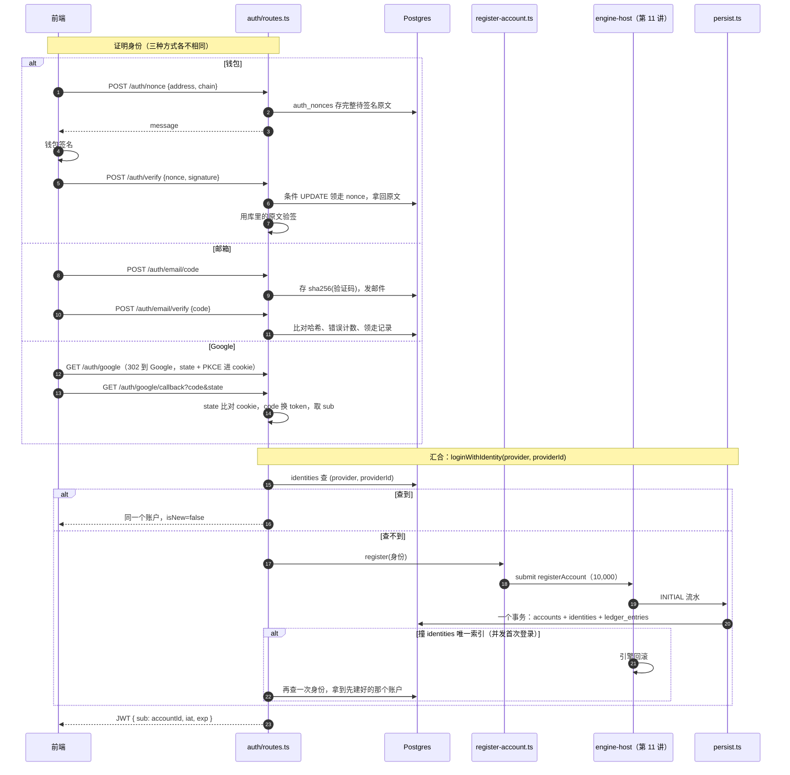

# 12 · 搭建教程：鉴权

> 到上一讲为止，引擎能从数据库恢复、能接行情、能把每个事件一个事务写进库——但**没有人能进来**。
> 第 11 讲的集成测试是直接往 `accounts` 表插一行来造账户的。这一讲把门装上：
> 钱包（EVM / Solana）、邮箱验证码、Google 三种登录，证明完"你拥有这个身份"之后**汇合成同一步**：
> 查身份 → 查不到就开户发 10,000 USDT → 签发同一套 JWT。
>
> 验收标准是：**三种方式都能登录并拿到 10,000 USDT；三种身份互相独立不合并**。

**这一讲结束时你会有什么**：

| 位置 | 干什么 |
| --- | --- |
| `packages/db` 迁移 0005 | `accounts` 删 `address` / `chain`；新增 `auth_provider` 枚举、`identities`、`email_verification_codes`（14 张业务表） |
| `packages/shared` | `AUTH_PROVIDER` 枚举；5 个鉴权错误码（邮箱 4 个 + `OAUTH_STATE_MISMATCH`） |
| `apps/server/src/persistence/persist.ts` | INITIAL 流水落库时，账户行 + 身份行 + 流水同一个事务 |
| `apps/server/src/engine-host/register-account.ts` | 开户：身份先记内存，交给宿主排队 `registerAccount` |
| `apps/server/src/http/respond.ts` | 响应包络 `{ ok, data }` / `{ ok, error }`、请求体校验、统一错误处理 |
| `apps/server/src/auth/` | `tokens.ts` JWT、`wallet.ts` SIWE / SIWS 验签、`email.ts` 验证码 + Resend、`google.ts` OAuth + PKCE、`nickname.ts` 脱敏昵称、`routes.ts` 7 个接口 |
| `apps/server/.env.schema` | `JWT_SECRET`（必填）、`RESEND_API_KEY` / `EMAIL_FROM`、`GOOGLE_*`（选填） |

- 迁移已应用到本地库；本地 `.env` 里生成了一个随机 `JWT_SECRET`
- 新依赖：`viem`（EVM 验签）、`tweetnacl` + `bs58`（Solana 验签）、`arctic`（Google OAuth），都是设计文档第 11 节点名的
- 测试：server 87 条（新增 21 条，其中 6 条是连本地数据库的鉴权验收），shared 34、db 51、引擎 285 全绿
- 真 server 实测：邮箱登录 → 拿到 token → `/auth/me` → `kill -9` → 重启恢复 1 个账户 → `reconcile:ledger` 通过

**先读**：`docs/design/04-backend-design.md` 第 11 节"通用约定"和"认证"（**注意几处"已定"**）、第 13 节错误码"认证"；`03-database-design.md` 第四节 `accounts` / `identities` / `auth_nonces` / `email_verification_codes`。

> **代码已经在仓库里了**：AI 写代码和讲义，你对照着读。代码块用脚本从源文件截取，和仓库逐字一致（只去掉公共缩进）。

---

## 第 1 节：一张图



一句话：**三种登录只在"怎么证明"上不同；开户走引擎宿主的队列，账户、身份、发钱三件事一个事务**。

---

## 第 2 节：先做表——12 → 14 张

设计文档早就改成了"账户表不记录登录方式"，代码里的 `accounts` 还是钱包时代的形状：`address` + `chain` 非空、`(chain, address)` 唯一。只要还有这两列，邮箱和 Google 账户就没地方放。

迁移后的 `accounts` 只管交易相关的状态：

```ts
// packages/db/src/schema/accounts.ts
export const accounts = pgTable(
  "accounts",
  {
    id: uuid("id").primaryKey().defaultRandom(),
    // 已结算的钱包余额，是 accounts.wallet_balance === SUM(ledger_entries.amount) 这条
    // 不变式里的左边——任何资金变动都必须同步改这个字段并写一条 ledger_entries。
    walletBalance: bigint("wallet_balance", { mode: "bigint" })
      .notNull()
      .default(sql`0`),
    positionMode: positionModeEnum("position_mode")
      .notNull()
      .default("ONE_WAY"),
    lastResetAt: timestamp("last_reset_at", { withTimezone: true }), // 上次账户重置的时间，null 表示没重置过
    // 排行榜显示名，默认脱敏地址 / 邮箱。
    nickname: text("nickname"),
    createdAt: timestamp("created_at", { withTimezone: true })
      .notNull()
      .defaultNow(),
    lastSeenAt: timestamp("last_seen_at", { withTimezone: true })
      .notNull()
      .defaultNow(), // 最近一次活跃时间
  },
);
```

登录身份全部在 `identities`：

```ts
// packages/db/src/schema/identities.ts
export const identities = pgTable(
  "identities",
  {
    id: uuid("id").primaryKey().defaultRandom(),
    accountId: uuid("account_id")
      .notNull()
      .references(() => accounts.id, { onDelete: "cascade" }),
    provider: authProviderEnum("provider").notNull(),
    // wallet_evm    → 小写地址
    // wallet_solana → base58 原样
    // email         → 小写邮箱
    // google        → Google 的 sub（用户唯一 id，不用 email，因为 email 可换绑）
    providerId: text("provider_id").notNull(),
    createdAt: timestamp("created_at", { withTimezone: true })
      .notNull()
      .defaultNow(),
  },
  (t) => [
    uniqueIndex("identities_provider_uq").on(t.provider, t.providerId),
    index("identities_account_idx").on(t.accountId),
  ],
);
```

`(provider, providerId)` 唯一 = 一个身份只能对应一个账户。表结构是 1:N，但**应用层规定每个账户只挂一个身份**：同一个人用 MetaMask 和邮箱各登录一次，就是两个账户。这是 `00-overview.md` "不做跨身份账户合并"那条的直接结果，有意的。

`chain` 枚举没删：`auth_nonces` 还在用（签名挑战要知道是哪条链的地址）。

### 迁移 0005：生成的 SQL + 一段手写回填

`drizzle-kit generate` 这次没有歧义（只加了一张表、只删了两列，没有"加一列删一列"），不用像第 11 讲那样拆两个迁移。但生成的 SQL 直接 `DROP COLUMN`——库里如果已经有钱包账户，它们的地址就丢了，下次登录会被当成新人再发 10,000。所以删列之前手写了一段回填：

```sql
CREATE UNIQUE INDEX "identities_provider_uq" ON "identities" USING btree ("provider","provider_id");--> statement-breakpoint
CREATE INDEX "identities_account_idx" ON "identities" USING btree ("account_id");--> statement-breakpoint
-- 手写：删列之前把已有账户的钱包地址搬进 identities（chain evm/solana → provider wallet_evm/wallet_solana），
-- 否则老账户会丢掉登录身份。建唯一索引之后再搬，重复数据会让迁移直接失败而不是悄悄吞掉。
INSERT INTO "identities" ("account_id", "provider", "provider_id", "created_at")
SELECT "id", ('wallet_' || "chain"::text)::"auth_provider", "address", "created_at" FROM "accounts";--> statement-breakpoint
ALTER TABLE "accounts" DROP COLUMN "address";--> statement-breakpoint
ALTER TABLE "accounts" DROP COLUMN "chain";
```

两个细节：

- **回填放在建唯一索引之后**：如果旧数据里有重复（按旧的唯一键不可能，但迁移不该靠"不可能"），`INSERT` 会直接失败，整个迁移回滚，而不是悄悄吞掉一行
- `'wallet_' || "chain"::text` 再转回 `auth_provider`：`evm → wallet_evm`、`solana → wallet_solana`。本地库 `accounts` 是空的，这段没搬到任何数据，所以单独验证过这个类型转换

---

## 第 3 节：开户——为什么不能"先插两行再发钱"

最直观的写法是：

```ts
// ✗ 不要这样
const [account] = await db.insert(accounts).values({}).returning();
await db.insert(identities).values({ accountId: account.id, provider, providerId });
await host.submit({ t: "registerAccount", accountId: account.id, walletBalance: 10000, ... });
```

第二行和第三行之间进程被杀：库里有账户、有身份、余额 0、没有 INITIAL 流水。**对账照样通过**（0 == 0），但这个用户下次登录能查到身份，就再也拿不到那 10,000 了。这种 bug 不报错、不告警，只有用户会发现。

第 11 讲定下的规矩是"引擎的每个事件一个事务落库"。开户发钱本来就是一个事件（`registerAccount` → `balanceUpdate` INITIAL），那就让账户行和身份行**搭这个事件的便车**：

```ts
// apps/server/src/engine-host/register-account.ts
export function createAccountRegistrar(options: {
  submit: (input: EngineInput) => Promise<EngineEvent[]>;
  now: () => number;
}): AccountRegistrar {
```

身份先放在内存的 `pending` 里；宿主落库时 `persist.ts` 问一句"这个账户是不是正在注册"：

```ts
// apps/server/src/persistence/persist.ts
case "balanceUpdate": {
  const registration = event.reason === "INITIAL" ? ctx.pendingRegistrationOf?.(event.accountId) : undefined;
  if (registration) {
    // 先建账户行（余额 0，下面和其它流水一样更新成 balanceAfter），再挂身份，流水的外键才有着落
    await tx.insert(accounts).values({
      id: event.accountId,
      positionMode: registration.positionMode,
      nickname: registration.nickname,
      createdAt: new Date(event.ts),
      lastSeenAt: new Date(event.ts),
    });
    await tx.insert(identities).values({
      accountId: event.accountId,
      provider: registration.provider,
      providerId: registration.providerId,
      createdAt: new Date(event.ts),
    });
  }
  await tx.insert(ledgerEntries).values({
    accountId: event.accountId,
    type: event.reason,
    symbol: event.symbol,
    amount: event.delta,
    balanceAfter: event.walletBalance,
    refType: event.ref?.type ?? null,
    refId: event.ref ? toDbId(event.ref.id) : null,
    createdAt: new Date(event.ts),
  });
  const updated = await tx
    .update(accounts)
    .set({
      walletBalance: event.walletBalance,
      ...(event.reason === "RESET" ? { lastResetAt: new Date(event.ts) } : {}),
    })
    .where(eq(accounts.id, event.accountId))
    .returning({ id: accounts.id });
  // 账户行要么是上面刚建的，要么早就在库里。没有这一行说明接线错了（注册没走 register-account.ts），不能让流水悬空
  if (updated.length === 0) throw new Error(`balanceUpdate 找不到账户 ${event.accountId}`);
  return;
}
```

先建账户行（外键要求流水之前得有账户），再挂身份，再写流水、更新余额——和其它所有 `balanceUpdate` 走同一段代码。任何一步失败，整个事务回滚，宿主调 `engine.rollback()`，引擎里这个账户也没了（第 02 讲的回滚日志）。

`start.ts` 里注册器和宿主互相需要对方（注册器往宿主 submit，宿主落库要问注册器），用闭包晚绑定：

```ts
// apps/server/src/engine-host/start.ts
// 注册器要往宿主 submit，宿主落库又要问注册器"这个账户是不是正在注册"——用闭包晚绑定 host
const registrar = createAccountRegistrar({ submit: (input) => host.submit(input), now });
const host: EngineHost = createEngineHost({
  engine,
  persist: (events) =>
    persistEvents(db, events, { positionModeOf, pendingRegistrationOf: registrar.pendingRegistrationOf }),
```

### 并发首次登录

两个请求同时拿同一个新身份来登录：都查不到身份、都来注册。队列保证一前一后，前一个事务提交；后一个插 `identities` 撞唯一索引 → 事务失败 → 引擎回滚。路由层认出这个错误，再查一次身份：

```ts
// apps/server/src/auth/routes.ts
/** 三种登录方式的汇合点 */
async function loginWithIdentity(provider: AuthProvider, providerId: string) {
  let accountId = await findAccountId(provider, providerId);
  let isNew = false;
  if (!accountId) {
    try {
      accountId = await deps.registrar.register({ provider, providerId, nickname: defaultNickname(provider, providerId) });
      isNew = true;
    } catch (error) {
      // 同一个身份并发首次登录：另一个请求先建好了，撞了唯一索引。再查一次就是它
      if (!isUniqueViolation(error, "identities_provider_uq")) throw error;
      accountId = await findAccountId(provider, providerId);
      if (!accountId) throw error;
    }
  }
  await db.update(accounts).set({ lastSeenAt: new Date(now()) }).where(eq(accounts.id, accountId));
  const token = await signToken(accountId, jwtSecret, now());
  return { token, account: { id: accountId, isNew } };
}
```

```ts
// apps/server/src/auth/routes.ts
/** Postgres 23505 唯一约束冲突。drizzle 会把驱动错误包在 cause 里，一层层往下找 */
export function isUniqueViolation(error: unknown, constraint: string): boolean {
  let current: unknown = error;
  for (let depth = 0; current && depth < 5; depth++) {
    const e = current as { code?: unknown; constraint?: unknown; cause?: unknown };
    if (e.code === "23505" && e.constraint === constraint) return true;
    current = e.cause;
  }
  return false;
}
```

集成测试里用两个 nonce、两个签名并发 verify 验证了这条路：一个 `isNew: true`、一个 `isNew: false`，同一个账户，只有一条 INITIAL 流水，引擎里只多了一个账户。**把 `isUniqueViolation` 改成永远 false，这条测试会变红**——确认过测试真的走到了竞争路径，不是碰巧串行。

---

## 第 4 节：响应包络和错误

`04` 第 11 节约定所有接口：

```jsonc
{ "ok": true,  "data": { ... } }
{ "ok": false, "error": { "code": "NONCE_INVALID", "message": "给用户直接看的中文" } }
```

鉴权是第一批真正的业务接口，先放一套最小的（第 13 讲补 bigint 序列化、限流、分页）：

```ts
// apps/server/src/http/respond.ts
export function ok<T>(c: Context, data: T, status: ContentfulStatusCode = 200) {
  return c.json({ ok: true as const, data }, status);
}
```

```ts
// apps/server/src/http/respond.ts
export function createErrorHandler(logger: Pick<Console, "error"> = console): ErrorHandler {
  return (error, c) => {
    if (error instanceof AppError) {
      return c.json(
        { ok: false as const, error: { code: error.code, message: error.message } },
        ERROR_HTTP_STATUS[error.code] as ContentfulStatusCode,
      );
    }
    logger.error(`[http] ${c.req.method} ${c.req.path} 内部错误`, error);
    return c.json({ ok: false as const, error: { code: "INTERNAL_ERROR", message: "服务器内部错误，请稍后重试" } }, 500);
  };
}
```

业务代码只管 `throw new AppError("NONCE_INVALID", "...")`，HTTP 状态码查 `packages/shared` 的 `ERROR_HTTP_STATUS`——错误码表和状态码只有一份。不是 `AppError` 的一律 500，**内部错误细节只进日志，不回给前端**。

`packages/shared/src/errors.ts` 补了设计第 13 节"认证"里还没有的 5 个码：`EMAIL_CODE_INVALID` / `EMAIL_CODE_EXPIRED`（400）、`EMAIL_CODE_TOO_MANY_ATTEMPTS` / `EMAIL_CODE_RATE_LIMITED`（429）、`OAUTH_STATE_MISMATCH`（400）。

---

## 第 5 节：JWT

```ts
// apps/server/src/auth/tokens.ts
export const TOKEN_TTL_SECONDS = 7 * 24 * 3600;

export async function signToken(accountId: string, secret: string, nowMs: number): Promise<string> {
  const iat = Math.floor(nowMs / 1000);
  return sign({ sub: accountId, iat, exp: iat + TOKEN_TTL_SECONDS }, secret, "HS256");
}
```

用 Hono 自带的 `hono/jwt`，不另装库。`verify` 默认会检查 `exp`，过期抛 `JwtTokenExpired`，我们翻译成 `TOKEN_EXPIRED`（前端据此提示"登录过期"而不是"token 无效"）。

**载荷和设计文档不一样（缺口 #35）**：设计写的是 `{ sub, addr, chain }`，那是只有钱包登录时的形状。现在账户不再有地址，邮箱和 Google 账户也没有链——token 里只放账户 id。要身份信息就查 `/auth/me`。

私有接口的中间件（第 13 讲的账户、交易接口都挂它）：

```ts
// apps/server/src/auth/routes.ts
export function requireAuth(jwtSecret: string): MiddlewareHandler<AuthEnv> {
  return async (c, next) => {
    const header = c.req.header("Authorization");
    const match = header?.match(/^Bearer (.+)$/);
    if (!match) throw new AppError("UNAUTHORIZED", "请先登录");
    c.set("accountId", await verifyToken(match[1]!, jwtSecret));
    await next();
  };
}
```

---

## 第 6 节：钱包——SIWE / SIWS

### 地址归一化

```ts
// apps/server/src/auth/wallet.ts
export function normalizeAddress(chain: Chain, address: string): string | null {
  const trimmed = address.trim();
  if (chain === "evm") {
    // strict: false —— 全小写的地址没有校验和信息，也是合法地址
    return isAddress(trimmed, { strict: false }) ? trimmed.toLowerCase() : null;
  }
  try {
    return bs58.decode(trimmed).length === 32 ? trimmed : null;
  } catch {
    return null;
  }
}
```

EVM 地址的大小写只是 EIP-55 校验和，`0xAbC…` 和 `0xabc…` 是同一个地址——统一存小写，否则同一个钱包换个前端就变成两个账户。Solana 的 base58 区分大小写，原样保留。

### 待签名文本

```ts
// apps/server/src/auth/wallet.ts
export function buildSignInMessage(params: SignInMessageParams): string {
  const origin = new URL(params.webOrigin);
  const issuedAt = new Date(params.issuedAtMs);
  const expirationTime = new Date(params.expiresAtMs);

  if (params.chain === "evm") {
    return createSiweMessage({
      address: getAddress(params.address),
      chainId: 1,
      domain: origin.host,
      nonce: params.nonce,
      uri: origin.origin,
      version: "1",
      statement: SIGN_IN_STATEMENT,
      issuedAt,
      expirationTime,
    });
  }

  return [
    `${origin.host} wants you to sign in with your Solana account:`,
    params.address,
    "",
    SIGN_IN_STATEMENT,
    "",
    `URI: ${origin.origin}`,
    "Version: 1",
    "Chain ID: mainnet",
    `Nonce: ${params.nonce}`,
    `Issued At: ${issuedAt.toISOString()}`,
    `Expiration Time: ${expirationTime.toISOString()}`,
  ].join("\n");
}
```

- **EVM**：EIP-4361（Sign-In with Ethereum），用 viem 自带的 `createSiweMessage`。MetaMask 等钱包认得这个格式，会把 `domain` 和当前页面比对，对不上就警告用户（防钓鱼站转手让你签）
- **Solana**：SIWS，格式对照 `@solana/wallet-standard-util` 的 `createSignInMessageText` 源码（2026-09-17），测试里逐字断言
- **domain / URI 用前端的来源**（`CORS_ORIGIN`，本地是 `localhost:3001`），不是 API 的地址——用户是在前端页面上签的

**声明句是英文（缺口 #36）**：设计文档的示例写的是"登录币安合约模拟交易平台"。EIP-4361 规定 statement 是 ASCII，viem 只检查了不能有换行，中文能生成出来，但严格按规范解析的钱包 / 库会拒绝。这句话写明"不是交易、不花 gas"，钱包弹窗里用户看到的就是它。

### 验签和"领走" nonce

```ts
// apps/server/src/auth/routes.ts
routes.post("/verify", async (c) => {
  const body = await parseBody(c, walletVerifySchema);
  const address = normalizeAddress(body.chain, body.address);
  if (!address) throw new AppError("INVALID_PARAMS", "钱包地址格式不正确");

  // 先原子地"领走"这个 nonce，再验签（设计文档是验签后再标记，缺口 #38）：
  // 条件 UPDATE 只有一个请求能成功，两个并发请求拿同一个签名来不会都登录；
  // 签名不对也算用掉了，想再试就重新要 nonce，不能对着同一段文本反复试。
  const nowDate = new Date(now());
  const [claimed] = await db
    .update(authNonces)
    .set({ usedAt: nowDate })
    .where(
      and(
        eq(authNonces.nonce, body.nonce),
        eq(authNonces.chain, body.chain),
        eq(authNonces.address, address),
        isNull(authNonces.usedAt),
        gt(authNonces.expiresAt, nowDate),
      ),
    )
    .returning({ message: authNonces.message });
  if (!claimed) throw new AppError("NONCE_INVALID", "登录请求已失效，请重新发起登录");

  // ★ 验签用库里存的原文，不用客户端传上来的任何文本
  const valid = await verifyWalletSignature(body.chain, address, claimed.message, body.signature);
  if (!valid) throw new AppError("SIGNATURE_INVALID", "签名验证失败，请重新发起登录");

  return ok(c, await loginWithIdentity(providerOfChain(body.chain), address));
});
```

**顺序和设计文档不一样（缺口 #38）**：设计是"取出 → 验签 → 标记已使用"。那样两个并发请求拿同一个签名来，都能在对方标记之前通过验签。现在是一条条件 `UPDATE ... WHERE used_at IS NULL AND expires_at > now RETURNING message`：数据库保证只有一个请求能领走。代价是签名不对也会用掉 nonce——前端重新要一个就行，这反而是对的：不能对着同一段文本反复试。

★ **验签用的是 `claimed.message`，库里的原文**。请求体里根本没有 message 字段。集成测试里专门用"对另一段文本的真签名"去验，得到 `SIGNATURE_INVALID`。

```ts
// apps/server/src/auth/wallet.ts
export async function verifyWalletSignature(chain: Chain, address: string, message: string, signature: string): Promise<boolean> {
  if (chain === "evm") {
    if (!/^0x[0-9a-fA-F]{130}$/.test(signature)) return false;
    try {
      return await verifyMessage({ address: getAddress(address), message, signature: signature as `0x${string}` });
    } catch {
      return false;
    }
  }

  try {
    const signatureBytes = bs58.decode(signature);
    const publicKey = bs58.decode(address);
    if (signatureBytes.length !== nacl.sign.signatureLength || publicKey.length !== nacl.sign.publicKeyLength) return false;
    return nacl.sign.detached.verify(new TextEncoder().encode(message), signatureBytes, publicKey);
  } catch {
    return false;
  }
}
```

格式不对（长度、编码）一律当"签名不对"返回 false，不抛错——否则畸形输入会变成 500。

---

## 第 7 节：邮箱验证码

```ts
// apps/server/src/auth/email.ts
export const EMAIL_CODE_TTL_MS = 5 * 60_000;
export const EMAIL_CODE_RESEND_INTERVAL_MS = 60_000;
export const EMAIL_CODE_MAX_ATTEMPTS = 5;

/** 去空格、转小写。identities.provider_id 和 email_verification_codes.email 用的都是这个形式 */
export function normalizeEmail(email: string): string {
  return email.trim().toLowerCase();
}

/** 6 位数字，前导 0 保留。用 crypto.randomInt，不用 Math.random */
export function generateEmailCode(): string {
  return randomInt(0, 1_000_000).toString().padStart(6, "0");
}

/** sha256 十六进制。库里只存这个，明文只出现在邮件里 */
export function hashEmailCode(code: string): string {
  return createHash("sha256").update(code).digest("hex");
}

/** 常量时间比较，避免按"前几位对了多快返回"去猜 */
export function emailCodeMatches(code: string, storedHash: string): boolean {
  const a = Buffer.from(hashEmailCode(code), "hex");
  const b = Buffer.from(storedHash, "hex");
  return a.length === b.length && timingSafeEqual(a, b);
}
```

- 6 位码用 `crypto.randomInt`，不用 `Math.random`
- **库里只存 sha256**。6 位数字只有一百万种可能，泄库后暴力撞出来是秒级的——但撞出来也没用：码 5 分钟过期、错 5 次作废、用一次就失效
- 比对用 `timingSafeEqual`

### 发码

```ts
// apps/server/src/auth/routes.ts
routes.post("/email/code", async (c) => {
  const email = normalizeEmail((await parseBody(c, emailCodeSchema)).email);
  const mailer = deps.mailer;
  if (!mailer) throw new AppError("SERVICE_UNAVAILABLE", "邮箱登录暂时不可用");

  const nowMs = now();
  const expiresAtMs = nowMs + EMAIL_CODE_TTL_MS;
  await db.transaction(async (tx) => {
    // 同一邮箱的发码串行：两个并发请求不会都通过 60 秒检查。事务级锁，提交或回滚自动释放
    await tx.execute(sql`SELECT pg_advisory_xact_lock(hashtext(${`email_code:${email}`}))`);
    const [recent] = await tx
      .select({ id: emailVerificationCodes.id })
      .from(emailVerificationCodes)
      .where(
        and(
          eq(emailVerificationCodes.email, email),
          gt(emailVerificationCodes.createdAt, new Date(nowMs - EMAIL_CODE_RESEND_INTERVAL_MS)),
        ),
      )
      .limit(1);
    if (recent) throw new AppError("EMAIL_CODE_RATE_LIMITED", "验证码发送太频繁，请 60 秒后再试");

    const code = generateEmailCode();
    await tx.insert(emailVerificationCodes).values({
      email,
      codeHash: hashEmailCode(code),
      expiresAt: new Date(expiresAtMs),
      createdAt: new Date(nowMs),
    });
    // 发信放在事务里：发失败整条记录回滚，用户马上重试不会被 60 秒限制卡住
    try {
      await mailer.sendLoginCode(email, code);
    } catch (error) {
      logger.error("[auth] 验证码邮件发送失败", error);
      throw new AppError("SERVICE_UNAVAILABLE", "验证码邮件发送失败，请稍后重试");
    }
  });
  return ok(c, { expiresAt: expiresAtMs });
});
```

- **60 秒限制要防并发**：两个请求同时查"最近 60 秒有没有发过"，都说没有，就发了两封。`pg_advisory_xact_lock` 按邮箱加一把事务级锁，同一个邮箱的发码串行，事务结束自动释放
- **发信放在事务里**：发失败，这条记录跟着回滚，用户马上重试不会被"60 秒内发过"卡住（明明没收到）

### 校验

```ts
// apps/server/src/auth/routes.ts
routes.post("/email/verify", async (c) => {
  const body = await parseBody(c, emailVerifySchema);
  const email = normalizeEmail(body.email);
  const nowDate = new Date(now());

  // 只认这个邮箱最近发的一条：重新发码之后，旧码自动失效
  const [record] = await db
    .select()
    .from(emailVerificationCodes)
    .where(eq(emailVerificationCodes.email, email))
    .orderBy(desc(emailVerificationCodes.createdAt))
    .limit(1);
  if (!record) throw new AppError("EMAIL_CODE_INVALID", "验证码不正确");
  if (record.usedAt || record.expiresAt <= nowDate) throw new AppError("EMAIL_CODE_EXPIRED", "验证码已失效，请重新获取");
  if (record.attempts >= EMAIL_CODE_MAX_ATTEMPTS) {
    throw new AppError("EMAIL_CODE_TOO_MANY_ATTEMPTS", "验证码错误次数过多，请重新获取");
  }

  if (!emailCodeMatches(body.code, record.codeHash)) {
    // attempts + 1 在数据库里做，并发的错误尝试不会互相覆盖
    const [updated] = await db
      .update(emailVerificationCodes)
      .set({ attempts: sql`${emailVerificationCodes.attempts} + 1` })
      .where(and(eq(emailVerificationCodes.id, record.id), lt(emailVerificationCodes.attempts, EMAIL_CODE_MAX_ATTEMPTS)))
      .returning({ attempts: emailVerificationCodes.attempts });
    if (!updated || updated.attempts >= EMAIL_CODE_MAX_ATTEMPTS) {
      throw new AppError("EMAIL_CODE_TOO_MANY_ATTEMPTS", "验证码错误次数过多，请重新获取");
    }
    throw new AppError("EMAIL_CODE_INVALID", `验证码不正确，还可以再试 ${EMAIL_CODE_MAX_ATTEMPTS - updated.attempts} 次`);
  }

  // 条件 UPDATE 领走这条记录：并发两个正确请求只有一个能成功
  const [claimed] = await db
    .update(emailVerificationCodes)
    .set({ usedAt: nowDate })
    .where(
      and(
        eq(emailVerificationCodes.id, record.id),
        isNull(emailVerificationCodes.usedAt),
        lt(emailVerificationCodes.attempts, EMAIL_CODE_MAX_ATTEMPTS),
        gt(emailVerificationCodes.expiresAt, nowDate),
      ),
    )
    .returning({ id: emailVerificationCodes.id });
  if (!claimed) throw new AppError("EMAIL_CODE_EXPIRED", "验证码已失效，请重新获取");

  return ok(c, await loginWithIdentity("email", email));
});
```

- **只认最近一条**：重新发码之后旧码自动失效，不用专门去作废
- **错误次数在数据库里 +1**（`attempts = attempts + 1 WHERE attempts < 5`），并发的错误尝试不会互相覆盖成"只算一次"
- 最后同样是条件 `UPDATE` 领走记录

### 发信：Resend

```ts
// apps/server/src/auth/email.ts
export function createResendSender(options: { apiKey: string; from: string; fetch?: typeof fetch }): MailSender {
  const doFetch = options.fetch ?? fetch;
  return {
    async sendLoginCode(to, code) {
      const minutes = EMAIL_CODE_TTL_MS / 60_000;
      const response = await doFetch("https://api.resend.com/emails", {
        method: "POST",
        headers: { Authorization: `Bearer ${options.apiKey}`, "Content-Type": "application/json" },
        body: JSON.stringify({
          from: options.from,
          to: [to],
          subject: `登录验证码 ${code}`,
          text: `你的登录验证码是 ${code}，${minutes} 分钟内有效。\n\n如果不是你本人操作，忽略这封邮件即可。`,
        }),
      });
      if (!response.ok) {
        // 响应体里可能有 Resend 的错误说明，只进服务端日志，不回给前端
        throw new Error(`Resend 发信失败：HTTP ${response.status} ${await response.text().catch(() => "")}`);
      }
    },
  };
}
```

就一个 HTTP 请求（对照 Resend 官方文档 2026-09-17），不装 SDK。**没配 `RESEND_API_KEY` 时**：

```ts
// apps/server/src/index.ts
const mailer =
  env.RESEND_API_KEY && env.EMAIL_FROM
    ? createResendSender({ apiKey: env.RESEND_API_KEY, from: env.EMAIL_FROM })
    : isProduction
      ? null // 生产环境发不了信就说发不了，不假装发出去
      : createConsoleSender();
```

- 开发环境：验证码打到服务端日志（`[auth] ⚠️ 开发模式未配置 RESEND_API_KEY……`），本地就能完整走通邮箱登录
- 生产环境：`/auth/email/code` 返回 `SERVICE_UNAVAILABLE`。**发不了就说发不了**，不返回一个"已发送"让用户傻等

**发件人域名**：Resend 只能用自己验证过的域名发信，`EMAIL_FROM` 填 Gmail 这类公共邮箱会被拒。没有域名时，测试用 `onboarding@resend.dev`，它只能发到注册 Resend 的那个邮箱；要发给任何人，得在 Resend 后台验证一个自己的域名（2026-09-17 对照 Resend 文档）。

---

## 第 8 节：Google——Authorization Code + PKCE

```ts
// apps/server/src/auth/google.ts
export function createGoogleOAuth(options: { clientId: string; clientSecret: string; redirectUri: string }): GoogleOAuth {
  const google = new Google(options.clientId, options.clientSecret, options.redirectUri);
  return {
    start() {
      const state = generateState();
      const codeVerifier = generateCodeVerifier();
      // 只要 openid：我们只需要 sub，不要邮箱、头像等个人信息
      const url = google.createAuthorizationURL(state, codeVerifier, ["openid"]);
      return { state, codeVerifier, url };
    },
    async exchange(code, codeVerifier) {
      const tokens = await google.validateAuthorizationCode(code, codeVerifier);
      // sub 从 ID token 里取，不再调 userinfo（设计文档写的是 userinfo，缺口 #37）：
      // ID token 是服务端直接通过 TLS 从 Google token 端点拿到的，OpenID Connect Core 3.1.3.7
      // 允许这种情况下用 TLS 服务端校验代替签名校验。少一次网络请求，sub 完全一样。
      const claims = decodeIdToken(tokens.idToken()) as { sub?: unknown };
      if (typeof claims.sub !== "string" || claims.sub.length === 0) {
        throw new Error("Google ID token 里没有 sub");
      }
      return claims.sub;
    },
  };
}
```

- 只要 `openid` 这一个 scope：我们只需要 `sub`，不要邮箱、头像
- **sub 从 ID token 取，不调 userinfo（缺口 #37）**：ID token 是服务端直接通过 TLS 从 Google 的 token 端点拿到的，OpenID Connect Core 3.1.3.7 允许这种情况下用 TLS 服务端校验代替签名校验（arctic 文档也是这么推荐的）。sub 一模一样，少一次网络请求
- 路由层只依赖 `GoogleOAuth` 这个接口，测试里换成一个直接返回 sub 的假实现

```ts
// apps/server/src/auth/routes.ts
routes.get("/google", (c) => {
  if (!deps.google) return redirectToWeb(c, { error: "SERVICE_UNAVAILABLE" });
  const { state, codeVerifier, url } = deps.google.start();
  const cookieOptions = {
    httpOnly: true,
    secure: deps.secureCookies,
    sameSite: "Lax" as const, // 从 Google 跳回来是顶层导航，Lax 会带上 cookie
    path: "/auth/google",
    maxAge: GOOGLE_COOKIE_MAX_AGE_SECONDS,
  };
  setCookie(c, GOOGLE_STATE_COOKIE, state, cookieOptions);
  setCookie(c, GOOGLE_VERIFIER_COOKIE, codeVerifier, cookieOptions);
  return c.redirect(url.toString(), 302);
});
```

```ts
// apps/server/src/auth/routes.ts
routes.get("/google/callback", async (c) => {
  const expectedState = getCookie(c, GOOGLE_STATE_COOKIE);
  const codeVerifier = getCookie(c, GOOGLE_VERIFIER_COOKIE);
  // 一次性：不管成功失败都清掉
  deleteCookie(c, GOOGLE_STATE_COOKIE, { path: "/auth/google" });
  deleteCookie(c, GOOGLE_VERIFIER_COOKIE, { path: "/auth/google" });

  if (!deps.google) return redirectToWeb(c, { error: "SERVICE_UNAVAILABLE" });
  const state = c.req.query("state");
  if (!state || !expectedState || !codeVerifier || state !== expectedState) {
    return redirectToWeb(c, { error: "OAUTH_STATE_MISMATCH" });
  }
  const code = c.req.query("code");
  if (!code) return redirectToWeb(c, { error: "UNAUTHORIZED" }); // 用户在 Google 页面点了取消

  let sub: string;
  try {
    sub = await deps.google.exchange(code, codeVerifier);
  } catch (error) {
    logger.error("[auth] Google code 换 token 失败", error);
    return redirectToWeb(c, { error: "UNAUTHORIZED" });
  }
  try {
    const result = await loginWithIdentity("google", sub);
    // ★ token 放 fragment（#）不放 query：fragment 不发给服务端、不进访问日志、不进 Referer
    return redirectToWeb(c, { token: result.token, isNew: result.account.isNew ? "1" : "0" });
  } catch (error) {
    logger.error("[auth] Google 登录开户失败", error);
    return redirectToWeb(c, { error: "INTERNAL_ERROR" });
  }
});
```

- **state + PKCE verifier 进 httpOnly cookie**，`SameSite=Lax`（从 Google 跳回来是顶层导航，Lax 会带上），`Path=/auth/google`（别的接口收不到），10 分钟过期，用一次就删
- state 对不上（CSRF，或者 cookie 过期）→ 跳回前端带 `#error=OAUTH_STATE_MISMATCH`，不建账户
- ★ **token 放 fragment（`#token=...`）不放 query**：fragment 不会发给服务端、不进访问日志、不进 Referer 头
- 这两个是浏览器跳转，出错也只能跳回前端，错误码放在 fragment 里

**本地没配 Google 凭据**：`/auth/google` 直接跳回 `#error=SERVICE_UNAVAILABLE`，启动日志会说一句。要真的试 Google 登录，去 Google Cloud Console 建一个"Web 应用"类型的 OAuth 客户端，重定向 URI 填 `http://localhost:3000/auth/google/callback`，把三个 `GOOGLE_*` 填进 `apps/server/.env`。

---

## 第 9 节：`/auth/me` 和默认昵称

```ts
// apps/server/src/auth/routes.ts
routes.get("/me", requireAuth(jwtSecret), async (c) => {
  const accountId = c.var.accountId;
  const [row] = await db
    .select({
      id: accounts.id,
      nickname: accounts.nickname,
      createdAt: accounts.createdAt,
      provider: identities.provider,
      providerId: identities.providerId,
    })
    .from(accounts)
    .innerJoin(identities, eq(identities.accountId, accounts.id))
    .where(eq(accounts.id, accountId))
    .limit(1);
  if (!row) throw new AppError("UNAUTHORIZED", "账户不存在，请重新登录");
  return ok(c, {
    account: { id: row.id, nickname: row.nickname, createdAt: row.createdAt.getTime() },
    identity: { provider: row.provider, providerId: row.providerId },
  });
});
```

```ts
// apps/server/src/auth/nickname.ts
export function defaultNickname(provider: AuthProvider, providerId: string): string {
  switch (provider) {
    case "wallet_evm":
      return `${providerId.slice(0, 6)}…${providerId.slice(-4)}`; // 0x12ab…cdef
    case "wallet_solana":
      return `${providerId.slice(0, 4)}…${providerId.slice(-4)}`;
    case "email": {
      const at = providerId.lastIndexOf("@");
      const local = providerId.slice(0, at);
      return `${local.slice(0, Math.min(2, local.length))}***${providerId.slice(at)}`; // ab***@gmail.com
    }
    case "google":
      return `Google 用户 ${providerId.slice(-4)}`; // sub 是一串数字，本身不含个人信息
  }
}
```

排行榜是公开的，默认昵称必须脱敏：`0xa0cf…251e`、`al***@example.com`、`Google 用户 4321`。开户时和账户行一起写进去（第 3 节的 `PendingRegistration.nickname`）。

---

## 第 10 节：环境变量

```bash
# ——— 鉴权（第 12 讲）———

# 签 JWT 的 HS256 密钥，至少 32 个字符。生成：openssl rand -base64 48
# @type=string(minLength=32)
JWT_SECRET=

# 邮箱验证码走 Resend 发信。不配：开发环境验证码打到服务端日志，生产环境邮箱登录返回 SERVICE_UNAVAILABLE
# @optional
RESEND_API_KEY=

# 发件人，域名要先在 Resend 后台验证，例如：模拟交易 <login@example.com>
# @optional @public
EMAIL_FROM=

# Google OAuth（Google Cloud Console → 凭据 → OAuth 客户端 ID，类型"Web 应用"）。三个都配了 Google 登录才开启
# @optional @public
GOOGLE_CLIENT_ID=

# @optional
GOOGLE_CLIENT_SECRET=

# 要和 Google 后台"已获授权的重定向 URI"完全一致，例如 http://localhost:3000/auth/google/callback
# @optional @public @type=url
GOOGLE_REDIRECT_URI=
```

`JWT_SECRET` 是必填：没有它 server 起不来。本地 `.env` 里已经用 `openssl rand -base64 48` 生成了一个。**上线时换一个新的**，并且不要进 git（`.env` 已在 `.gitignore`）。

---

## 第 11 节：验收——真数据库

`apps/server/src/auth/auth.integration.test.ts`，6 条，每条都包在最终回滚的事务里，库里不留痕迹。真引擎、真宿主、真签名（viem 本地私钥签 EVM、tweetnacl 签 Solana）；只有发邮件（记下验证码）和 Google 换 token（直接返回 sub）是假的。

| 用例 | 断言 |
| --- | --- |
| ★ 四种身份各登录一次 | 4 个不同账户；每个库里 10,000、正好一条 INITIAL 流水、引擎内存也是 10,000；身份按规范化形式存；再登录回到同一个账户、`isNew: false`、不再发钱；四种方式拿到的 token 都能调 `/auth/me` |
| 同一身份并发首次登录 | 同一个账户、一个 isNew 一个不是、一条身份、一条流水、没有无身份的孤儿账户、引擎只多一个账户 |
| 钱包 nonce | 对别的文本签名 → `SIGNATURE_INVALID`，且 nonce 已用掉；过期 → `NONCE_INVALID`；别人的地址拿我的 nonce → `NONCE_INVALID`；地址格式不对 → `INVALID_PARAMS` |
| 邮箱验证码 | 库里没有明文；60 秒内重发 → 429；错 4 次提示剩余次数、第 5 次作废、作废后正确的码也不行；重发后旧码失效；用过一次失效；过期 |
| Google | Set-Cookie 带 HttpOnly / SameSite=Lax / Path；state 不对、没 cookie → `OAUTH_STATE_MISMATCH`；用户取消 → `UNAUTHORIZED`；都不建账户 |
| `/auth/me` | 没 token、token 不对 → 401 |

另外在真 server 上走了一遍（行情就绪、本地数据库）：

```text
POST /auth/email/code   → {"ok":true,"data":{"expiresAt":...}}，日志里打出验证码
POST /auth/email/verify → {"ok":true,"data":{"token":"<jwt>","account":{"id":"2226e5d7-…","isNew":true}}}
GET  /auth/me           → nickname "sm***@example.com"，identity email
GET  /auth/google       → 302 http://localhost:3001/login/callback#error=SERVICE_UNAVAILABLE（没配凭据）
kill -9 → reconcile:ledger「对账通过」→ 重启「已恢复 1 个账户」
```

> 这个冒烟测试账户（`smoke-test@example.com`）留在了本地库里，是一个真实走过注册流程的账户，不影响任何东西。

之后填上真实凭据又测了一遍：

| 方式 | 结果 |
| --- | --- |
| Google（真实 OAuth 客户端） | 登录 3 次：第一次开户，后两次回到同一个账户；`/auth/me` 返回 `google` 身份，昵称 `Google 用户 9898` |
| 邮箱（Resend，`onboarding@resend.dev`） | 收到验证码邮件，登录开户；库里验证码只存 64 位哈希、已标记使用 |
| 对账 | 3 个账户各一条 10,000 的 INITIAL 流水，`reconcile:ledger` 通过 |

> 踩到一个现象：Google 登录成功跳到 `localhost:3001/login/callback#token=…` 之后，日志里又来了一个**不带任何参数**的 `/auth/google/callback`，这次 state cookie 已经被清掉，于是页面显示 `#error=OAUTH_STATE_MISMATCH`——但账户早就登录成功了。3001 上没跑前端，浏览器打不开那一页，刷新或地址栏自动补全都可能发出这个请求。这是正确的拒绝，不是 bug；前端做了 `/login/callback` 页面（取走 token 后清掉 URL）之后就不会再遇到。

---

## 验收清单

- [x] 迁移 0005 应用到本地库，`accounts` 没有 `address` / `chain`，`identities` / `email_verification_codes` 存在
- [x] 钱包 EVM / Solana、邮箱、Google 都能登录并拿到 10,000 USDT
- [x] 四种身份互相独立，再次登录回到同一个账户
- [x] 开户是一个事务：账户 + 身份 + INITIAL 流水；并发首次登录不重复发钱
- [x] 验签只用服务端存的原文；nonce / 验证码一次性、有效期、防并发
- [x] 验证码库里只存哈希，5 次作废，60 秒限发
- [x] Google state + PKCE，token 走 fragment
- [x] `kill -9` 后重启，账户恢复、`reconcile:ledger` 通过

---

## 读完可以自测

1. 为什么不能"先插账户行和身份行，再 `submit(registerAccount)`"？会出什么样的 bug，为什么对账发现不了？
2. 同一个新身份并发两次首次登录，第二个请求具体经历了什么？引擎内存里那个多出来的账户去哪了？
3. 钱包登录为什么先"领走" nonce 再验签，而不是验签通过再标记？这样做的代价是什么？
4. 验签时如果用客户端传上来的 message，攻击者能做什么？
5. 邮箱验证码为什么要哈希，而钱包 nonce 存原文？两者的威胁有什么不同？
6. `attempts = attempts + 1` 为什么要在 SQL 里做，而不是读出来加一再写回去？
7. Google 回调为什么把 token 放在 `#` 后面？放在 `?token=` 会泄露到哪些地方？
8. 生产环境没配 Resend 时为什么返回 `SERVICE_UNAVAILABLE`，而不是和开发环境一样打日志？
