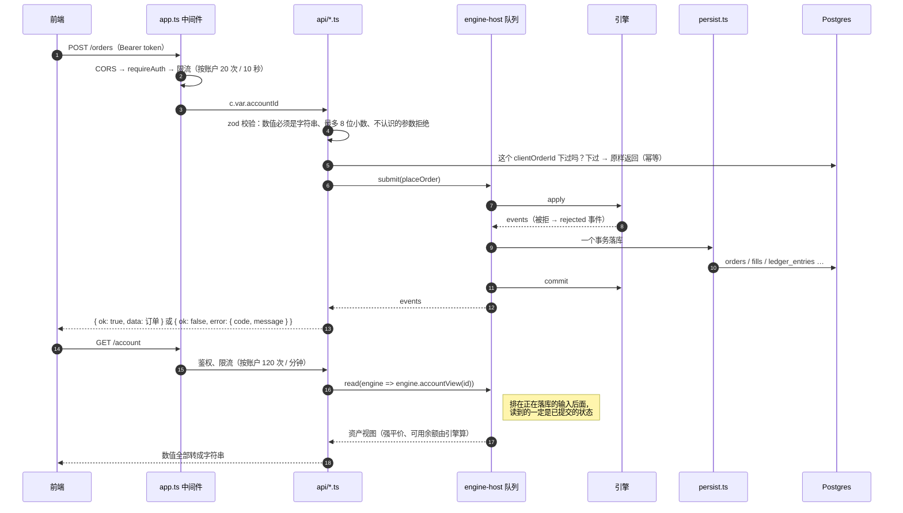

# 13a · 搭建教程：REST 接口（上）——交易与账户

> 到上一讲为止，用户能登录、能拿到 10,000 USDT，但**什么都做不了**：引擎能撮合，可是没有一个接口能把单子送进去，也没有一个接口能把余额、仓位读出来。
> 这一讲把交易和账户两组接口接上：下单、撤单、调杠杆、平仓；查资产、仓位、订单、成交、流水；重置账户。
>
> 验收标准是：**每个接口一条集成测试；同一个 `clientOrderId` 提交两次只产生一张单**。

第 13 讲原计划一讲做完全部 25 个接口，实际拆成两讲：13a 做 HTTP 基础设施 + 交易 + 账户，13b 做行情 + 权益快照 + 排行榜。

**这一讲结束时你会有什么**：

| 位置 | 干什么 |
| --- | --- |
| `packages/engine/src/liquidation.ts` | **修 bug**：全仓强平价 cum 符号写反，按币安 FAQ 重写（多空两条腿、crossWalletBalance、换档重算） |
| `packages/engine/src/views.ts` | 只读视图：账户资产、仓位视图、挂单，字段对照币安 account v3 / positionRisk v3 |
| `packages/engine` | 新输入 `cancelAllOrders`（按币对全撤，一个事务） |
| `apps/server/src/engine-host/engine-host.ts` | `read()`：只读查询排进同一个队列；**修 bug**：队列只剩同步任务时卡死 |
| `apps/server/src/http/` | `decimal.ts` 数值进出边界、`rate-limit.ts` 限流、`pagination.ts` 游标分页、`db-errors.ts` |
| `apps/server/src/api/` | `orders.ts` 3 个、`positions.ts` 4 个、`account.ts` 10 个接口，`serialize.ts` 输出形状 |
| `apps/server/src/app.ts` | 组装：CORS、鉴权、三档限流、所有路由；`index.ts` 和测试共用 |

- 测试：引擎 297 条（新增强平价 FAQ 算例、视图 7 条、全撤）、server 103 条（新增 16 条，其中 7 条是连本地数据库的接口验收），shared 34、db 51 全绿
- 真 server 实测：真实币安行情下查资产 → 挂单 → 重复提交被识别为重放 → 撤单 → 历史订单；`reconcile:ledger` 通过

**先读**：`docs/design/04-backend-design.md` 第 11 节"通用约定""账户""交易""账户重置"（**注意几处"已定"**）、第 13 节错误码；`07-binance-reference.md` 第 2、11 节。

> **代码已经在仓库里了**：AI 写代码和讲义，你对照着读。代码块用脚本从源文件截取，和仓库逐字一致（只去掉公共缩进）。

---

## 第 1 节：一张图



两条原则：**写操作全部经过引擎队列**（第 11 讲的规矩不变），**实时状态读引擎、历史读数据库**。

---

## 第 2 节：先修一个 bug——全仓强平价

`GET /account/positions` 要返回强平价。设计文档说"强平价由服务端算好返回，前端不自己算"，引擎里第 03 讲早就有 `liquidationPrice()`。接上之前，照 `07-binance-reference.md` "还没核对、写到时要查的"那一节的提醒，去对了一遍币安 FAQ「How to Calculate Liquidation Price of USDⓈ-M Futures Contracts」。

FAQ 里有一个完整算例（钱包 1,535,443.01，ETH 和 BTC 两个全仓多头，给了各自的 MMR 和 cum），拿第 03 讲的公式算：

| | FAQ 答案 | 第 03 讲写法 |
| --- | --- | --- |
| ETHUSDT | 1,153.26 | **1,234.91** |
| BTCUSDT | 26,316.89 | **26,622.28** |

差在 cum 的符号。第 03 讲写的是 `+ cumB − cumL`，把 cumB 理解成"逐仓的速算额"、cumL 理解成"全仓的速算额"，全仓时取了减号。FAQ 里 cumB 是**单向模式**（BOTH）仓位的，cumL / cumS 是**双向模式**多 / 空仓位的，**全都是加号**。

自己推一遍也能确认。单个全仓多头，强平价 P 处"权益 = 维持保证金"：

```
WB + Q × (P − EP) = Q × P × MMR − cum
P × (Q − Q × MMR) = EP × Q − WB − cum
P = (WB + cum − Q × EP) ÷ (Q × MMR − Q)
```

**为什么第 03 讲的测试没发现**：三个算例的名义价值都在第 1 层，cum = 0，正负号没区别。只断言结果、不换一组 cum ≠ 0 的数据，符号错了测试照样绿。

**为什么没有造成损失**：这个函数只用于展示。风控强平（第 07 讲 `risk.ts`）直接比较"权益 ≤ 维持保证金"，从来不经过强平价。

顺带对齐了 FAQ 的另外三处：

1. **全仓 WB 是 crossWalletBalance**（钱包余额 − 逐仓保证金），不是钱包余额
2. **双向持仓**：同一币对的多、空两个全仓仓位一起进分子分母，得到同一个强平价
3. **换档重算**："假设的档位"算出强平价，如果强平价处的名义价值落在别的档，换那一档再算——这就是缺口 #24（算例 B 应该是第 2 层的 54,776.12）

```ts
// packages/engine/src/liquidation.ts
export interface LiquidationLeg {
  side: "LONG" | "SHORT";
  qty: Fixed; // 非负
  entryPrice: Fixed;
}

export interface LiquidationPriceInput {
  /**
   * WB。全仓：全仓钱包余额 crossWalletBalance（钱包余额 − 逐仓保证金，缺口 #6）；
   * 逐仓：这个仓位自己的逐仓保证金。
   */
  walletBalance: Fixed;
  /** TMM₁：其它币对全仓仓位的维持保证金之和（按各自标记价）。逐仓传 0。 */
  otherMaintMarginSum: Fixed;
  /** UPNL₁：其它币对全仓仓位的未实现盈亏之和（按各自标记价）。逐仓传 0。 */
  otherUnrealizedPnlSum: Fixed;
  /** 本币对参与计算的仓位。全仓双向模式把多、空两条都传进来；逐仓每个仓位单独算，只传一条。 */
  legs: readonly LiquidationLeg[];
  /** 本币对的分层表（按 notionalCap 升序）：每条腿按"强平价处的名义价值"选层 */
  brackets: readonly LeverageBracket[];
}

/**
 * 强平价，按币安 FAQ「How to Calculate Liquidation Price of USDⓈ-M Futures Contracts」（2026-09-17 核对，页面更新于 2025-12-31）：
 *
 *   强平价 = (WB − TMM₁ + UPNL₁ + cumB + cumL + cumS − Side_B×Pos_B×EP_B − Pos_L×EP_L + Pos_S×EP_S)
 *          ÷ (Pos_B×MMR_B + Pos_L×MMR_L + Pos_S×MMR_S − Side_B×Pos_B − Pos_L + Pos_S)
 *
 * 写成"腿"的形式就是：分子 = WB − TMM₁ + UPNL₁ + Σcum − Σ(方向×数量×开仓价)，分母 = Σ(数量×MMR) − Σ(方向×数量)，
 * 方向多头 +1、空头 −1。推导：强平价处 全仓权益 WB + UPNL₁ + Σ方向×数量×(P − 开仓价) = TMM₁ + Σ(数量×P×MMR − cum)，解出 P。
 *
 * ⚠️ 第 13 讲修正（缺口 #39）：原来的写法是 `+ cumB − cumL`，把全仓的 cum 当成减号。
 * 第 03 讲三个算例都落在 cum = 0 的第 1 层，测试没发现；拿 FAQ 的 ETH / BTC 算例一对就错了
 * （ETHUSDT 应为 1,153.26，旧写法得 1,234.91）。这个函数只用于展示，风控强平不经过它，没有影响过任何资金。
 *
 * 选层（FAQ "Note"）：假设一个档位算出强平价，如果强平价处的名义价值落在别的档，就换那一档重算。
 * 这里从开仓价处的名义价值起步，最多迭代到档位数那么多次；分层表在边界上连续（维持保证金两层相等），
 * 边界上来回跳时两种选法结果相同，取最后一次。这也顺带修了缺口 #24（算例 B 应该是第 2 层的 54,776.12）。
 *
 * 返回 null = 没有强平价：分母为 0（双向全仓多空数量对冲、价格怎么走权益都不降到维持保证金）
 * 或算出来 ≤ 0（钱包足够扛到价格归零）。币安这两种情况显示 0 / "--"，我们返回 null，不编一个数。
 *
 * 不对齐 tickSize（缺口 #5）：强平价是计算阈值，不是委托价。最后一步 divRound 四舍五入到 8 位。
 */
export function liquidationPrice(input: LiquidationPriceInput): Fixed | null {
  const legs = input.legs.filter((leg) => leg.qty > 0n);
  if (legs.length === 0) return null;

  let chosen = legs.map((leg) => findBracket(input.brackets, mul(leg.qty, leg.entryPrice)));
  let price: Fixed | null = null;
  for (let round = 0; round <= input.brackets.length; round++) {
    price = solve(input, legs, chosen);
    if (price === null) return null;
    const next = legs.map((leg) => findBracket(input.brackets, mul(leg.qty, price!)));
    if (next.every((bracket, i) => bracket === chosen[i])) break;
    chosen = next;
  }
  return price !== null && price > 0n ? price : null;
}

function solve(input: LiquidationPriceInput, legs: readonly LiquidationLeg[], brackets: readonly LeverageBracket[]): Fixed | null {
  let numerator = input.walletBalance - input.otherMaintMarginSum + input.otherUnrealizedPnlSum;
  let denominator = 0n;
  legs.forEach((leg, i) => {
    const bracket = brackets[i]!;
    const sideTerm = mul(leg.qty, leg.entryPrice);
    numerator += bracket.cum - (leg.side === "LONG" ? sideTerm : -sideTerm);
    denominator += mul(leg.qty, bracket.mmr) - (leg.side === "LONG" ? leg.qty : -leg.qty);
  });
  if (denominator === 0n) return null;
  return divRound(numerator, denominator);
}
```

FAQ 算例直接进测试：

```ts
// packages/engine/src/liquidation.test.ts
const faqTier = (mmr: string, cum: string) => [{ bracketNum: 1, notionalFloor: 0n, notionalCap: parse("100000000"), maxLeverageNum: 125, mmr: parse(mmr), cum: parse(cum) }];

it("★ 币安 FAQ 算例 · ETHUSDT：1,153.26（第 13 讲前的旧写法算出 1,234.91——全仓 cum 符号反了，缺口 #39）", () => {
  const liq = liquidationPrice({
    walletBalance: parse("1535443.01"),
    otherMaintMarginSum: parse("71200.81144"),
    otherUnrealizedPnlSum: parse("-56354.57"),
    legs: [{ side: "LONG", qty: parse("3683.979"), entryPrice: parse("1456.84") }],
    brackets: faqTier("0.10", "135365"),
  })!;
  expect(format(liq, 2)).toBe("1153.26");
});
```

更重要的一条测试在视图里：**展示出来的强平价，必须就是风控真正强平的位置**。标记价比强平价好 0.01 不强平、差 0.01 就强平，全仓、逐仓、双向各跑一遍：

```ts
// packages/engine/src/views.test.ts
it("★ 展示的强平价和风控真正强平的位置一致：标记价比强平价高一点不强平、低一点就强平（全仓 / 逐仓 / 双向）", () => {
  const cases: { name: string; positions: Position[]; mode?: "HEDGE"; wallet: string }[] = [
    { name: "全仓单向多头", positions: [testPosition({ qty: parse("2"), leverageNum: 20 })], wallet: "8000" },
    {
      name: "逐仓空头",
      positions: [testPosition({ positionSide: "SHORT", marginMode: "ISOLATED", isolatedMargin: parse("3000"), leverageNum: 20 })],
      wallet: "10000",
    },
    {
      name: "双向全仓多空两条腿",
      mode: "HEDGE",
      positions: [testPosition({ qty: parse("2") }), testPosition({ positionSide: "SHORT", qty: parse("0.5"), entryPrice: parse("52000") })],
      wallet: "6000",
    },
  ];
  for (const c of cases) {
    const build = () => {
      const engine = createEngine(testConfig(), {
        accounts: [{ id: "acc-1", walletBalance: parse(c.wallet), positionMode: c.mode ?? "ONE_WAY" }],
        settings: [],
        positions: c.positions,
        orders: [],
      });
      run(engine, bookInput());
      run(engine, markPriceInput("50000"));
      return engine;
    };
    const liq = build().positionViews("acc-1")[0]!.liquidationPrice!;
    expect(liq, c.name).not.toBeNull();
    const isShortSide = c.positions[0]!.positionSide === "SHORT";
    const safe = isShortSide ? liq - parse("0.01") : liq + parse("0.01");
    const unsafe = isShortSide ? liq + parse("0.01") : liq - parse("0.01");

    const stillAlive = build();
    expect(run(stillAlive, markPriceInput(format(safe))).some((e) => e.t === "liquidation"), `${c.name} 强平价 ${format(liq, 2)} 外侧不该强平`).toBe(false);
    const liquidated = build();
    expect(run(liquidated, markPriceInput(format(unsafe))).some((e) => e.t === "liquidation"), `${c.name} 强平价 ${format(liq, 2)} 内侧应该强平`).toBe(true);
  }
});
```

把 cum 的符号改回旧写法，这条和 FAQ 两条一起变红（跑过）。

---

## 第 3 节：引擎只读视图

强平价、可用余额、维持保证金，服务端能不能自己算？能，但会漂移——风控改了一个舍入方式，展示这边忘了改，用户看到的强平价就和实际强平的位置不一样。所以视图也放在引擎里，和风控用同一套函数、同一份分层表：

```ts
// packages/engine/src/views.ts
export function accountView(state: EngineState, accountId: string): AccountView | null {
  requireSettled(state);
  const account = state.accounts.get(accountId);
  if (!account) return null;

  const positions = sortedPositions(state, (p) => p.accountId === accountId && p.qty > 0n);
  const missing = new Set<string>();
  let unrealized = 0n;
  let crossUnrealized = 0n;
  let positionIm = 0n;
  let maint = 0n;
  let crossMaint = 0n;
  for (const position of positions) {
    const mark = state.marks.get(position.symbol)?.markPrice;
    if (mark === undefined) {
      missing.add(position.symbol);
      continue;
    }
    const pnl = unrealizedPnl(position, mark);
    const mm = positionMaintMargin(state, position, mark);
    unrealized += pnl;
    positionIm += initialMargin(position.qty, mark, position.leverageNum);
    maint += mm;
    if (position.marginMode === "CROSS") {
      crossUnrealized += pnl;
      crossMaint += mm;
    }
  }

  let openOrderMargin = 0n;
  for (const order of state.orders.values()) {
    if (order.accountId === accountId) openOrderMargin += order.frozenMargin;
  }

  const crossWallet = crossWalletBalance(state, accountId);
  const known = missing.size === 0;
  const available = accountAvailable(state, account);
  return {
    accountId,
    positionMode: account.positionMode,
    walletBalance: account.walletBalance,
    crossWalletBalance: crossWallet,
    unrealizedPnl: known ? unrealized : null,
    crossUnrealizedPnl: known ? crossUnrealized : null,
    marginBalance: known ? account.walletBalance + unrealized : null,
    positionInitialMargin: known ? positionIm : null,
    openOrderMargin,
    maintMargin: known ? maint : null,
    availableBalance: typeof available === "string" ? null : available,
    marginRatio: known ? (crossMaint === 0n ? 0n : marginRatio(crossMaint, crossWallet + crossUnrealized)) : null,
    missingMarkPrices: [...missing].sort(),
  };
}
```

字段口径对照币安 `GET /fapi/v3/account`（`07-binance-reference.md` 第 11 节）。两个细节：

- **缺标记价就返回 null，并点名是哪个币对**（`missingMarkPrices`）。比如已下架币对上的旧仓位永远不会再有标记价——不拿 0 顶替，宁可说算不出来
- **起始保证金按标记价**：币安 positionRisk 原文 "initial margin required with current mark price"。可用余额（下单校验用的那个数）还是第 04 讲的开仓价口径，两者对不上，记为缺口 #43，查到币安原文之前不改下单校验

```ts
// packages/engine/src/views.ts
export function positionViews(state: EngineState, accountId: string): PositionView[] {
  requireSettled(state);
  if (!state.accounts.has(accountId)) return [];
  const positions = sortedPositions(state, (p) => p.accountId === accountId && p.qty > 0n);
  return positions.map((position) => {
    const mark = state.marks.get(position.symbol)?.markPrice ?? null;
    const value = mark === null ? null : notional(position.qty, mark);
    const pnl = mark === null ? null : unrealizedPnl(position, mark);
    const im = mark === null ? null : initialMargin(position.qty, mark, position.leverageNum);
    return {
      symbol: position.symbol,
      positionSide: position.positionSide as "LONG" | "SHORT",
      marginMode: position.marginMode,
      leverageNum: position.leverageNum,
      qty: position.qty,
      entryPrice: position.entryPrice,
      markPrice: mark,
      notional: value,
      unrealizedPnl: pnl,
      initialMargin: im,
      maintMargin: mark === null ? null : positionMaintMargin(state, position, mark),
      isolatedMargin: position.marginMode === "ISOLATED" ? position.isolatedMargin : 0n,
      liquidationPrice: liquidationPriceOf(state, position, positions),
      roe: pnl === null || im === null || im === 0n ? null : divRound(pnl, im),
      openedAt: position.openedAt,
      updatedAt: position.updatedAt,
    };
  });
}
```

ROE 按币安 FAQ「How to Calculate Profit and Loss」的标记价口径：未实现盈亏 ÷ (标记价 × 数量 ÷ 杠杆)。

### 宿主的 read()：读也要排队

视图有一道闸：

```ts
// packages/engine/src/views.ts
function requireSettled(state: EngineState): void {
  if (state.journal) throw new Error("有未结算的 apply（没调 commit() 或 rollback()），不能读视图：读到的可能是还没落库的状态");
}
```

为什么？宿主处理一个输入是 `apply → await 落库 → commit`。await 期间内存里已经是新状态，但**还没落库，可能被回滚**。这时候 HTTP 请求直接读引擎，就会读到一张最后并不存在的单。

所以读也排进同一个队列，轮到它时前一个输入一定已经提交或回滚：

```ts
// apps/server/src/engine-host/engine-host.ts
read(fn) {
  return new Promise((resolve, reject) =>
    enqueue({
      kind: "read",
      run: () => {
        try {
          resolve(fn(engine));
        } catch (error) {
          reject(error);
        }
      },
    }),
  );
},
```

### 顺带修的队列 bug

加 `read()` 的测试时，"查询函数抛错之后队列照常往下走"这条超时了。原因在 `enqueue`：

```ts
function enqueue(task) {
  queue.push(task);
  if (!running) running = drain();
}
```

`drain` 是 async 函数，第一次 `await` 之前的代码同步执行。以前队列里全是输入任务，处理时一定会 `await persist`，所以 `running = drain()` 的赋值总是先于 drain 结束。只读任务没有 await：drain 同步跑完、把 `running` 置成 null、返回——**然后**赋值把 `running` 设成一个已经完成的 Promise。之后再入队，`running` 非空，没人启动 drain，任务永远卡在队列里。

修法是在 drain 开头先让出一次：

```ts
// apps/server/src/engine-host/engine-host.ts
async function drain(): Promise<void> {
  // 先让出一次：保证 enqueue 里 `running = drain()` 的赋值发生在 drain 结束之前。
  // 只读任务没有 await，如果不让出，drain 会同步跑完、先把 running 置 null，
  // 随后赋值又把它设成一个已完成的 Promise——之后再入队的任务永远没人处理（第 13 讲加 read 时踩到）
  await Promise.resolve();
```

---

## 第 4 节：数值怎么过 JSON 边界

CLAUDE.md 硬约束 4：bigint 不许直接进 JSON。第 12 讲还没有金额，这一讲开始到处都是：

```ts
// apps/server/src/http/decimal.ts
const DECIMAL = /^(0|[1-9]\d*)(\.\d{1,8})?$/;

export function decimalInput(label: string) {
  return z
    .string({ error: `${label}要用字符串传，例如 "0.01"` })
    .regex(DECIMAL, `${label}格式不对：要求非负十进制数、最多 8 位小数，例如 "50000.5"`)
    .transform((value): Fixed => parse(value));
}

export function toDecimal(value: Fixed): string {
  const text = format(value);
  return text.includes(".") ? text.replace(/\.?0+$/, "") : text;
}
```

- **只收字符串**。`{"qty": 0.1}` 在 `JSON.parse` 那一刻就已经是二进制浮点数了，精度在代码看到它之前就丢了
- **超过 8 位小数拒绝，不截断**。`packages/shared` 的 `parse()` 会静默截掉第 9 位——用户以为下了 0.123456789，实际下的是 0.12345678。宁可报错
- 输出按 8 位精确格式化，再去掉末尾的 0：`"50000.25"`、`"0"`、`"0.00000001"`

---

## 第 5 节：下单与幂等

```ts
// apps/server/src/api/orders.ts
const placeOrderSchema = z.strictObject(
  {
    clientOrderId: z.string().regex(CLIENT_ORDER_ID, "clientOrderId 只能是 1～36 位字母、数字或 . : / _ -").optional(),
    symbol: z.string({ error: "缺少 symbol" }).min(1, "缺少 symbol"),
    side: z.enum(ORDER_SIDE, { error: "side 只能是 BUY 或 SELL" }),
    // 币安：单向模式默认 BOTH
    positionSide: z.enum(POSITION_SIDE, { error: "positionSide 只能是 BOTH / LONG / SHORT" }).default("BOTH"),
    type: z.enum(USER_ORDER_TYPES, { error: `type 只能是 ${USER_ORDER_TYPES.join(" / ")}` }),
    timeInForce: z.enum(TIME_IN_FORCE, { error: "timeInForce 只能是 GTC / IOC / FOK / GTX" }).optional(),
    price: decimalInput("price").optional(),
    stopPrice: decimalInput("stopPrice").optional(),
    workingType: z.enum(WORKING_TYPE, { error: "workingType 只能是 MARK_PRICE 或 CONTRACT_PRICE" }).optional(),
    qty: decimalInput("qty").optional(),
    reduceOnly: z.boolean({ error: "reduceOnly 要传布尔值" }).optional(),
    closePosition: z.boolean({ error: "closePosition 要传布尔值" }).optional(),
  },
  {
    // 缺口 #28：priceProtect、goodTillDate、activationPrice（跟踪止损）等没实现的参数，直接拒，不假装支持
    error: (issue) => (issue.code === "unrecognized_keys" ? `不支持的参数：${issue.keys.join(", ")}` : undefined),
  },
);
```

参数"组合"合不合法（LIMIT 必须有 price、双向模式不能传 reduceOnly……）是引擎校验链第 3 步的事，这里只管形状。`z.strictObject` 让不认识的参数直接报错——`priceProtect`、`goodTillDate` 这些没实现的币安参数，传了就明确告诉用户"不支持"，不悄悄忽略（缺口 #28）。

```ts
// apps/server/src/api/orders.ts
routes.post("/", async (c) => {
  const accountId = c.var.accountId;
  const body = await parseBody(c, placeOrderSchema);
  requireTradableSymbol(deps.symbols, body.symbol);
  const clientOrderId = body.clientOrderId ?? `web_${randomUUID().replace(/-/g, "").slice(0, 32)}`;

  // 幂等（设计文档）：同一账户同一个 clientOrderId 重复提交，返回已经存在的那张单，不再下一次。
  // 和币安不同（缺口 #41）：币安只要求"在未完成订单里唯一"，我们对历史订单也唯一（orders_acc_client_uq），
  // 网络超时重试不管那张单成交没成交都不会重复下
  const replay = async () => {
    const existing = await findByClientOrderId(accountId, clientOrderId);
    if (!existing) return null;
    c.header("X-Idempotent-Replay", "true");
    return ok(c, orderFromDb(existing));
  };
  const early = await replay();
  if (early) return early;

  const orderId = randomUUID();
  const req: PlaceOrderRequest = { ...body, clientOrderId };
  let events;
  try {
    events = await submitOrThrow(host, { t: "placeOrder", accountId, orderId, req, ts: deps.now() });
  } catch (error) {
    // 两个同样的请求同时到：都没查到、都去下单，队列一前一后，后一个撞唯一索引、引擎回滚。返回前一个下的那张
    if (isUniqueViolation(error, "orders_acc_client_uq")) {
      const replayed = await replay();
      if (replayed) return replayed;
    }
    throw error;
  }

  const update = events.findLast((e) => e.t === "orderUpdate" && e.order.id === orderId);
  if (!update || update.t !== "orderUpdate") throw new Error(`下单 ${orderId} 没有产生订单事件`);
  return ok(c, orderFromEngine(update.order));
});
```

幂等分两层：

1. **先查**：这个 `(accountId, clientOrderId)` 下过就原样返回，带响应头 `X-Idempotent-Replay: true`
2. **再兜底**：两个同样的请求同时到，都没查到、都去下单。队列一前一后，后一个落库时撞 `orders_acc_client_uq` 唯一索引 → 事务失败 → 引擎回滚 → 这里认出是这个索引，再查一次返回前一张

集成测试用 `Promise.all` 并发发两次，库里只有一行。**把兜底那段改成 `if (false)`，这条测试变红**——确认并发真的走到了唯一索引那条路。

和币安不一样的地方（缺口 #41）：币安的 `newClientOrderId` 只要求在**未完成订单**里唯一，我们对历史订单也唯一。网络超时后重试，不管那张单成交没成交都不会重复下。被引擎拒掉的单不入库，同一个 id 改了参数可以重新下。

还有一道 REST 层的挡板：

```ts
// apps/server/src/api/context.ts
export function requireTradableSymbol(symbols: readonly SymbolSpec[], symbol: string): SymbolSpec {
  const spec = symbols.find((s) => s.symbol === symbol);
  if (!spec || !spec.enabled || spec.status !== "TRADING") {
    throw new AppError("SYMBOL_NOT_TRADING", `${symbol} 不存在或未开放交易`);
  }
  return spec;
}
```

---

## 第 6 节：撤单和按币对全撤

```ts
// apps/server/src/api/orders.ts
routes.delete("/:id", async (c) => {
  const id = c.req.param("id");
  if (!z.uuid().safeParse(id).success) throw new AppError("ORDER_NOT_FOUND", `订单 ${id} 不存在或已经结束`);
  const events = await submitOrThrow(host, { t: "cancelOrder", accountId: c.var.accountId, orderId: id, ts: deps.now() });
  const update = events.find((e) => e.t === "orderUpdate");
  if (!update || update.t !== "orderUpdate") throw new Error(`撤单 ${id} 没有产生订单事件`);
  return ok(c, orderFromEngine(update.order));
});
```

id 不是 uuid 直接报"订单不存在"，不让格式错误变成 500。别人的订单 id 也是"不存在"（引擎按账户核对），不泄露"这张单存在但不是你的"。

按币对全撤如果在 REST 层循环调 `cancelOrder`，撤到一半数据库挂了，就是"撤了一半"。所以加成引擎的一个输入，一次 apply、一个事务：

```ts
// packages/engine/src/resting-orders.ts
export function cancelAllOrders(state: EngineState, input: InputOf<"cancelAllOrders">): EngineEvent[] {
  requireSymbol(state, input.symbol);
  return sortedOrders(state, (o) => o.accountId === input.accountId && o.symbol === input.symbol).map((order) => {
    removeOrder(state, order.id);
    return { t: "orderUpdate", order: { ...order, status: "CANCELED", frozenMargin: 0n, updatedAt: input.ts } };
  });
}
```

---

## 第 7 节：仓位设置和一键平仓

调杠杆、切保证金模式、调逐仓保证金，规则全在第 08 讲的 `account-ops.ts`，接口只是转发 + 翻译错误。调杠杆这里差点犯一个"凭记忆"的错：原本写了 `max(125)`，查库里 BTCUSDT 分层表，第 1 层最大杠杆现在是 **150**；币安参数说明也只写了 "target initial leverage"。上限交给引擎按分层表判。

```ts
// apps/server/src/api/positions.ts
routes.post("/close", async (c) => {
  const accountId = c.var.accountId;
  const body = await parseBody(c, closeSchema);
  requireTradableSymbol(deps.symbols, body.symbol);

  const target = await host.read((engine) => {
    const view = engine.accountView(accountId);
    if (!view) return null;
    const position = engine
      .positionViews(accountId)
      .find((p) => p.symbol === body.symbol && (view.positionMode === "ONE_WAY" || p.positionSide === body.positionSide));
    return position ? { mode: view.positionMode, position } : null;
  });
  if (!target) throw new AppError("POSITION_NOT_FOUND", `${body.symbol} 上没有可以平的仓位`);
  if (target.mode === "HEDGE" && body.positionSide === "BOTH") {
    throw new AppError("POSITION_SIDE_MISMATCH", "当前是双向持仓模式，positionSide 必须是 LONG 或 SHORT");
  }

  const orderId = randomUUID();
  const { position, mode } = target;
  const events = await submitOrThrow(host, {
    t: "placeOrder",
    accountId,
    orderId,
    req: {
      clientOrderId: `close_${randomUUID().replace(/-/g, "").slice(0, 30)}`,
      symbol: body.symbol,
      side: position.positionSide === "LONG" ? "SELL" : "BUY",
      positionSide: mode === "ONE_WAY" ? "BOTH" : position.positionSide,
      type: "MARKET",
      qty: position.qty,
      ...(mode === "ONE_WAY" ? { reduceOnly: true } : {}),
    },
    ts: deps.now(),
  });
  const update = events.findLast((e) => e.t === "orderUpdate" && e.order.id === orderId);
  if (!update || update.t !== "orderUpdate") throw new Error(`平仓单 ${orderId} 没有产生订单事件`);
  return ok(c, orderFromEngine(update.order));
});
```

一键平仓就是按当前仓位数量下一张市价单：

- 单向模式带 `reduceOnly`：万一读仓位和下单之间仓位变小了，引擎按只减仓截断（缺口 #18），不会反手开出新仓
- 双向模式按币安规则不能传 `reduceOnly`，`SELL + LONG` 本身就是平多
- 仓位超过市价单最大数量（BTCUSDT 120）会被校验链拒 `LOT_SIZE`。**不自动拆单**：拆成几张、间隔多久、中途价格变了怎么办，都是在替用户做交易决定

---

## 第 8 节：账户接口

### 资产和仓位：读引擎

```ts
// apps/server/src/api/account.ts
routes.get("/", async (c) => {
  const accountId = c.var.accountId;
  const row = await accountRow(accountId);
  const view = await host.read((engine) => engine.accountView(accountId));
  if (!view) throw new AppError("UNAUTHORIZED", "账户不存在，请重新登录");
  const availableAt = resetAvailableAt(row.lastResetAt);
  return ok(c, {
    ...accountJson(view),
    nickname: row.nickname,
    canReset: availableAt === null,
    resetAvailableAt: availableAt,
  });
});
```

仓位按币安 positionRisk 的表示法输出（缺口 #12 当时定的"REST 建议一致"）：单向模式 `positionSide: "BOTH"` + `positionAmt` 多正空负。

### 历史：读数据库，游标分页

```ts
// apps/server/src/http/pagination.ts
export async function paginate<Row extends { id: string }>(options: PageOptions): Promise<{ items: Row[]; nextCursor: string | null }> {
  const { db, table, idColumn, timeColumn, accountColumn, accountId } = options;
  const conditions: (SQL | undefined)[] = [eq(accountColumn, accountId), ...(options.filters ?? [])];

  if (options.cursor) {
    // 游标只认自己账户的记录：拿别人的 id 当游标，不能借此探测别人的数据存不存在
    const [anchor] = await db
      .select({ time: timeColumn })
      .from(table)
      .where(and(eq(idColumn, options.cursor), eq(accountColumn, accountId)));
    if (!anchor) throw new AppError("INVALID_PARAMS", "cursor 无效，请从第一页重新查询");
    conditions.push(or(lt(timeColumn, anchor.time), and(eq(timeColumn, anchor.time), lt(idColumn, options.cursor))));
  }

  const rows = (await db
    .select()
    .from(table)
    .where(and(...conditions))
    .orderBy(desc(timeColumn), desc(idColumn))
    .limit(options.limit + 1)) as Row[];
  const hasMore = rows.length > options.limit;
  const items = hasMore ? rows.slice(0, options.limit) : rows;
  return { items, nextCursor: hasMore ? items[items.length - 1]!.id : null };
}
```

- **为什么不用 offset**：流水一直在增长，offset 要先数过前面所有行；翻页期间插进来新记录，offset 会错位，同一条出现两次或者漏一条
- **为什么排序键要带 id**：一次 apply 的所有事件是同一个时间戳，只按时间排，同一时刻的几条之间顺序不定，翻页会漏
- **游标只认自己账户的记录**：拿别人的流水 id 当游标报 `INVALID_PARAMS`，不能借此探测别人的数据

挂单（`status=open`）不分页：从引擎读，排队位置是实时的，每个币对最多 200 张。

### 重置：冷却和并发

```ts
// apps/server/src/api/account.ts
const resetLocks = new Map<string, Promise<unknown>>();
routes.post("/reset", async (c) => {
  const accountId = c.var.accountId;
  const previous = resetLocks.get(accountId) ?? Promise.resolve();
  const current = previous.catch(() => {}).then(async () => {
    const row = await accountRow(accountId);
    const availableAt = resetAvailableAt(row.lastResetAt);
    if (availableAt !== null) {
      throw new AppError("RESET_COOLING_DOWN", `重置冷却中，${new Date(availableAt).toISOString()} 之后可以再次重置`);
    }
    const ts = deps.now();
    await submitOrThrow(host, { t: "resetAccount", accountId, walletBalance: INITIAL_WALLET_BALANCE, ts });
    return { walletBalance: toDecimal(INITIAL_WALLET_BALANCE), resetAt: ts, resetAvailableAt: ts + RESET_COOLDOWN_MS };
  });
  resetLocks.set(accountId, current);
  try {
    return ok(c, await current);
  } finally {
    if (resetLocks.get(accountId) === current) resetLocks.delete(accountId);
  }
});
```

24 小时冷却由宿主查 `accounts.last_reset_at`（第 08 讲定：引擎不看钟）。检查和提交之间有 await，两个并发请求可能都通过冷却检查、重置两次——所以同一个账户的重置串行。集成测试并发发两次：一个 200、一个 409 `RESET_COOLING_DOWN`。

---

## 第 9 节：限流和组装

```ts
// apps/server/src/http/rate-limit.ts
export function rateLimit(options: RateLimitOptions): MiddlewareHandler {
  const now = options.now ?? Date.now;
  const windows = new Map<string, { startedAt: number; count: number }>();

  return async (c, next) => {
    const key = options.key(c);
    if (key === null) return next();
    const t = now();
    let window = windows.get(key);
    if (!window || t - window.startedAt >= options.windowMs) {
      window = { startedAt: t, count: 0 };
      windows.set(key, window);
      if (windows.size % 1000 === 0) {
        for (const [k, w] of windows) if (t - w.startedAt >= options.windowMs) windows.delete(k);
      }
    }
    window.count++;
    if (window.count > options.limit) {
      const retryAfterSeconds = Math.ceil((window.startedAt + options.windowMs - t) / 1000);
      c.header("Retry-After", String(retryAfterSeconds));
      throw new AppError("RATE_LIMITED", `请求太频繁，请 ${retryAfterSeconds} 秒后再试`);
    }
    await next();
  };
}
```

固定窗口、进程内存计数。服务端是单进程（引擎也只有一份），用不着 Redis。

```ts
// apps/server/src/app.ts
export function createApp(deps: AppDeps) {
  const now = deps.now ?? Date.now;
  const logger = deps.logger ?? console;
  const clientIp = deps.clientIp ?? remoteAddress;
  const app = new Hono();

  app.onError(createErrorHandler(logger));
  if (deps.logRequests !== false) app.use(requestLogger());
  app.use(
    "/*",
    cors({
      origin: deps.webOrigin,
      allowMethods: ["GET", "POST", "DELETE", "OPTIONS"],
      allowHeaders: ["Authorization", "Content-Type"],
      exposeHeaders: ["Retry-After", "X-Idempotent-Replay"],
    }),
  );
  app.get("/", (c) => c.text("OK"));

  const byAccount = (c: Context) => (c as Context<AuthEnv>).get("accountId") ?? null;
  const auth = requireAuth(deps.jwtSecret);
  const privateRateLimit = rateLimit({ name: "private", limit: 120, windowMs: 60_000, key: byAccount, now });

  app.use("/auth/*", rateLimit({ name: "public", limit: 60, windowMs: 60_000, key: clientIp, now }));
  app.route(
    "/auth",
    createAuthRoutes({
      db: deps.db,
      registrar: deps.registrar,
      jwtSecret: deps.jwtSecret,
      webOrigin: deps.webOrigin,
      mailer: deps.mailer,
      google: deps.google,
      secureCookies: deps.secureCookies,
      now,
      logger,
    }),
  );

  const api: ApiDeps = { db: deps.db, host: deps.host, symbols: deps.symbols, jwtSecret: deps.jwtSecret, now };
  app.route("/orders", createOrderRoutes(api, { auth, orderRateLimit: rateLimit({ name: "orders", limit: 20, windowMs: 10_000, key: byAccount, now }) }));
  app.route("/positions", createPositionRoutes(api, { auth, rateLimit: privateRateLimit }));
  app.route("/account", createAccountRoutes(api, { auth, rateLimit: privateRateLimit }));

  return app;
}
```

几个要注意的地方：

- **每组私有路由挂在自己的前缀下**（`/orders`、`/positions`、`/account`）。Hono 里子应用的 `use("*")` 会随 `app.route()` 合并进来，如果都挂在 `/` 下，下单限流会套到所有接口上
- **CORS 加了 `DELETE`**：第 12 讲只有 GET / POST，撤单接口从浏览器发会被预检拦住
- **按 IP 限流取的是 TCP 对端地址**。以后部署在 Cloudflare Tunnel 或反向代理后面，对端永远是代理，要改成信任代理头（`clientIp` 参数留了口子）
- `index.ts` 和集成测试用同一个 `createApp`：测试测到的就是线上的路由、中间件和错误处理

---

## 第 10 节：验收

`apps/server/src/api/api.integration.test.ts`，7 条，真数据库（事务最终回滚）+ 真引擎 + 真宿主 + `createApp`；行情是固定的假盘口，交易规则和分层表是库里从币安同步来的真实数据。

| 用例 | 覆盖的接口 | 关键断言 |
| --- | --- | --- |
| ★ 下单 / 撤单 / 幂等 | `POST /orders` `DELETE /orders/:id` `DELETE /orders?symbol=` `GET /account/orders` `GET /account` | 重复提交返回同一张 + 重放头；**并发两次库里只有一行**；挂单冻结 = 资产里的 openOrderMargin；别人撤不了也看不到；全撤一个事务 |
| 市价开仓到平仓 | `GET /account/positions` `/fills` `/ledger` `POST /positions/close` | 单向空头 `BOTH` + `-0.1`；空头强平价在上方；手续费流水 = 成交手续费；平仓后流水类型齐全；对账 0 差 |
| 仓位设置 | `POST /positions/leverage` `/margin-mode` `/isolated-margin` `/account/position-mode` | 有仓位时切模式 409；加保证金后强平价离得更远；减太多 `MARGIN_WOULD_LIQUIDATE`；双向模式平仓要指定方向 |
| 账户重置 | `POST /account/reset` | **并发两次一个 200 一个 409**；仓位挂单清空、余额 10,000、一条 RESET 流水；冷却结束能再重置 |
| 参数和权限 | 各接口 | JSON 数字、9 位小数、`priceProtect`、`LIQUIDATION`、中文 clientOrderId、未知币对都拒；引擎拒单 400 且不入库；没行情的币对 503；没 token 401；昵称 |
| 游标分页 | `/account/ledger` `/fills` `/funding` `/liquidations` | limit=2 逐页翻完和一次查全部**逐条相同、没有重复**；别人的 id、不存在的 id 当游标报错 |
| 限流 | `/orders` | 第 21 次 429 + `Retry-After: 10`；另一个账户、查询接口不受影响；窗口过了恢复 |

另外在真 server 上走了一遍（真实币安行情、本地数据库）：

```text
GET    /account       → walletBalance "10000"，availableBalance "10000"
POST   /orders        → 挂 0.002 BTC @ 74,589（标记价 76,896 的 97%）：NEW，frozenMargin "7.533489"
                         = 74,589 × 0.002 ÷ 20 + 74,589 × 0.002 × 0.0005
POST   /orders（重复）→ x-idempotent-replay: true
GET    /account       → openOrderMargin "7.533489"，availableBalance "9992.466511"
DELETE /orders/:id    → CANCELED，frozenMargin "0"
GET    /account/orders?status=history → 查到这张
reconcile:ledger      → 对账通过
```

---

## 验收清单

- [x] 每个接口至少一条集成测试
- [x] 同一个 `clientOrderId` 提交两次（含并发）只产生一张单
- [x] 金额只收字符串、最多 8 位小数，输出全是字符串
- [x] 强平价、可用余额由引擎算，展示的强平价就是风控强平的位置
- [x] 实时状态读引擎（排队读），历史读数据库（游标分页不重不漏）
- [x] 按币对全撤、重置都是一个事务；并发重置不会重置两次
- [x] 三档限流
- [x] 全仓强平价 cum 符号 bug 修掉，币安 FAQ 算例进测试

---

## 读完可以自测

1. 第 03 讲的强平价测试有"反向验算"，为什么还是没抓住 cum 的符号错误？要怎么选测试数据才能抓住？
2. HTTP 请求为什么不能直接调 `engine.accountView()`，而要走 `host.read()`？直接读会读到什么？
3. `drain()` 开头那行 `await Promise.resolve()` 删掉之后，什么情况下队列会卡死？为什么以前没发生？
4. 为什么拒绝 `{"qty": 0.1}`，只收 `{"qty": "0.1"}`？为什么 9 位小数要拒绝而不是截断？
5. 下单幂等为什么"先查一次"之后还需要唯一索引兜底？两个并发请求具体是怎么走到唯一索引的？
6. 按币对全撤为什么要加成引擎的输入，而不是在接口里循环撤单？
7. 游标分页的排序键为什么是 (时间, id) 而不只是时间？拿别人的记录 id 当游标会发生什么？
8. 一键平仓为什么单向模式要带 `reduceOnly`，而仓位太大时不自动拆单？
