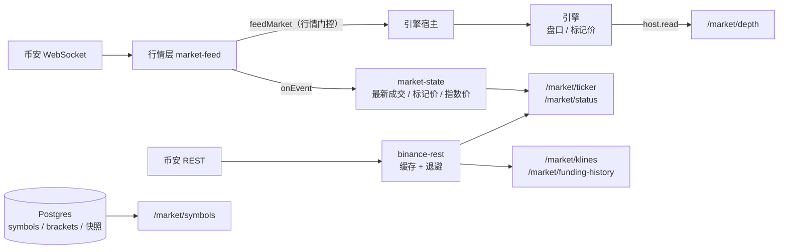

# 13b · 搭建教程：REST 接口（下）——行情、权益快照、排行榜

> 13a 之后，登录的用户能下单、能看自己的账户。但打开交易页面的第一眼——币对列表、价格、盘口、K 线——还全都拿不到；排行榜和收益曲线也没有数据来源。
> 这一讲补齐剩下的 REST 接口：6 个行情接口、每日权益快照、排行榜、权益曲线。
>
> 验收标准沿用第 13 讲：**每个接口一条集成测试**。

**这一讲结束时你会有什么**：

| 位置 | 干什么 |
| --- | --- |
| `apps/server/src/market/binance-rest.ts` | 代理币安公开 REST：K 线、历史资金费率、24 小时统计。TTL 缓存、并发只请求一次、被限流按 Retry-After 退避、严格解析 |
| `apps/server/src/market/market-state.ts` | 行情层收到的最新标记价 / 指数价格 / 成交 |
| `apps/server/src/market/parse.ts` | 标记价推送补解析指数价格 `i` |
| `packages/engine/src/views.ts` | 新视图 `marketView`（撮合用的盘口）、`allAccountViews`（快照用） |
| `apps/server/src/api/market.ts` | `/market/symbols` `ticker` `depth` `klines` `funding-history` `status` |
| `apps/server/src/jobs/equity-snapshot.ts` | 每日 UTC 00:00 权益快照 |
| `apps/server/src/api/leaderboard.ts` | `/leaderboard` |
| `apps/server/src/api/account.ts` `positions.ts` | `/account/equity-curve`；调杠杆返回 `maxNotional` |
| `apps/server/src/testing/api-harness.ts` | 接口集成测试的共用脚手架（13a 的搭建代码抽出来） |

- 测试：引擎 299 条、server 121 条（新增 18 条：行情接口 6、排行榜 3、快照任务 4、币安 REST 代理 5），shared 34、db 51 全绿
- 真 server 实测：真实币安行情下 9 个新接口全部走通

**先读**：`docs/design/04-backend-design.md` 第 11 节"行情（公共）""排行榜"（**注意"已定"**）；`03-database-design.md` 的 `equity_snapshots`；`07-binance-reference.md` 第 12 节。

> **代码已经在仓库里了**：AI 写代码和讲义，你对照着读。代码块用脚本从源文件截取，和仓库逐字一致（只去掉公共缩进）。

---

## 第 1 节：行情数据从哪来

一个行情页面要的数，在我们系统里有四个来源，每个接口都要想清楚取哪一个：

| 数据 | 来源 | 为什么 |
| --- | --- | --- |
| 币对规格、分层表 | 数据库 | `seed:symbols` / `sync:brackets` 同步的，分层表热加载之后库里就是最新的 |
| 盘口 | **引擎** | 用户看到的盘口必须就是撮合用的那份，不能另起一份 |
| 最新成交、标记价、指数价格 | 行情层（`market-state`） | 引擎只收"就绪币对"的推送（第 11 讲行情门控），状态接口要的恰恰是"最后一笔成交是什么时候"——不管就绪不就绪 |
| 24 小时统计、历史 K 线、历史资金费率 | 币安 REST（代理 + 缓存） | 我们没存历史，也不该自己从推送里攒——重启一次就断档 |



---

## 第 2 节：代理币安 REST

为什么不让前端直接请求币安？一是浏览器跨域，二是更要紧的：**币安的限额按 IP 算**。我们代理之后，所有用户共用服务器这一个 IP——前端每打开一次页面就原样转发一次，几十个用户就能把 IP 打进币安的封禁名单（HTTP 418），之后所有人的 K 线都没了。

先对着网页版文档把规则抄准（`07-binance-reference.md` 第 12 节）：K 线 interval 15 种（**没有 1s**）、limit 默认 500 最大 1500、权重按 limit 1 / 2 / 5 / 10；历史资金费率 limit 默认 100 最大 1000，和 fundingInfo 共享 500 次 / 5 分钟。

```ts
// apps/server/src/market/binance-rest.ts
export function createBinanceRest(options: BinanceRestOptions = {}): BinanceRest {
  const fetchImpl = options.fetch ?? fetch;
  const now = options.now ?? Date.now;
  const base = options.base ?? BINANCE_REST_BASE;
  const timeoutMs = options.timeoutMs ?? 5_000;
  const logger = options.logger ?? console;
  const maxEntries = options.maxCacheEntries ?? 500;

  let pausedUntil = 0;
  const cache = new Map<string, { expiresAt: number; value: Promise<unknown> }>();

  const unavailable = () => new AppError("SERVICE_UNAVAILABLE", "行情数据暂时拿不到，请稍后再试");

  async function getJson(path: string, params: Record<string, string | number | undefined>): Promise<unknown> {
    if (now() < pausedUntil) throw unavailable();
    const query = new URLSearchParams();
    for (const [k, v] of Object.entries(params)) if (v !== undefined) query.set(k, String(v));
    let response: Response;
    try {
      response = await fetchImpl(`${base}${path}?${query}`, { signal: AbortSignal.timeout(timeoutMs) });
    } catch (error) {
      logger.error(`[binance-rest] ${path} 请求失败`, error);
      throw unavailable();
    }
    if (response.status === 429 || response.status === 418) {
      const retryAfter = Number(response.headers.get("Retry-After"));
      const pauseMs = Number.isFinite(retryAfter) && retryAfter > 0 ? retryAfter * 1000 : 60_000;
      pausedUntil = now() + pauseMs;
      logger.error(`[binance-rest] ${path} 被币安限流（HTTP ${response.status}），暂停 ${pauseMs / 1000} 秒`);
      throw unavailable();
    }
    if (!response.ok) {
      logger.error(`[binance-rest] ${path} HTTP ${response.status}：${await response.text().catch(() => "")}`);
      throw unavailable();
    }
    return response.json();
  }

  /** TTL 缓存 + single-flight。失败的结果不缓存 */
  function cached<T>(key: string, ttlMs: number, load: () => Promise<T>): Promise<T> {
    const t = now();
    const hit = cache.get(key);
    if (hit && hit.expiresAt > t) return hit.value as Promise<T>;
    const value = load();
    cache.set(key, { expiresAt: t + ttlMs, value });
    value.catch(() => {
      if (cache.get(key)?.value === value) cache.delete(key);
    });
    if (cache.size > maxEntries) {
      for (const [k, entry] of cache) {
        if (entry.expiresAt <= t || cache.size > maxEntries) cache.delete(k);
        if (cache.size <= maxEntries) break;
      }
    }
    return value;
  }

  function parsed<T>(path: string, body: unknown, parser: (body: unknown) => T): T {
    try {
      return parser(body);
    } catch (error) {
      logger.error(`[binance-rest] ${path} 响应格式不对：${(error as Error).message}`);
      throw unavailable();
    }
  }
```

三件事：

- **TTL 缓存 + single-flight**：同一个请求并发到达，只发一次，其余等同一个 Promise；失败的结果不缓存
- **限流退避**：429 / 418 按 `Retry-After` 暂停（没有就 60 秒），暂停期间**连请求都不发**，直接返回 `SERVICE_UNAVAILABLE`——被限流了还继续撞，只会被封得更久
- **缓存时长看数据会不会变**：最新的 K 线最后一根还没收盘，缓存 5 秒；整段都已经收盘的历史 K 线不会再变，缓存 10 分钟

```ts
// apps/server/src/market/binance-rest.ts
klines({ symbol, interval, limit, startTime, endTime }) {
  // 最新的 K 线（最后一根还没收盘）只缓存 5 秒；整段都在过去、已经收盘的缓存 10 分钟
  const settled = endTime !== undefined && endTime < now() - INTERVAL_MS[interval];
  const key = `klines:${symbol}:${interval}:${limit}:${startTime ?? ""}:${endTime ?? ""}`;
  return cached(key, settled ? 600_000 : 5_000, async () =>
    parsed("/fapi/v1/klines", await getJson("/fapi/v1/klines", { symbol, interval, limit, startTime, endTime }), parseKlines),
  );
},
```

解析和行情推送同一个态度——**格式不对就报错，不猜**：

```ts
// apps/server/src/market/binance-rest.ts
export function parseKlines(body: unknown): Kline[] {
  if (!Array.isArray(body)) throw new Error("K 线响应不是数组");
  return body.map((row, i) => {
    if (!Array.isArray(row) || row.length < 11) throw new Error(`第 ${i} 根 K 线不是 12 元组`);
    return {
      openTime: integer(row[0], "openTime"),
      open: decimal(row[1], "open"),
      high: decimal(row[2], "high"),
      low: decimal(row[3], "low"),
      close: decimal(row[4], "close"),
      volume: decimal(row[5], "volume"),
      closeTime: integer(row[6], "closeTime"),
      quoteVolume: decimal(row[7], "quoteVolume"),
      trades: integer(row[8], "trades"),
      takerBuyVolume: decimal(row[9], "takerBuyVolume"),
      takerBuyQuoteVolume: decimal(row[10], "takerBuyQuoteVolume"),
    };
  });
}
```

写完之后先拿币安的真实响应跑了一遍解析（BTC / DOGE / SUI 各 1,500 根 K 线、资金费率、24 小时统计，全部解析通过），顺带发现一处文档和实际不一致：历史资金费率文档写 limit 最大 1000，实测 `limit=1000` 只返回 500 条（缺口 #46）。接口照文档允许 1～1000，返回多少条以币安为准，不补不编。

---

## 第 3 节：六个行情接口

```ts
// apps/server/src/api/market.ts
/** 只对开放且在交易的币对提供行情：代理币安的接口不能变成"任意币对都能查"的免费转发 */
function openSymbol(symbol: string): SymbolSpec {
  const spec = deps.symbols.find((s) => s.symbol === symbol);
  if (!spec || !spec.enabled || spec.status !== "TRADING") throw new AppError("SYMBOL_NOT_TRADING", `${symbol} 不存在或未开放交易`);
  return spec;
}
```

代理出去的接口必须限定币对，不然我们的服务器就成了"任意币对都能查"的免费转发，额度被别人耗光。

### ticker：实时部分和 24 小时统计分开失败

```ts
// apps/server/src/api/market.ts
routes.get("/ticker", async (c) => {
  const { symbol } = parseQuery(c, z.object(symbolQuery));
  openSymbol(symbol);
  const mark = deps.marketState.mark(symbol);
  const trade = deps.marketState.lastTrade(symbol);
  // 24 小时统计拿不到（币安限流、网络）不影响实时价格部分，stats24h 为 null
  const stats = await deps.rest.ticker24h(symbol).catch((error) => {
    if (error instanceof AppError) return null;
    throw error;
  });
  return ok(c, {
    symbol,
    ready: deps.feed.symbolReady(symbol),
    lastPrice: trade ? toDecimal(trade.price) : null,
    lastTradeTime: trade?.ts ?? null,
    markPrice: mark ? toDecimal(mark.markPrice) : null,
    indexPrice: mark ? toDecimal(mark.indexPrice) : null,
    fundingRate: mark ? toDecimal(mark.fundingRate) : null,
    nextFundingTime: mark?.nextFundingTs ?? null,
    markTime: mark?.ts ?? null,
    stats24h: stats && {
      priceChange: toDecimal(stats.priceChange),
      priceChangePercent: toDecimal(stats.priceChangePercent),
      openPrice: toDecimal(stats.openPrice),
      highPrice: toDecimal(stats.highPrice),
      lowPrice: toDecimal(stats.lowPrice),
      volume: toDecimal(stats.volume),
      quoteVolume: toDecimal(stats.quoteVolume),
      openTime: stats.openTime,
      closeTime: stats.closeTime,
      count: stats.count,
    },
  });
});
```

24 小时统计拿不到（币安限流、网络抖动）时，`stats24h` 是 `null`，**实时价格照常返回**。整个接口报错会让交易页面的价格也跟着消失，而价格其实就在内存里。

指数价格 `indexPrice` 本来就在标记价推送里（真实推送 fixtures 里有 `"i":"2445.30302326"`），第 10 讲解析时没取，这一讲补上：

```ts
// apps/server/src/market/parse.ts
function parseMarkPrice(data: Record<string, unknown>, raw: string): MarkPriceEvent {
  expectEvent(data, "markPriceUpdate", raw);
  return {
    t: "markPrice",
    symbol: str(data, "s", raw),
    markPrice: positive(data, "p", raw),
    indexPrice: positive(data, "i", raw),
    fundingRate: decimal(data, "r", raw, true),
    nextFundingTs: int(data, "T", raw),
    ts: int(data, "E", raw),
  };
}
```

### depth：读引擎

```ts
// apps/server/src/api/market.ts
routes.get("/depth", async (c) => {
  const query = parseQuery(c, z.object({ ...symbolQuery, limit: z.enum(["5", "10", "20"], { error: "limit 只能是 5、10、20" }).default("20") }));
  openSymbol(query.symbol);
  const view = await deps.host.read((engine) => engine.marketView(query.symbol));
  if (!view) throw new AppError("SYMBOL_NOT_TRADING", `${query.symbol} 不存在或未开放交易`);
  const n = Number(query.limit);
  const level = (l: { price: bigint; qty: bigint }) => [toDecimal(l.price), toDecimal(l.qty)];
  return ok(c, {
    symbol: query.symbol,
    ready: deps.feed.symbolReady(query.symbol),
    bids: view.bids.slice(0, n).map(level),
    asks: view.asks.slice(0, n).map(level),
    updateTime: view.bookTs,
  });
});
```

读盘口也走 `host.read()`。引擎里加了对应的视图：

```ts
// packages/engine/src/views.ts
export function marketView(state: EngineState, symbol: string): MarketView | null {
  requireSettled(state);
  if (!state.symbols.has(symbol)) return null;
  const book = state.books.get(symbol);
  const mark = state.marks.get(symbol);
  return structuredClone({
    symbol,
    bids: book?.bids ?? [],
    asks: book?.asks ?? [],
    bookTs: book?.ts ?? null,
    markPrice: mark?.markPrice ?? null,
    fundingRate: mark?.fundingRate ?? null,
    nextFundingTs: mark?.nextFundingTs ?? null,
    markTs: mark?.ts ?? null,
    lastPrice: state.lastPrices.get(symbol) ?? null,
  });
}
```

### symbols：带分层表

`/market/symbols` 返回每个币对的交易规则和**整张分层表**。前端下单面板要显示"当前杠杆最多能开多大"，就是在分层表里找 `maxLeverage ≥ 当前杠杆` 的档位中 `notionalCap` 最大的那个。调杠杆接口也顺手返回这个数（缺口 #44，和币安 Change Initial Leverage 的 `maxNotionalValue` 同义）：

```ts
// apps/server/src/api/positions.ts
// 缺口 #44：和币安 Change Initial Leverage 的 maxNotionalValue 同义——允许这个杠杆的档位里上限最高的那一档
// （和引擎 validate-order.ts 的 maxNotionalFor 同一个算法；分层表以数据库为准，热加载后库里就是最新的）
const brackets = await deps.db.select().from(leverageBrackets).where(eq(leverageBrackets.symbol, body.symbol));
const maxNotional = brackets.filter((b) => b.maxLeverage >= body.leverage).reduce((max, b) => (b.notionalCap > max ? b.notionalCap : max), 0n);
return ok(c, { symbol: body.symbol, leverage: body.leverage, maxNotional: toDecimal(maxNotional) });
```

---

## 第 4 节：排行榜的口径——先问清楚再写

设计文档对排行榜只给了一行接口和几个字段名：`roi`、`winRate`、`tradeCount`，外加 `period=daily|weekly|all`。怎么算没写，币安也没有可照搬的规则。这种时候不自己拍板，列出选项问用户。用户 2026-09-17 定的（缺口 #48）：

| 问题 | 定的规则 | 为什么 |
| --- | --- | --- |
| 收益率怎么算 | 总榜 = (权益 − 10,000) ÷ 10,000，从上次重置算；日榜 / 周榜 = 期内权益变化 ÷ **期初权益**；期内重置过的不上日榜周榜 | 分母用 10,000 的话，权益已经涨到 20,000 的人日榜收益会被放大一倍；重置把权益拉回 10,000，算出来的"收益"没有意义 |
| 胜率 | 统计期内赚钱的**平仓成交** ÷ 平仓成交；成交次数 = 统计期内成交笔数 | 开仓成交没有盈亏，不该算进胜率 |
| 00:00 那一刻 server 没在跑 | **跳过当天，不补拍** | 补拍的权益不是 00:00 的，拿去排名不诚实——和"行情断线暂停撮合、恢复后不补算"同一个态度 |
| 从没交易过的账户 | 至少一笔成交才上榜 | 不然榜单中间一大片 0% 并列 |

---

## 第 5 节：每日权益快照

```ts
// apps/server/src/jobs/equity-snapshot.ts
export async function takeEquitySnapshot(options: {
  db: DbExecutor;
  host: EngineHost;
  isSymbolReady: (symbol: string) => boolean;
  /** 快照对应的时刻（当天 UTC 00:00），决定 snap_date */
  at: number;
}): Promise<SnapshotReport> {
  const { db, host, isSymbolReady, at } = options;
  const snapDate = utcDate(at);
  const accounts = await host.read((engine) =>
    engine.allAccountViews().map((view) => ({ view, symbols: [...new Set(engine.positionViews(view.accountId).map((p) => p.symbol))] })),
  );

  const skipped: SnapshotReport["skipped"] = [];
  const rows = [];
  for (const { view, symbols } of accounts) {
    if (view.marginBalance === null) {
      skipped.push({ accountId: view.accountId, reason: `缺少 ${view.missingMarkPrices.join(", ")} 的标记价` });
      continue;
    }
    const notReady = symbols.filter((s) => !isSymbolReady(s));
    if (notReady.length > 0) {
      skipped.push({ accountId: view.accountId, reason: `${notReady.join(", ")} 行情未就绪` });
      continue;
    }
    const cumulativePnl = view.marginBalance - INITIAL_WALLET_BALANCE;
    rows.push({
      accountId: view.accountId,
      snapDate,
      equity: view.marginBalance,
      walletBalance: view.walletBalance,
      cumulativePnl,
      roi: divRound(cumulativePnl, INITIAL_WALLET_BALANCE),
      createdAt: new Date(at),
    });
  }
  if (rows.length > 0) {
    await db.insert(equitySnapshots).values(rows).onConflictDoNothing({ target: [equitySnapshots.accountId, equitySnapshots.snapDate] });
  }
  return { snapDate, written: rows.length, skipped };
}
```

- **所有账户在引擎队列里一次读完**：同一时刻的状态，不会一半账户是这笔成交之前、一半是之后
- **拍不了的账户跳过，不拿假数凑**：缺标记价的（已下架币对上的旧仓位）算不出权益；仓位所在币对行情没就绪的，引擎里的标记价是断线前的旧值
- 同一天重复拍（手动触发两次）不覆盖已有的那条

设计文档原来规划的是独立脚本 `snapshot:equity`。但权益 = 钱包余额 + 按标记价的未实现盈亏，这个数只有引擎能算，独立脚本连不上引擎，所以改成 server 里的定时任务：

```ts
// apps/server/src/jobs/equity-snapshot.ts
export function startEquitySnapshotJob(options: EquitySnapshotJobOptions): { stop(): void; idle(): Promise<void> } {
  const logger = options.logger ?? console;
  const now = options.now ?? Date.now;
  const setTimer = options.setTimer ?? ((fn, ms) => setTimeout(fn, ms));
  const clearTimer = options.clearTimer ?? ((handle) => clearTimeout(handle as NodeJS.Timeout));
  let timer: unknown = null;
  let stopped = false;
  let running: Promise<void> = Promise.resolve();

  function schedule(): void {
    if (stopped) return;
    const target = nextUtcMidnight(now());
    timer = setTimer(() => {
      running = fire(target).finally(schedule);
    }, target - now());
  }

  async function fire(target: number): Promise<void> {
    const late = now() - target;
    if (late > SNAPSHOT_TOLERANCE_MS) {
      logger.error(`[equity-snapshot] 触发时已经过了 ${utcDate(target)} 00:00 ${Math.round(late / 1000)} 秒，跳过这一天（不补拍）`);
      return;
    }
    try {
      const report = await options.take(target);
      logger.log(`[equity-snapshot] ${report.snapDate}：写入 ${report.written} 个账户，跳过 ${report.skipped.length} 个`);
      for (const s of report.skipped) logger.log(`[equity-snapshot] 跳过 ${s.accountId}：${s.reason}`);
    } catch (error) {
      logger.error(`[equity-snapshot] ${utcDate(target)} 快照失败，这一天没有快照`, error);
    }
  }

  schedule();
  return {
    stop() {
      stopped = true;
      if (timer !== null) clearTimer(timer);
    },
    idle: () => running,
  };
}
```

"错过就跳过"落在 `fire` 里：定时器触发时离 00:00 超过 60 秒就不拍。定时器链的写法和第 01b 讲分层表同步一样，每次按当前时间重新算下一个 00:00，机器休眠、时钟跳变之后都能自己对齐。

---

## 第 6 节：排行榜查询

```ts
// apps/server/src/api/leaderboard.ts
const base =
  since === null
    ? sql`
      SELECT a.id, a.nickname, cur.equity, cur.roi,
             COALESCE((SELECT max(l.created_at) FROM ledger_entries l WHERE l.account_id = a.id AND l.type = 'RESET' AND l.created_at <= ${end}), '-infinity'::timestamptz) AS window_start
      FROM equity_snapshots cur
      JOIN accounts a ON a.id = cur.account_id
      WHERE cur.snap_date = ${asOf}`
    : sql`
      SELECT a.id, a.nickname, cur.equity,
             round((cur.equity - prev.equity)::numeric * 100000000 / prev.equity)::bigint AS roi,
             ${start}::timestamptz AS window_start
      FROM equity_snapshots cur
      JOIN equity_snapshots prev ON prev.account_id = cur.account_id AND prev.snap_date = ${since}
      JOIN accounts a ON a.id = cur.account_id
      WHERE cur.snap_date = ${asOf}
        AND prev.equity > 0
        AND NOT EXISTS (
          SELECT 1 FROM ledger_entries l
          WHERE l.account_id = a.id AND l.type = 'RESET' AND l.created_at > ${start} AND l.created_at <= ${end}
        )`;

const result = await deps.db.execute(sql`
  WITH base AS (${base}),
  eligible AS (
    SELECT b.* FROM base b WHERE EXISTS (SELECT 1 FROM fills f WHERE f.account_id = b.id)
  ),
  stats AS (
    SELECT e.id,
           count(f.id) AS trade_count,
           count(f.id) FILTER (WHERE f.realized_pnl <> 0 OR f.is_liquidation) AS close_count,
           count(f.id) FILTER (WHERE f.realized_pnl > 0) AS win_count
    FROM eligible e
    LEFT JOIN fills f ON f.account_id = e.id AND f.created_at > e.window_start AND f.created_at <= ${end}
    GROUP BY e.id
  ),
  ranked AS (
    SELECT e.id, e.nickname, e.equity, e.roi, s.trade_count, s.close_count, s.win_count,
           rank() OVER (ORDER BY e.roi DESC) AS rank
    FROM eligible e JOIN stats s ON s.id = e.id
  )
  SELECT * FROM ranked
  WHERE rank <= ${query.limit} OR id = ${me}
  ORDER BY rank, id
`);
```

几个细节：

- **"期内重置过"用流水查，不用 `accounts.last_reset_at`**：`last_reset_at` 只记最近一次。某人昨天重置过、今天又重置一次，`last_reset_at` 是今天，昨天那次就漏了；`ledger_entries` 里每次重置都有一条 RESET
- **平仓成交按 `realized_pnl ≠ 0` 或强平认**：fills 表没有开仓 / 平仓标记。已实现盈亏恰好为 0（精确到 1e-8）的平仓不计入，记为缺口 #45
- **名次用 `RANK()`**：收益率相同名次相同
- **带了 token 就必须有效**：无效 token 返回 401，不静默当成没登录——前端以为自己在看"我的名次"，其实服务端没认出来，这种错很难查

---

## 第 7 节：权益曲线

```ts
// apps/server/src/api/account.ts
routes.get("/equity-curve", async (c) => {
  const accountId = c.var.accountId;
  const { days } = parseQuery(
    c,
    z.object({ days: z.coerce.number({ error: "days 必须是整数" }).int("days 必须是整数").min(1, "days 最小 1").max(365, "days 最大 365").default(30) }),
  );
  const from = new Date(deps.now() - days * 86_400_000).toISOString().slice(0, 10);
  const rows = await db
    .select()
    .from(equitySnapshots)
    .where(and(eq(equitySnapshots.accountId, accountId), gt(equitySnapshots.snapDate, from)))
    .orderBy(asc(equitySnapshots.snapDate));
  const view = await host.read((engine) => engine.accountView(accountId));
  if (!view) throw new AppError("UNAUTHORIZED", "账户不存在，请重新登录");
  return ok(c, {
    snapshots: rows.map((r) => ({
      date: r.snapDate,
      equity: toDecimal(r.equity),
      walletBalance: toDecimal(r.walletBalance),
      cumulativePnl: toDecimal(r.cumulativePnl),
      roi: toDecimal(r.roi),
    })),
    current: { equity: view.marginBalance === null ? null : toDecimal(view.marginBalance), time: deps.now() },
  });
});
```

没拍到快照的日子就是缺的，不插值。最后附上当前实时权益，曲线的最右端才是"现在"。

---

## 第 8 节：测试脚手架

13a 的接口测试里有 70 多行搭建代码（引擎、宿主、注册器、假行情、`createApp`、下单辅助函数）。13b 又要写两组，抽到 `testing/api-harness.ts` 共用，并且让行情就绪状态、测试时钟、币安 REST 都能注入。

抽的时候踩到一个坑：排行榜测试把时钟放在 2099 年（保证测试的快照日期比库里任何真实快照都新），结果所有请求都返回 401。原因是 token 按测试时钟签发，而 `hono/jwt` 校验 `iat` 用的是真实时钟——"签发时间在未来"被判成无效。脚手架改成用真实时间签 token：

```ts
// apps/server/src/testing/api-harness.ts
async function newAccount(nickname = "tester") {
  const id = await registrar.register({ provider: "email", providerId: `${randomUUID()}@test.local`, nickname });
  // token 用真实时间签：hono/jwt 校验 iat / exp 看的是真实时钟，按测试时钟（比如 2099 年）签会被判成"签发时间在未来"
  return { id, token: await signToken(id, JWT_SECRET, Date.now()) };
}
```

---

## 第 9 节：验收

| 测试文件 | 用例 | 关键断言 |
| --- | --- | --- |
| `api/market.integration.test.ts` | symbols | 列表 = 库里开放的币对；分层表逐档和库一致 |
| | ticker | 实时价格来自行情层；24 小时统计来自币安；**币安拿不到时实时部分照常、`stats24h: null`** |
| | depth | 就是引擎里的盘口，按 limit 截档 |
| | klines / funding-history | 参数校验（1s、1501、startTime > endTime）；转发参数正确；**没开放的币对不转发** |
| | status | 每个开放币对的就绪状态和最后成交时间 |
| | 限流 | /market、/leaderboard 共用按 IP 60 次 / 分钟；换 IP 不受影响；窗口过了恢复 |
| `api/leaderboard.integration.test.ts` | ★ 完整流程 | 两天快照之间 winner 赚、loser 亏、idle 不交易、resetter 期内重置：**日榜只有 winner、loser**，ROI 按期初权益算，胜率 1 / 0、成交次数 2；**总榜有 resetter 没有 idle**，resetter 重置后没成交所以胜率 null；myRank；周榜期初没有快照所以为空；权益曲线 |
| | 快照跳过 | 行情没就绪的账户不写；同一天再拍不覆盖（中间交易过、权益已经变了） |
| | 空榜 | 没有任何快照时 `asOf: null` |
| `jobs/equity-snapshot.test.ts` | 定时任务 | 快照时刻是 00:00 本身；**晚 60,001 毫秒跳过、晚 60,000 毫秒照拍**；失败不影响排下一天 |
| `market/binance-rest.test.ts` | 代理 | 并发只请求一次；缓存过期重新请求；**418 + Retry-After 期间不再请求币安**；超过 8 位小数、网络错误都报 SERVICE_UNAVAILABLE 且不缓存 |

排行榜的两条规则（期内重置不上榜、至少一笔成交）分别故意删掉，测试都会变红（跑过）。

真 server 实测（真实币安行情）：

```text
GET /market/symbols          → 19 个币对；BTCUSDT tickSize 0.1、minNotional 50、maxLeverage 150、分层 12 档
GET /market/ticker           → lastPrice 76604、markPrice 76604、indexPrice 76638.51304348、fundingRate 0.00008074、
                               stats24h { priceChangePercent 1.49、high 77149.8、low 75025、count 4300025 }
GET /market/depth?limit=5    → 买一 76603.9 × 0.585，卖一 76604 × 8.358（引擎里的那份）
GET /market/klines?interval=1h&limit=2          → 两根 1 小时 K 线
GET /market/funding-history?limit=2            → 两次结算的费率和标记价
GET /market/status           → ready，19 / 19 就绪
GET /leaderboard?period=daily → asOf null（还没到 UTC 00:00，没有快照）
GET /account/equity-curve    → snapshots []、current.equity 10000
```

---

## 验收清单

- [x] 6 个行情接口，每个一条集成测试
- [x] 盘口来自引擎（撮合用的那份），实时价格来自行情层，历史来自币安
- [x] 代理币安：缓存、并发合并、被限流退避、严格解析、只限开放币对
- [x] 每日 UTC 00:00 快照，错过超过 60 秒不补拍，拍不了的账户跳过
- [x] 排行榜按用户定的口径（缺口 #48）
- [x] 权益曲线：快照 + 实时权益，缺的日子不插值
- [x] 调杠杆返回当前杠杆下最大可开

---

## 读完可以自测

1. 为什么要代理币安的 K 线接口，而且一定要缓存？不缓存会出什么事？
2. 被币安限流之后为什么要"暂停期间连请求都不发"，而不是每次照常请求、失败了再报错？
3. ticker 的 24 小时统计拿不到时，为什么不让整个接口报错？
4. `/market/depth` 为什么读引擎，而最新成交读 `market-state`？反过来会有什么问题？
5. 每日快照错过 00:00 为什么不补拍？补拍的数据会让排行榜出现什么不公平？
6. "期内重置过"为什么查流水，不查 `accounts.last_reset_at`？
7. 日榜收益率为什么用期初权益当分母，而不是 10,000？
8. 带了无效 token 的排行榜请求为什么返回 401，而不是当作没登录？
