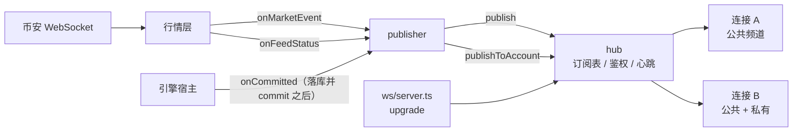

# 14 · 搭建教程：WebSocket 网关

> REST 接口做完之后，前端能拿到所有数据——但只能靠轮询。盘口每 100 毫秒变一次，轮询要么慢要么把服务器打爆。
> 这一讲把推送接上：公共频道（盘口、成交、K 线、行情状态）和私有频道（订单、成交、仓位、余额、强平、资金费）。
>
> 验收标准是：**两个账户同时在线互不串号；断线重连后状态一致**。
>
> 这也是服务端的最后一讲。01～14 讲完成之后，数据库、引擎、行情、仓储、鉴权、REST、WebSocket 全部就位。

**这一讲结束时你会有什么**：

| 位置 | 干什么 |
| --- | --- |
| `apps/server/src/ws/protocol.ts` | 客户端消息和频道名解析；补 `ack` / `error` 两种服务端消息 |
| `apps/server/src/ws/hub.ts` | 连接中心：订阅、鉴权、token 过期降级、心跳 |
| `apps/server/src/ws/publisher.ts` | 行情事件 → 公共频道；引擎事件 → 私有频道 |
| `apps/server/src/ws/serialize.ts` | 引擎对象 → 推送载荷（和 REST 同一种形状） |
| `apps/server/src/ws/server.ts` | 用 `ws` 库接在 HTTP server 的 upgrade 上 |
| `apps/server/src/engine-host/start.ts` | 交易内核加三个钩子：`onMarketEvent` / `onFeedStatus` / `onCommitted` |

- 测试：server 138 条（新增 17 条：协议 2、连接中心 8、推送 4、端到端 3），引擎 299、shared 34、db 51 全绿
- 真 server 实测：9 秒内收到盘口 81 条、成交 32 条、ticker 9 条（正好 1 秒一条）、K 线 18 条；下单和撤单各推一条 `order`

**先读**：`docs/design/04-backend-design.md` 第 12 节（**注意末尾"已定"**）。

> **代码已经在仓库里了**：AI 写代码和讲义，你对照着读。代码块用脚本从源文件截取，和仓库逐字一致（只去掉公共缩进）。

---

## 第 1 节：一张图



两件事决定了这一讲的形状：

1. **私有推送只在落库之后**。宿主的 `onCommitted` 是在事务提交、`engine.commit()` 之后调用的——推出去的每一条都是已经写进数据库的事实。要是在 `apply` 之后就推，落库失败回滚，用户界面上就会留下一张根本不存在的单。
2. **hub 不碰 socket**。每个连接进来只给它两个函数：发一条消息、关闭连接。所以订阅、鉴权、心跳这些逻辑全都能脱离网络单测，`ws/server.ts` 才是唯一和 `ws` 库打交道的地方。

---

## 第 2 节：协议

设计文档定了客户端的四种消息和服务端的数据推送格式。但"订阅成功回什么""参数错了回什么"没写（缺口 #49）——补两种服务端消息，形状和数据推送一样，前端只要一套解析：

```ts
// apps/server/src/ws/protocol.ts
export const PUBLIC_CHANNEL_KINDS = ["ticker", "depth", "trade", "kline"] as const;
/** 鉴权之后自动订阅，不用 sub（设计文档第 12 节"私有频道"） */
export const PRIVATE_CHANNELS = ["account", "position", "order", "fill", "liquidation", "funding"] as const;
export const MARKET_STATUS_CHANNEL = "market";

const channelName = z.string().min(1).max(64);

export const clientMessageSchema = z.discriminatedUnion("op", [
  z.strictObject({ op: z.literal("auth"), token: z.string().min(1).max(4096) }),
  z.strictObject({ op: z.literal("sub"), channels: z.array(channelName).min(1).max(100) }),
  z.strictObject({ op: z.literal("unsub"), channels: z.array(channelName).min(1).max(100) }),
  z.strictObject({ op: z.literal("pong") }),
]);

export type ClientMessage = z.infer<typeof clientMessageSchema>;
```

频道名解析顺带做校验：币对统一成大写，没开放的币对、不支持的 K 线周期、多余的冒号段一律拒：

```ts
// apps/server/src/ws/protocol.ts
export function parsePublicChannel(name: string, isOpenSymbol: (symbol: string) => boolean): ParsedChannel | null {
  if (name === MARKET_STATUS_CHANNEL) return { name, kind: "market" };
  const [kind, rawSymbol, interval, ...rest] = name.split(":");
  if (rest.length > 0 || !kind || !rawSymbol) return null;
  if (!(PUBLIC_CHANNEL_KINDS as readonly string[]).includes(kind)) return null;
  const symbol = rawSymbol.toUpperCase();
  if (!isOpenSymbol(symbol)) return null;
  if (kind === "kline") {
    if (!interval || !(KLINE_INTERVALS as readonly string[]).includes(interval)) return null;
    return { name: `kline:${symbol}:${interval}`, kind: "kline", symbol, interval };
  }
  if (interval !== undefined) return null;
  return { name: `${kind}:${symbol}`, kind: kind as ParsedChannel["kind"], symbol };
}
```

---

## 第 3 节：连接中心

```ts
// apps/server/src/ws/hub.ts
export interface WsHub {
  /** 新连接。send 发一条文本消息，close 关闭连接 */
  connect(send: (raw: string) => void, close: (code: number, reason: string) => void): WsClient;
  /** 推给订阅了这个公共频道的所有连接 */
  publish(channel: string, data: unknown): void;
  /** 推给这个账户的所有连接（私有频道） */
  publishToAccount(accountId: string, channel: string, data: unknown): void;
  stop(): void;
  readonly size: number;
}
```

订阅表就是两张 Map：连接自己记订了哪些频道，频道那边记有哪些连接订了它——推送时不用遍历所有连接。

```ts
// apps/server/src/ws/hub.ts
function subscribe(client: ClientState, channel: string): void {
  if (client.channels.has(channel)) return;
  client.channels.add(channel);
  const set = subscribers.get(channel) ?? new Set();
  set.add(client);
  subscribers.set(channel, set);
}

function unsubscribe(client: ClientState, channel: string): void {
  client.channels.delete(channel);
  const set = subscribers.get(channel);
  if (!set) return;
  set.delete(client);
  if (set.size === 0) subscribers.delete(channel);
}
```

### 私有频道不用 sub

设计文档写的是"auth 后自动订阅"。实现上私有频道在内部存成 `order:<账户 id>`，推出去时**频道名不带账户 id**——前端订的是 `order`，收到的也是 `order`：

```ts
// apps/server/src/ws/hub.ts
publishToAccount(accountId, channel, data) {
  const set = subscribers.get(`${channel}:${accountId}`);
  if (!set || set.size === 0) return;
  // 推给用户的频道名不带账户 id：前端订的是 "order"，不是 "order:<我的 id>"
  const raw = serverMessage(channel, now(), data);
  for (const client of set) send(client, raw);
},
```

"两个账户同时在线互不串号"就是这一段：`publishToAccount` 只找 `order:<那个账户>` 的订阅者。测试里两个连接各 auth 一个账户，推给 A 的消息 B 一条都收不到。

### auth 与 token 过期

```ts
// apps/server/src/ws/hub.ts
async function handleAuth(client: ClientState, token: string): Promise<void> {
  let accountId: string;
  try {
    accountId = await verifyToken(token, options.jwtSecret);
  } catch (error) {
    const code = error instanceof AppError ? error.code : "UNAUTHORIZED";
    const message = error instanceof AppError ? error.message : "登录状态无效，请重新登录";
    send(client, errorMessage(now(), code, message));
    return;
  }
  dropPrivate(client);
  client.accountId = accountId;
  for (const channel of privateChannelsOf(accountId)) subscribe(client, channel);

  // token 到期就降级成公共连接：长连接不能绕过有效期
  const exp = decode(token).payload.exp;
  if (typeof exp === "number") {
    const ms = exp * 1000 - now();
    client.tokenTimer = setTimer(() => {
      dropPrivate(client);
      send(client, errorMessage(now(), "TOKEN_EXPIRED", "登录已过期，请重新登录并重新 auth"));
    }, Math.max(0, ms));
  }
  send(client, ackMessage(now(), { op: "auth", accountId }));
}
```

设计文档没写"token 在长连接期间过期怎么办"（缺口 #52）。REST 每个请求都校验一次 token，过期自然就拦住了；WebSocket 连上之后再也不校验，一条长连接就能绕过 7 天有效期一直收私有数据。所以按 token 里的 `exp` 排一个定时器，到点取消私有订阅、推一条 `TOKEN_EXPIRED`，公共频道不受影响，客户端重新 auth 就能恢复。

再次 auth 换账户时先 `dropPrivate`：不然一个连接会同时收到两个账户的推送。

### 心跳

```ts
// apps/server/src/ws/hub.ts
function tick(): void {
  const t = now();
  for (const client of clients) {
    if (t - client.lastPongAt > pongTimeoutMs) {
      logger.log(`[ws] 连接 ${client.id} ${Math.round((t - client.lastPongAt) / 1000)} 秒没有 pong，断开`);
      client.close(1001, "心跳超时");
      continue;
    }
    send(client, pingMessage());
  }
  heartbeat = setTimer(tick, heartbeatMs);
}
```

设计文档：每 30 秒发 `{ op: "ping" }`，60 秒没有 pong 就断开。为什么服务端主动发而不是等客户端：连接可能"半开"——TCP 没断、对面其实已经没了，只有发点东西出去才能发现。

---

## 第 4 节：推送什么

```ts
// apps/server/src/ws/publisher.ts
onMarketEvent(event) {
  switch (event.t) {
    case "book":
      hub.publish(`depth:${event.symbol}`, {
        bids: event.bids.map((l) => [toDecimal(l.price), toDecimal(l.qty)]),
        asks: event.asks.map((l) => [toDecimal(l.price), toDecimal(l.qty)]),
        updateTime: event.ts,
      });
      return;
    case "trade":
      hub.publish(`trade:${event.symbol}`, {
        tradeId: event.tradeId,
        price: toDecimal(event.price),
        qty: toDecimal(event.qty),
        buyerIsMaker: event.buyerIsMaker,
        time: event.ts,
      });
      return;
    case "kline":
      hub.publish(`kline:${event.symbol}:${event.interval}`, {
        interval: event.interval,
        openTime: event.openTime,
        closeTime: event.closeTime,
        open: toDecimal(event.open),
        high: toDecimal(event.high),
        low: toDecimal(event.low),
        close: toDecimal(event.close),
        volume: toDecimal(event.volume),
        closed: event.closed,
      });
      return;
    case "markPrice": {
      // 涨跌幅要 24 小时统计，那是币安 REST 的数（第 13b 讲），不在推送里（缺口 #50）：前端首屏拉一次 /market/ticker
      const trade = marketState.lastTrade(event.symbol);
      hub.publish(`ticker:${event.symbol}`, {
        lastPrice: trade ? toDecimal(trade.price) : null,
        lastTradeTime: trade?.ts ?? null,
        markPrice: toDecimal(event.markPrice),
        indexPrice: toDecimal(event.indexPrice),
        fundingRate: toDecimal(event.fundingRate),
        nextFundingTime: event.nextFundingTs,
        markTime: event.ts,
      });
      return;
    }
  }
},
```

公共频道直接跟着行情层的事件走。`ticker` 跟着标记价推送——币安的 `@markPrice@1s` 本来就是 1 秒一条，正好是设计要求的频率，不用另外加节流器。

**ticker 里没有涨跌幅**（缺口 #50）：涨跌幅是 24 小时统计，来自币安 REST（第 13b 讲），推送里带上就得按秒去请求币安。前端首屏拉一次 `/market/ticker` 拿这个数即可。

私有频道来自引擎事件：

```ts
// apps/server/src/ws/publisher.ts
onCommitted(_input, events) {
  const accountsToRefresh = new Set<string>();
  for (const event of events) {
    switch (event.t) {
      case "orderUpdate":
        hub.publishToAccount(event.order.accountId, "order", orderFromEngine(event.order));
        break;
      case "fill":
        hub.publishToAccount(event.fill.accountId, "fill", fillPayload(options.positionModeOf(event.fill.accountId), event.fill));
        break;
      case "positionUpdate": {
        const p = event.position;
        if (p.qty > 0n) pushPosition(p.accountId, p.symbol, p.positionSide);
        else hub.publishToAccount(p.accountId, "position", closedPositionPayload(options.positionModeOf(p.accountId), p));
        break;
      }
      case "balanceUpdate":
        accountsToRefresh.add(event.accountId);
        break;
      case "liquidation":
        hub.publishToAccount(event.record.accountId, "liquidation", liquidationPayload(options.positionModeOf(event.record.accountId), event.record));
        accountsToRefresh.add(event.record.accountId);
        break;
      case "fundingPaid":
        hub.publishToAccount(event.payment.accountId, "funding", fundingPayload(options.positionModeOf(event.payment.accountId), event.payment));
        break;
      case "settingUpdate":
        // 杠杆 / 保证金模式变了，仓位的强平价和起始保证金跟着变
        pushPosition(event.setting.accountId, event.setting.symbol, "LONG");
        pushPosition(event.setting.accountId, event.setting.symbol, "SHORT");
        accountsToRefresh.add(event.setting.accountId);
        break;
      case "positionModeUpdate":
        accountsToRefresh.add(event.accountId);
        break;
      case "rejected":
        break; // 拒单的结果在 REST 响应里，不用推
    }
  }
  for (const accountId of accountsToRefresh) pushAccount(accountId);
},
```

三个细节：

- **账户快照按 apply 去重**：一笔成交会产生好几条余额变动（已实现盈亏、手续费、资金费各一条），逐条推账户快照是浪费，收集完在最后推一次
- **仓位平掉要推一条数量为 0 的**：引擎里这个仓位已经没了，视图查不到——不推的话前端列表里会一直挂着一个已经平掉的仓位
- **被拒的请求不推**：REST 响应里已经带着错误码和原因了

推送载荷和 REST 是同一种形状，连 id 都是同一套换算：

```ts
// apps/server/src/ws/serialize.ts
export function fillPayload(mode: PositionMode, fill: Fill) {
  return {
    id: toDbId(fill.id),
    orderId: toDbId(fill.orderId),
    symbol: fill.symbol,
    side: fill.side,
    positionSide: toDbPositionSide(mode, fill.positionSide),
    price: toDecimal(fill.price),
    qty: toDecimal(fill.qty),
    role: fill.role,
    fee: toDecimal(fill.fee),
    realizedPnl: toDecimal(fill.realizedPnl),
    isLiquidation: fill.isLiquidation,
    createdAt: fill.ts,
  };
}
```

---

## 第 5 节：接到 HTTP server 上

Hono 有 Node 的 WebSocket 适配 `@hono/node-ws`，但它只兼容 `@hono/node-server` v1，我们用的是 v2（缺口 #51）。协议本来就是消息驱动的（连上之后发 auth），路由层面只要认一个路径，所以直接用 `ws` 库：

```ts
// apps/server/src/ws/server.ts
export function attachWsServer(options: WsServerOptions): { close(): void } {
  const path = options.path ?? "/ws";
  const logger = options.logger ?? console;
  const wss = new WebSocketServer({ noServer: true, maxPayload: options.maxPayload ?? 16 * 1024 });

  const onUpgrade = (request: import("node:http").IncomingMessage, socket: import("node:stream").Duplex, head: Buffer) => {
    const url = request.url ?? "";
    if (url.split("?")[0] !== path) {
      socket.destroy();
      return;
    }
    wss.handleUpgrade(request, socket, head, (socket_) => wss.emit("connection", socket_, request));
  };
  options.server.on("upgrade", onUpgrade);

  wss.on("connection", (socket: WebSocket) => {
    const client = options.hub.connect(
      (raw) => socket.send(raw),
      (code, reason) => socket.close(code, reason),
    );
    socket.on("message", (data) => {
      client.handleMessage(data.toString()).catch((error) => logger.error(`[ws] 连接 ${client.id} 处理消息出错`, error));
    });
    socket.on("close", () => client.handleClose());
    socket.on("error", (error) => {
      logger.error(`[ws] 连接 ${client.id} 出错`, error);
      client.handleClose();
    });
  });

  return {
    close() {
      options.server.off("upgrade", onUpgrade);
      wss.close();
    },
  };
}
```

这一层只做三件事：认路径、把消息转给 hub、连接关掉时告诉 hub。

交易内核那边加了三个钩子，`index.ts` 把它们接到 publisher 上：

```ts
// apps/server/src/index.ts
// WebSocket 推送（第 14 讲）：hub 先建好，行情和引擎事件在交易内核启动时就挂上；
// publisher 要用交易内核里的引擎视图，所以晚一步再建（启动过程中的事件没有客户端在听，丢掉没关系）
let publisher: WsPublisher | null = null;
const trading = await startTradingCore({
  db: getDb(),
  onMarketEvent: (event) => publisher?.onMarketEvent(event),
  onFeedStatus: (status) => publisher?.onFeedStatus(status),
  onCommitted: (input, events) => publisher?.onCommitted(input, events),
});
```

`publisher` 要用交易内核里的引擎视图，交易内核又要在启动时就挂上事件钩子——先建 hub、用一个可变引用晚绑定 publisher。启动过程中的事件会被丢掉，这时候还没有客户端在听。

---

## 第 6 节：断线重连——前端必须做的事

设计文档第 12 节写得很清楚，这里再强调一遍，因为漏了就会数据不一致：

```
1. 重新 auth
2. 重新 sub 所有频道
3. REST 全量拉一次 /account、/account/positions、/account/orders?status=open
4. 用 REST 的结果覆盖本地状态
```

**增量推送只在连接持续期间可信。**断开的那几秒里发生的成交、强平、资金费，服务端不会补发——和"行情断线暂停撮合、恢复后不补算"是同一个态度：宁可让你重新对齐一次，也不给你一份看起来连续、其实缺了几条的数据。

---

## 第 7 节：验收

| 测试 | 关键断言 |
| --- | --- |
| 协议（2 条） | 四种 op；多余字段、未知 op、空 channels 都拒；频道名大小写归一；没开放的币对、`1s` 周期、私有频道名都返回 null |
| 连接中心（8 条） | **auth 后自动订私有频道，推给 A 的 B 收不到**；无效 / 过期 token 回 error 且不订私有；**token 到期自动取消私有订阅**；再次 auth 换账户后收不到旧账户的推送；sub / unsub 的 ack 和 rejected；**30 秒 ping、60 秒没 pong 断开，回了 pong 不断**；连接关掉后不再推；消息格式错回 error 但不断开 |
| 推送（4 条） | 四个公共频道的载荷逐字段；行情状态变化推 market；**一次 apply 多条余额变动只推一次账户快照**；仓位平掉推数量为 0 的；被拒的请求不推 |
| 端到端（3 条） | 真起 HTTP server、真连 WebSocket：auth → sub → 收到公共和私有推送 → 断开后 hub 里不再有这个连接；心跳超时真的被断开；连错路径连不上 |

真 server 实测（真实币安行情，订阅 5 个频道，跑 9 秒）：

```text
ack              ×2   订阅 5 个频道，rejected 为空
depth:BTCUSDT    ×81  {"bids":[["76895.3","3.317"],…],"asks":[…],"updateTime":…}
trade:BTCUSDT    ×32  {"tradeId":3454487764,"price":"76895.3","qty":"0.052","buyerIsMaker":true,…}
ticker:BTCUSDT   ×9   {"lastPrice":"76895.3","markPrice":"76895.4","indexPrice":"76931.32195652","fundingRate":"0.0000672",…}
kline:BTCUSDT:1m ×18  {"interval":"1m","open":"76895.3","close":"76895.3",…,"closed":false}
order            ×2   REST 下一张限价单 + 撤掉，私有频道各推一条
```

ticker 9 条 / 9 秒，正好是设计要求的 1 秒一条。

---

## 验收清单

- [x] 公共频道：depth / trade / ticker / kline / market
- [x] 私有频道：account / position / order / fill / liquidation / funding，auth 后自动订阅
- [x] 两个账户同时在线互不串号
- [x] 私有推送只在落库并 commit 之后
- [x] 30 秒心跳、60 秒无 pong 断开
- [x] token 在连接期间过期会自动取消私有订阅
- [x] 推送载荷和 REST 同一种形状、同一套 id

---

## 读完可以自测

1. 为什么私有频道的推送要挂在宿主的 `onCommitted` 上，而不是引擎 `apply` 之后？
2. `publishToAccount` 内部用 `order:<账户 id>` 存订阅，推给前端时却只写 `order`，为什么？
3. token 在长连接期间过期，如果不处理会发生什么？
4. 为什么心跳是服务端主动发 ping，而不是等客户端发？
5. 一次成交会产生好几条余额变动，为什么账户快照只推一次？
6. 仓位平掉时为什么要推一条数量为 0 的仓位，而不是什么都不推？
7. 断线重连之后，为什么必须用 REST 全量覆盖本地状态？只重新 sub 会漏什么？
8. `ticker` 频道为什么不带涨跌幅？要带的话得付出什么代价？
